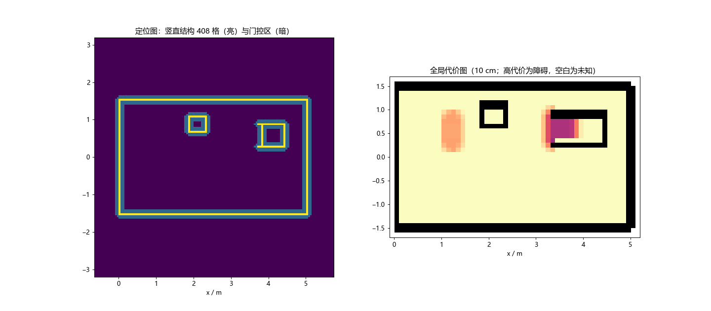

# 3×5米场地的落地调试与建图指南

更新：2026-10-27。适用当前单芯片 PNR61、G3c 固件、SLF128 和 RK 真双串口桥接。

PNR61当前是50/100MHz两域实现，报告setup/hold均0；PNR62第二布局仍有124条setup违例，继续选61。内部时序通过不代替外部IO、实际站立与停止测试。

现有架空联调完成后，下一步是分阶段落地：先验证原4500的站立和平衡、短程运动及受控停止，再接入地图定位和自主导航。**首次落地站立不需要先建图；地图可以在这期间离线量测准备。** 对于固定的3×5米自建场地，先采用量测地图，比现在接入一套尚未打通的 SLAM 扫图链路更直接。

当前尚不能把整车记为“可直接自主运行”：TTL 控制遥测仍有间歇残帧，USB软重启后的25.537秒复测再次缺序；10分钟和30分钟浸泡未通过，落地站稳和实际刹停也未验收。最近一次收尾记录为hold；本轮只完成方案、源码核对和离线地图示例，未切换镜像、下发示例地图或运动指令。

## 1 接下来怎样落地调试

| 阶段 | 具体做什么 | 进入下一阶段看什么 |
|---|---|---|
| 站立 | 地面平整、前向和转向目标为零，原4500继续工作；观察姿态、轮速、车体是否持续滑移 | 身体能稳定站立，IMU方向和编码器方向正确，反馈连续可用 |
| 短程手动闭环 | 在空旷区域做低幅短直行、短转向，随后取消、运行急停、主机失联 | 用地面标记和录像确认实际减速、站稳和停止后的漂移；不能只看命令已归零 |
| 有图定位 | 导入实测地图，把车放在已量测的起点，设置初始位姿并对准 | 地图轮廓与实物对应，定位状态和独立量测位置一致 |
| 定点导航 | 先近距离单点和返航，再绕障、巡逻 | 无碰撞、无假到达；实际终点与状态报文同时记录 |
| 地形与视觉任务 | 再测坡道、台阶、找物和跟随 | 地形能力和停止距离先实测，再扩大任务范围 |

这里的“运行急停”是撤销运动目标、保持原4500平衡并等待站稳，**不是把全部轮子直接关掉**。平衡控制允许微小轮动；“轮子完全不转”不能替代“车体稳定站立”。hold 镜像是测试收尾状态，不是网页急停的实现。

地面记录至少包含：固件和地图版本、实际起终点、指令和反馈时间、姿态/轮速/定位状态、独立录像。先解决实际发现的问题，不因一个成功短段就跳到连续自主任务。

## 2 是否必须先建图

无图模式可以在线形成局部结构、高程和代价信息，也可以在约定的里程计坐标中接收目标。因此，首次站立、短程调试和有限无图任务不依赖先验地图。但这些在线片上地图不会自动成为一份可保存、下次复用的全场地图；上电起点变化和里程计漂移会影响坐标重复性。

反复执行“去A点、回家、巡逻”时，建议先准备真实场地的先验地图，并固定起点、朝向和点位。当前选择如下：

| 路线 | 当前是否可用 | 本阶段安排 |
|---|---|---|
| 卷尺量测墙体、箱子、坡道和平台，生成点云及 `.nvmp` | 已提供离线生成工具并跑通示例 | 先用这条路线 |
| 录真实雷达和IMU，经 SLAM 导出地图点云 | 当前生产链路没有打通；旧 Point-LIO 服务未运行，雷达转换脚本也不齐 | 后续专项接入，不能承诺现在推车一圈就能建图 |
| 将 FPGA 当前在线局部地图直接导出为先验包 | 当前没有该导出接口 | 不作为当前方案 |

Astra 相机当前承担 RK 视觉目标检测，不会自动为 FPGA 生成先验地图。不要为了扫图直接启用旧 SLAM 服务；雷达数据流所有权、时间同步和外参需要单独安排。

## 3 坐标和地图格式

建议在实物场地贴原点和方向标记：长边沿 `+x`，`+y` 在面向 `+x` 时的左侧，`+z` 向上。本文示例范围为 `x=0…5m，y=−1.5…1.5m`。也可另选原点，但点云、初始位姿、点位、返航点必须一起变换。

| 数据 | 当前尺寸和含义 |
|---|---|
| SLF结构图 | 128×128格、每格5cm，窗口覆盖6.4×6.4m；用于结构匹配定位 |
| 局部高程图 | 128×128格、每格5cm；用于在线地形分析 |
| 先验全局代价图 | 最多64×64格、每格10cm；用于规划和网页静态地图展示 |
| `.nvmp`地图包 | v3、48字节包头、18位结构字；几何 `0x0107`、profile `0x33580001`、ZHI=350mm、ZLO=−300mm |

地图点云的单位是**米**，地面取 `z=0`。输入可为 XYZ、NPY、PCD 或 PLY；普通占用栅格 PNG/PGM/YAML 不能改个后缀就当 `.nvmp`，它缺少定位所需的结构槽。

导航报文的初始位姿是车体在地图里的位置和朝向。“前移1000mm”是当前 SLF 局部窗口配置，**不是给车发送前进1米，也不是把地图坐标平移1米**。

网页/RK接口：位置 m、角度 rad，逆时针左转为正。维护用 `nav_host.py pose` 则是 mm、度，不能混用。

## 4 量测场地并生成地图

### 4.1 先填写真实几何

模板在 [field3x5_survey.example.json](../../config/field3x5_survey.example.json)。复制为 `field_actual.json`，逐项改成实测值；模板内箱子、坡道、平台和起点全部是演示坐标，不代表已经搭好的实物。

- `bounds`：包含边界墙的 `[x0,y0,x1,y1]`，米。
- `walls`：墙段 `start/end`、高度 `height`；不规则围栏拆为多个线段。
- `boxes`：箱子/平台的中心 `center`、长宽高 `size`、平面角 `yaw_deg`；低矮箱体可表示台阶。
- `ramps`：低端到高端中心线 `start/end`、宽 `width`、升高 `rise`；下面不会重复铺一层平地。
- `start_pose`：车体起点 `[x,y,yaw]`，yaw为弧度；它只存记录，生成脚本不会向机器人设置位姿。

量测固定物体和车体起点，临时人员不要写成永久墙。实际通道还要给车宽和转弯留空间；格子“可通行”不等于整车刚好能挤过。场地尺寸相同也不能省掉实际箱体位置和高度的量测。

### 4.2 使用与板上配套的转换工具

**不要直接用仓库根目录旧的 `tools/map_tool.py` 生成当前生产包。** 根目录仍有 v2/旧尺寸模型；当前桥接只接收上述 v3 SLF128 格式。已从当前冻结主机 profile 导出独立工具目录：

`D:\tools\nav_slf128_mapkit_20261027`

它保持四份选定数学模型原字节，只修正显示中的旧20cm比例、限制当前profile，并将工具能力参数缺省改为20mm/12°。这两个能力值仍是暂定假设，**没有证明实车能跨20mm台阶或爬12°坡**；第一次落地不要据此直接上地形。

下面在 Windows PowerShell 执行，`field_actual.json` 必须先量测填写：

```powershell
$py = 'D:\Anaconda\python.exe'
$kit = 'D:\tools\nav_slf128_mapkit_20261027'
& $py -B -X utf8 "$kit\tools\field_to_cloud.py" `
  'D:\tools\field_actual.json' -o 'D:\tools\field_actual.xyz'
& $py -B -X utf8 "$kit\tools\map_tool.py" build `
  'D:\tools\field_actual.xyz' -o 'D:\tools\field_actual.nvmp' `
  --bounds=0,-1.5,5,1.5 --step 20 --slope 12 --zhi 350
```

转换同时生成同名PNG。先核对米制坐标、墙体、通道、坡面和不可通行区域；若实测范围不同，要同步改 `--bounds`。bounds 会裁掉场外点，不应把用于定位的边界墙一起裁掉。

工具使用 NumPy 和 Matplotlib，当前 Anaconda 已具备。换电脑时可运行 [prepare_slf128_map_tools.py](../../tools/prepare_slf128_map_tools.py)，用 `--profile` 指定同一冻结 `host_profile`、`--out` 指定全新目录；它拒绝覆盖已有目录。不要用“修改旧包头版本”代替按正确模型重建。

### 4.3 已验证的离线示例

模板生成47874点，地图包11840字节，包含1998个槽字、53×34代价格。选定模型回读、CRC32、槽地址/18位字宽和实际Web解析合同检查通过。这个结果证明离线转换链路可用，不证明真实场地定位精度。



图中布局仅用于演示，未向车下发。输出保存在工具目录的 `example_only` 下，文件名带 `not_for_robot`。

## 5 如何把真实地图导入 FPGA

### 5.1 当前入口

网页现有地图用于显示和选择点位，**没有上传本地 `.nvmp` 文件的界面**。当前可执行入口是 RK 上桥接的本机接口。`path` 指的是 **RK本机绝对路径**，不是 Windows 文件路径。

正常运行由桥接独占 CH 导航串口 `/dev/ttyACM0`（921600）和 P11-40 遥测 `/dev/ttyUSB0`（230400）。通过桥接导图无需停它，也不会另开串口抢占。内部9101端口仅本机访问，不作为公网文件上传接口。

### 5.2 拷贝并提交

以下是后续操作说明，本轮没有执行。先确认 PNR61 和配套 G3c 已恢复、真实来源和新鲜传感器正常；hold 镜像不能执行导航。

PC上将**实测包**拷到 RK：

```powershell
ssh robomaster@100.113.173.115 'mkdir -p /home/robomaster/fpga_bench/maps'
scp 'D:\tools\field_actual.nvmp' `
  robomaster@100.113.173.115:/home/robomaster/fpga_bench/maps/field_actual.nvmp
```

在 RK 上先看状态，确认 real、链路新鲜，再显式解除运行急停进入IDLE。解除不会自动恢复旧任务。

```bash
curl -sS http://127.0.0.1:9101/health
curl -sS -X POST http://127.0.0.1:8000/api/platform/estop \
  -H 'Content-Type: application/json' -d '{"engage":false,"source":"web"}'
```

确认反馈已是新鲜IDLE后再上传：

```bash
curl -sS -X POST http://127.0.0.1:9101/api/internal/fpga/map \
  -H 'Content-Type: application/json' \
  -d '{"path":"/home/robomaster/fpga_bench/maps/field_actual.nvmp","map_id":"yuntuo_field"}'
curl -sS http://127.0.0.1:9101/health
curl -sS http://127.0.0.1:8000/api/navigation/map/metadata
```

HTTP `accepted:true` 只表示校验后进入上传队列。继续查看 `/health` 的 `map` 文字和 `platform.map_loaded`，等到“先验地图已加载”及READY对应成功结果，再核对后端地图版本和图像。不要在上传过程中设置运动目标。

此前实板最大86064字节合成包经桥接加载约13.8秒；本示例11840字节未实测下发时间，不能按比例保证。上传中曾出现STATUS超过1秒的间隔，应按上传应答和终态判断，不能把一次网页短暂陈旧当成上传成功或立刻断电。

### 5.3 设置实测初始位姿

地图READY只证明存储与格式受理，**不代表定位对准成功**。把车体放到标记起点，再设置该起点的真实位姿。下面数值仍是示例，执行前替换：

```bash
curl -sS -X POST http://127.0.0.1:8000/api/platform/set_pose \
  -H 'Content-Type: application/json' \
  -d '{"x":0.45,"y":-0.95,"yaw":0.0,"align":true,"source":"web"}'
```

**对准不一定是静止操作。** 当前定位源码在结构不足时可能请求约0.4rad/s、1.5秒的换视角转向，实际执行还受SAFE和租约门控影响。因此对准放在站立和受控停止验证之后，周围留出转向空间，观察车体与定位反馈，不能把它当纯只读查询。

| 定位状态 | 此时怎么做 |
|---|---|
| mapless / 0 | 里程计或尚未设置位姿；单靠它不能判断刚上传的包是否存在，须结合加载结果 |
| aligning / 1 | 等对准结果，不启动点位任务 |
| ok / 2 | 再与独立地面位置核对，确认后做近距离目标 |
| degraded / 3 | 定位质量下降，先查遮挡、几何和坐标；不据此接受精度 |
| lost / 4 | 停止新任务并排查；不靠反复强设位姿掩盖问题 |

源码缺省初始搜索范围为±0.5m、±10°，不是保证能补偿任意错误起点。初始位置和朝向应先量准，`align:false` 不能用来绕过对准失败。

### 5.4 配置返航点和任务点

RK工程 `~/QHXD/backend/app/config/yuntuo/waypoints.json` 配置位置和别名，`patrol_routes.json` 配置点位顺序。点位 `map_id` 与上传用的 `yuntuo_field` 保持一致。

当前示例的 home=(0,0)、A=(2,1.5)、B=(3.5,−1.5) 并非实测点。按本文边界，home在端墙上，A/B在侧墙上，**必须修改后才可作为实际任务目标**。目标点要在车体能完整到达且可以转弯的位置。

后端点位文件会按修改时间刷新；桥接的点位与巡逻路线在启动时读取。修改后在IDLE、无进行中任务时重启 `yuntuo-fpga-bridge`，再确认API与网页坐标一致。若修改 `.env` 的地图ID、`YUNTUO_FIELD_BOUNDS=0,-1.5,5,1.5` 或配置文件路径，则重启相关桥接/后端服务。单改网页显示边界不会改 FPGA 地图或裁剪点云。

## 6 复位后如何恢复和维护

地图存于 FPGA RAM。FPGA复位或重新下载后，先验丢失；RK磁盘上的源文件仍在，需要重新加载地图、设置初始位姿。桥接会识别时间回退并清缓存，不应自动继续旧任务。

若重新下载 PNR61 SRAM，还要按既有流程重新加载 `fw/nav_fw_g3c.bin`，再查询SLF运行参数，确认“前移1000mm、ZHI350”。PNR61原始初始化与后装固件的窗口配置不能混为一谈。固件加载期间须先停桥接，完成后恢复；本流程不写Flash。

可选启动项 `YUNTUO_PRIOR_MAP` 只能排队地图文件，不能代替新鲜IDLE、显式解除和设置位姿。清图使用同一内部地图接口的 `{"clear":true}`，也需要新鲜IDLE。

维护工具 `nav_host.py` 和 `nav_uart.py` 使用CH串口前必须停桥接。尤其 `nav_host.py pose` 发完就退出，`listen` 只收不发心跳；不能用它们代替持续保活，主机租约250ms后可能重新锁定。日常导图和位姿设置优先走上面的桥接接口。

不要直接套用旧 `board_init.py`：其中包含旧独立导航板的SAFE、IMU和安装配置，不能视为当前G3整车的通用初始化。

## 7 现阶段怎样判断建图完成

完成分成三件事，分别记录：

1. **地图生成完成**：实际量测记录、JSON、点云、检查图、v3地图包保存为同一版本；检查轮廓和能力参数。
2. **地图导入完成**：实板READY、RK `map_loaded` 和网页版本一致；坏包拒绝、复位后失效已知。
3. **地图可用于导航**：真实场地对准、静止和短程定位对照、近距离到点及受控停止都通过。前两件不能替代这一件。

当前网页尚没有固件实时PATH和COSTMAP_TILE数据，规划路径或局部代价图为空是已知边界；静态先验图不等于 FPGA 此刻看到的障碍。合成测试包、网页画布、转发成功都不能算实际场地建图完成。

## 依据和文件入口

- [离线流程核对与示例结果](../4_design/evidence/g2_20261023/ground_mapping_workflow_review_20261027.json)。
- [当前PNR61剩余签核](../4_design/g2_PNR61_signoff_20261027.md)、[RK真链路与USB失败记录](../4_design/evidence/g2_20261023/RK_Web_real_hardware_integration_20261027.json)。
- [量测点云生成器](../../tools/field_to_cloud.py)、[选定profile工具导出器](../../tools/prepare_slf128_map_tools.py)、[演示量测模板](../../config/field3x5_survey.example.json)。
- QHXD_Web：`yuntuo/fpga_link/nvmp.py` 为当前包格式，`yuntuo/bridge/core.py` 为地图、位姿、保活与复位行为；RK已部署源码 `fdf3f4a`。
- 选定冻结源码：`F:/nav_integration_g2_20261023/K_timing_syn49/host_profile` 与同目录 `fw/app/nav_app.c`、`fw/nav/loc.c`、`fw/nav/nav_task.c`。
