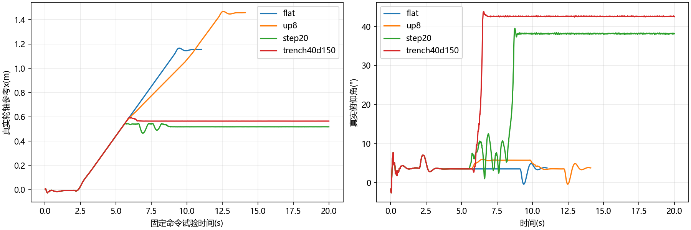
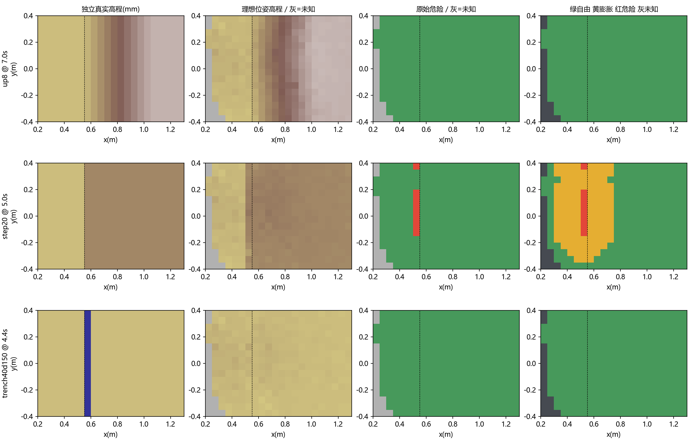

# 原4500真实接触地形与局部地图可行性分析

执行日期：2026-10-22；按2026-10-21规划保留文件名。当前结论：**地图对已观测的连续平地和缓坡可提供有用高程，但不能据现有50mm格的高程区间证明窄沟轮迹有支撑；原4500能力也不能用20mm/12°旧假设代替。N2仍未验收。**

本轮已经实现真实坡道、台阶、沟槽及连续物理记录，保留全部成功/失败。接受基线仍为N1c，工作区导航C仍为AS；AU是独立试验并已因真实沟槽碰撞和旧关键反例退化而否决。原4500权重和控制仓库均未改，没有上板。

## 1. 交付入口与判分边界

- [完整试验与视频索引](../../sim/build/terrain4500_20261022/VIDEO_INDEX.md)：逐例配置、完整状态、接触、地图和视频对应。证据实际在`F:\nav_terrain4500_20261022\evidence`，仓库`sim/build/terrain4500_20261022`为目录联接，保留原有链接入口。
- [机器可读汇总](../../sim/build/terrain4500_20261022/analysis_summary.json)、[完整状态连续性核对](../../sim/build/terrain4500_20261022/state_integrity.json)、[冻结入口](../../sim/build/terrain4500_20261022/frozen/freeze.json)。最终交付核对与视频时长另见`delivery_check.json`。
- [执行规划与进度](../1_plan/terrain_map_feasibility_plan_20261021.md)、[前阶段N2结果](nav_optimization_results.md)。旧55cm窄通道不是沟槽；本轮深沟是实物碰撞几何中的负空间。
- [N2接续检查点](../../sim/build/terrain4500_20261022/n2av/checkpoint.json)、[接续运行与视频](../../sim/build/terrain4500_20261022/n2av/VIDEO_INDEX.md)、[最新锚定/停止记录](../../sim/build/terrain4500_20261022/n2av/n2az/INDEX.md)和[候选构建说明](../../sim/closed_loop/candidates/README.md)：独立于原94例记录，AY与本轮BJ/BH2均未联合接受，见第8.1–8.2节。

固定命令试验先静止2s，再请求0.2m/s，越过出口后请求零速并继续观察2s。“passed”仅表示在相应模型/命令下无已锁存失稳或非轮接触地越过出口平面，**不要求横向误差150mm，不等于导航成功**。横向漂移仍保存在轨迹中；例如16°坡虽越过出口，横向偏移约0.89m，不能称跟踪良好。未越过出口且无失稳也保留为timeout。

导航使用真实冻结C、SAFE、原4500、编码器/IMU适配和实际雷达求交，统一150mm位置容差、速度/角速度停稳和2s外部观察，45s时限。固定命令与导航分别判分，不把因规划停车而没进入地形称为策略能够/不能通过。重复pilot、补跑和相同种子的确定性轨迹不当作独立实车样本。

AS/AU显式使用350mm启动平地声明，各主场景起点400mm区域实际清平；该声明不随车扩大。N1c没有相应支撑声明接口，运行器只记录接口缺失，不假装N1c执行了该守卫；两版本能力差异本身属于受测算法，不向任何一版补入未知地形真值。

## 2. 模型来源和必须保留的差异

| 项目 | 本轮使用值/证据 | 能说明什么 |
|---|---|---|
| 固定策略 | 只读控制快照6443f56，`model_4500.pt`与源runtime | Torch float32原权重；不是FPGA F12推理已等价 |
| 调度 | 物理2ms、策略8ms、SAFE1ms；与源相同的单次8ms零动作初始化 | 运行中不复位；物理状态每2ms保存，失败后继续积分 |
| 原模型质量 | 总2.171117kg；base1.826753kg | 训练设定，非实车称重。旧CAD约676g不含完整电子负载，见[平台证据表](platform.md) |
| 原轮形 | 胶囊半径32.5mm、轴向半长9mm，总轴向外包约83mm | 保留训练等效碰撞体，不误称18mm宽圆柱胎 |
| CAD轮形对照 | 圆柱半径33.650mm、宽26.600mm | 旧CAD几何对照；当前实物受载半径/轮距仍待测 |
| 开链/闭链 | 原等效开链；另从`kinematics_report_extended.json`恢复前后五连杆，l1=75/l2=125mm，髋距103.146mm | 几何有来源；后支链惯量用均匀细胶囊近似，增加质量82.972g。Knee动作到后髋的IK映射是工程适配，尚未确认与实际舵机通道等同 |
| 闭合约束 | connect约束，185个随机可达侧支链构型的前后端点最大误差约2.53e-11m；物理闭链启动瞬态最大约1.99mm，平地中位约0.068mm | 未强制把关节投回几何解；求解器残差保留，不称刚性精确闭合的实车模型 |
| 执行器 | 原生训练仿射驱动；另接J3数字PID/1320CPR/10ms采样、20ms舵机锁存 | 数字参考有此前RTL合同；PWM/2400映射0.5Nm的电机动力学模型未标定，平地即失稳的结果只是否决该执行模型组合，不能据此否定实机已调通的控制 |
| 雷达 | XT-M60既有方向表、前伸123mm/高度155mm/俯角10°、径向高斯σ4mm、0.1–8m | 实际物理姿态与遮挡；只查询地形组，未模拟车体自遮挡、强度相关失效、多径和整帧内扫描畸变 |
| 参数敏感性 | 摩擦0.4/0.6/0.8、轮扭矩上限×0.5、base共址负载+250g、策略角速度/重力姿态噪声0.3°量级 | 声明的压力取值，不是实测置信区间；负载共址并不能代表真实质心迁移 |

来源文件在[固定控制审阅](../5_teams/control_repo_review_20261021.md)、[仿真架构](../1_plan/simulation_architecture_decision_20261021.md)、只读控制快照`sim2sim/model4500_mujoco/robot.xml`、`runtime.py`及`rl_ws/_car_tools/kinematics_report_extended.json`。本轮参数修改都发生在输出目录中的模型副本。

C轮迹守卫仍采用旧CAD投影半长34mm/半宽14mm，物理对照的原胶囊轮更宽。这项差异没有被隐藏：C守卫通过不能被解释为对原胶囊轮全部实际接触几何的保证，CAD圆柱对照也必须单列。40mm沟在某个轮形/摩擦下能跨过，不等于地图已辨认出沟，也不等于所有车辆都不可通过。

## 3. 场景和观测源修复

坡道是实际可碰撞楔体，包含上坡、下坡和上下坡组合；台阶有独立抬高支撑面；沟槽由两岸、侧岸和下沉沟底组成，没有跨沟平面。轮子接触坡、阶或沟壁记录为轮接触，不能一律判碰撞失败；非轮接触、持续失稳、停滞分别记录。

[几何核验](../../sim/build/terrain4500_20261022/geometry_v3/geometry_contract.json)覆盖7类，每类605条竖直射线和1500条斜向射线，共14,735条，与独立连续表面/垂直壁求交对照最大误差约3.21e-8m。150mm沟底确实在z=-0.15m，场景无plane。

最初竖直核验没能发现斜向求交问题：本机MuJoCo3.3.7的`mj_multiRay`对一个应击中平台的斜向射线返回下方地板，`mj_ray`返回平台。已改为C循环封装公开单射线函数`mj_ray`，并通过上述斜向合同；不能仅由该有限反例断言所有版本都有同一缺陷。[对应版本接口源码](https://github.com/google-deepmind/mujoco/blob/3.3.7/src/engine/engine_ray.c)。

**旧批量求交地图不用于最终统计。** 固定命令运动未使用这些雷达帧，因此从保存的相同qpos/速度重建`maps_v2`，物理轨迹不变。4°/8°坡原先约9–10mm的高程平均误差和大批原始危险误报，修正后降至约2.4/2.9mm且固定走廊原始误报为0。这证明该批问题来自观测源，不能靠放宽地形阈值“修复”。

D盘写满中断了`primary/trench65d50`的旧射线压缩帧；完整物理状态可读，随后在`primary_recovered`补跑。旧记录和中断说明都保留。仅迁移本阶段生成目录，未清理用户其它文件。

## 4. 固定策略的条件性能力

原训练等效模型在本次固定命令下：4/8/12/16°上坡、8°下坡和8°上下坡组合越过出口；20°上坡20s未完成。5mm上阶通过，10–50mm上阶出现失稳、卡住或非轮接触，未取得通过证据。20mm下阶通过，30mm下阶失稳。20mm宽/50mm深沟通过；40/65/100mm代表宽度出现失稳或卡住。斜穿40mm深沟取得通过，说明进入方向也影响结果。

不能把这些结果拟合成一个单调的“最大台阶高度”：例如10mm失败、15mm卡住无失稳、20mm失稳，是该策略/摩擦/姿态/有限时限下的不同响应；不代表真实车辆对所有速度都跨不过10mm。也不能把上阶20mm和下阶20mm的结果合并。

模型与工况对照尤其重要：

| 同一代表工况 | 对照结果 | 含义 |
|---|---|---|
| 40mm宽/150mm深，原胶囊轮，摩擦0.6 | 失稳 | 原训练等效模型的该次失败 |
| 只换CAD圆柱轮 | 通过 | 轮形足以改变结果，不能由原模型确定实车边界 |
| 只改摩擦0.4/0.8 | 失败/通过 | 接触参数也改变跨沟结果，必须实测或保留条件 |
| CAD闭链，胶囊轮或圆柱轮 | 代表平地/坡/沟均20s未完成；未必失稳 | 几何闭合并不保证原策略在新执行映射下保持速度/转向性能 |
| 原模型+250g共址负载、扭矩上限减半、0.3°量级策略姿态噪声 | 代表平地/8°坡仍通过 | 只覆盖这些声明工况，不能推广为所有负载/电机条件 |
| 数字执行模型 | 四个代表场景均在约0.22s失稳，尚未入场 | 首先需要标定执行模型，不能将其纳入地形成功率 |

完整27个主工况和逐例时间见末尾表，所有变体在视频索引中。没有为失败重新初始化后拼接成功。

摩擦对照曾有一次参数未实际生效：旧`friction_low`只设地面0.4，实际接触仍为轮子默认0.6，故这两例不作为0.4对照。修正地形接触优先级后在`friction_low_v2`补跑并直接核对接触摩擦均为0.4；8°坡通过，40mm深沟6.336s失稳。0.6主试验与0.8对照的接触值也已核对，未受这一问题影响。前后证据见`friction_contract_before/after.json`。

另补4/8/12°的90°横坡：仅在首次积分前按坡面设置一次起始姿态/高度，之后自由积分，不约束根节点；从x=0.8m、y=-0.4m横向行驶至y=0.6m。三例都越过y终点且无失稳，但8/12°在约6.63/6.62s离开声明的坡段中心带x∈[0.6,1.0]m，之后进入平台区，**不能算维持横坡通过**；4°未离开该带。出口平面原结果和坡段维持判分分别保留在`cross_slope/band_audit.json`，没有把漂移后的平地运行当成功横坡。初始已在坡上的条件也不同于从平地进入坡道。

## 5. 地图在什么条件下有用，哪里会漏判

### 5.1 判分方法与分母

每帧使用固定世界走廊x∈[-0.2,出口+0.1]、y∈[-0.4,0.4]，分别统计直接高程有效V、原始危险、膨胀后代价、UNKNOWN和无直接观测的填补格。普通导航仅在判分时用当前真实/估计对应关系对齐地图，真值不回灌导航。

高程误差对有直接观测的非几何边界格计算，采用地图实际用于判定的zmax。边界格单独保留观测/危险计数，不从所有统计里删掉。20mm/12°及沟口只是独立几何参考包络，**不是原4500的物理能力真值**。16°坡能跨过却超出12°旧参考，是三条证据链不能混用的例子。

所有累计分母是**重复格观测**；一个格可连续出现数百帧，不当作数万个独立样本。未知率还包含固定走廊中背向/遮挡区域，不直接解释成导航前方支撑区的缺测率。不同闭环路线的格统计不用于算法单因素归因；相同原始输入的对照见第7节。

### 5.2 已确认的窄沟原始点来源与支撑反例

[原始点见证](../../sim/build/terrain4500_20261022/negative_gap_witness.json)：40mm/150mm沟位于x=550–590mm；地图世界格(11,2)覆盖x≈549.883–599.872mm。4.1s像素9543–9545真实击中远岸，真实x≈600.3–601.9mm；加噪/定点投影后x≈595–599mm，进入包含沟口的格。4.4s该格V=true、H=2mm、区间宽3mm、age=4、代价4，原始危险=false。

这些是**真实远岸点**，不能把它们当凭空噪点删掉。噪声使邻近格归属改变，但更根本的问题是“格内有地面点”被解释成“整个格可作轮支撑”。50mm格内40mm缺口和少量岸面共存，高程min/max、点数和格龄都不能表达缺口所占子区域。

[真实AS支撑C查询](../../sim/build/terrain4500_20261022/support_audit/queries.json)在同一保存地图、4.4s真实位姿x≈345.6mm，对200mm/s、1.2s前推返回PASS；该名义轮迹会经过沟口。这里只测支撑守卫，不把它当作规划器当时选择了该命令。[无噪声对照](../../sim/build/terrain4500_20261022/negative_gap_noiseless_comparison.json)仍是V=true/H=0mm/区间宽5mm/代价1、C返回PASS，证明单纯调噪声不能消除此反例。

真实AU导航进一步暴露了完整链路后果：16.0s真实x≈563mm时仍输出200mm/s前进；16.5s实际x≈589mm而估计x≈662mm，接触后轮滑/里程计误差已叠加；17.03s锁存失稳，17.06s附近出现机身与岸面接触，继续积分到20.03s。**可以确认地图/支撑表示有缺口且闭环发生失败；不能把后续每一帧错误都唯一归因于地图，控制、打滑和估计也参与。**

这与前阶段55cm窄通道的真实箱体边界点是不同现场，但结论一致：需要保留点来源与空间有效性，不能通过删“可疑危险格”、提高高差容忍或缩小车体把问题掩盖。

### 5.3 过保守、漏检与历史有效性

- 连续平地、4/8/12°坡在理想位姿/已知外参下，主走廊高程平均绝对误差约2–4mm，原始误报为0；这支持其作为平滑表面高程，不证明未观测区域安全。
- 16°坡按12°参考的已观测危险格中原始标记召回约29%，膨胀后约99.6%；21mm台阶原始边缘标记很少、邻格危险膨胀覆盖较多。边缘位置量化/高侧规则会把危险落在参考边缘相邻格；须分别看边缘定位和覆盖，不能把高膨胀召回当原始检测质量。
- 40mm深沟在主走廊的3,200次已观测参考危险格中，原始危险和膨胀阻塞均为0。100mm深沟为9,501次已观测参考危险格，原始279、膨胀阻塞2,384。它们是该路线/时段的格观测，不能扩展成一般负障碍检出概率。
- 当前keep_r保留近区旧高程并带stale标记。40mm深沟理想诊断中，50,947次直接有效格观测里24,549次带保留过期标记。静态地形下旧点不必错误，但它们不是新鲜支撑；本轮没有移动地形实测，不能声称危险消退和动态世界维护已验证。
- 缺回波、遮挡和格内未覆盖子区域必须与“测得零高差”分开。当前表示只解决了部分年龄/区间问题，尚未解决子区域覆盖和未知负空间。

## 6. 导航与路径联修结果

AS要求完成一圈观察，真实原4500旋转过程中出现平移漂移和支撑UNKNOWN拒绝；平地45s终点约(0.139,-0.330)m，从未输出平移命令，主要日志来源是启动观察。它没有进入地形，0碰撞不能当作地形安全；漂移不是本轮已证明的唯一停车原因，仍需逐次查询区分区间不一致与缺测。N1c能在部分平滑场景到达，但遇深沟发生失败，不能用较高到达率替代负障碍守卫。

AU只在450mm完整退出走廊已经通过原有车体/轮支撑查询时提前停稳，不改变20mm能力、350mm启动声明、210mm车体、候选预算、最终守卫或50mm/s退出速度。取得3个代表导航到达，也暴露40mm深沟失稳，且旧N2窄通道退化至90s超时，因此**否决合入，生产C保持AS**。受测主机0失败/90条轨迹数值一致、RV128资源通过，不足以覆盖该实际失败。

AU镜像50,864B、BSS73,512B、6KiB栈预留后余552B、完整静态栈界2,672B；没有新增固件大数组，也没有验证全循环100ms/看门狗200ms最坏时延。启动阶段更频繁地查询退出走廊，CPU开销仍须独立量化。

N1c的20mm上阶、20mm下阶闭环绕行离开了声明分析域，之后接触有限地板边缘并跌落。原始日志保留collision，分析索引明确标`left_declared_domain`；**这些后续跌落不作为该台阶必然导致碰撞的证据**。直接命令上/下阶试验仍是有效的能力记录。其余关键深沟失败发生在场景内部。

坡上仍有跨时段高度/支撑和候选路径问题：AU在8°坡终点约(0.646,0.028)m，估计z=0、真实参考z约2.7mm，全程最大高程误差19mm；A*记录最大堆236。最终来源为局部规划，运动结果为MOTION_OK，输出50mm/s，而末段实际速度约19mm/s；过程还有2次恢复。它不同于AS一直停在启动观察阶段，不能一概归因于“路线没算出来”。本轮不在缺少逐候选评分和细检顺序的情况下认定3+3预算饥饿是唯一根因。

## 7. 同输入对照与未采用的修复

1. **修正射线：** 原4500固定命令状态完全保留，用同一物理姿态重建观测源；没有通过换轨迹取得地图改善。旧错误观测源与修正后的统计分别存档。
2. **关闭空洞填补：** [相同原始帧对照](../../sim/build/terrain4500_20261022/classifier_no_fill_comparison.json)只设fill_min=9，V/H/RO/原始危险/年龄/计数逐项一致；变化格全部是无直接观测的推断自由转回UNKNOWN。40mm沟仍已被岸面点标V=true，两个深沟N1c实跑仍失败，故不称其为负障碍修复，也未改生产默认值。
3. **位姿对照：** [同原始帧位姿对照](../../sim/build/terrain4500_20261022/pose_replay_comparison.json)保存相同原始深度、顺序与配置下，估计采集变换和理想真实采集变换的回放。估计分支必须逐帧重现原记录V/H/RO/原始危险/代价，才使用理想分支作归因；理想位姿仅用于诊断，不进入普通导航。
4. **噪声隔离：** 相同40mm深沟物理状态，σ4mm与0mm均被C支撑放行。噪声处理仍应保留真实立面/岸面点，不能以全局平滑区间换取更好的通过率。

本轮尚未建立实测制动包络。地图“发现危险时间早”也不等于能停住：应使用实际速度、SAFE/策略/执行器时延、轮滑和制动响应验证停止余量；未标定数字执行模型不能提供可信的最坏停止距离。

## 8. 下一步按什么顺序修

| 优先级 | 具体动作 | 验收证据 |
|---|---|---|
| P0：负空间表示 | 先在宿主原型保留轮迹尺度的点覆盖/子区域有效性和年龄，不把格内一点扩展为整格支撑。可比较更细高程层与粗格子区覆盖；2×2覆盖只是候选，仍不能证明更窄沟连续安全 | 当前40mm原始点/C守卫反例必须变为UNKNOWN/危险，同时保留平地和可行接入；扫描格相位、方向和至少两档深度。缺有效证据时停车，不能再由到达率覆盖失败 |
| P0：确定能力合同 | 分开记录台阶上/下、沟宽/深、速度/角度、轮形、摩擦和真实质量。20mm/12°暂不能写成已标定能力 | 完整模型下重复边界工况；实机可接触后测滚动半径、轮距/包络、含负载质量/质心、舵机通道与响应、轮扭矩/摩擦、实际通过和刹停 |
| P1：路径/观察 | 在负空间反例稳定后再恢复受检退出；记录每个候选评分、顺序、车体与支撑拒绝原因、未被预算选中的可行原语 | 新观测源旧ramp/gap、真实原4500平地/坡/沟都配对；有实际失败则否决，不能仅以主机合同接受AU |
| P1：高度与锚定 | 同一原始帧分离姿态投影误差、垂直锚定、新旧高程和局部地形坐标；保留锚定是否获准/为何拒绝 | 理想与估计回放可重现；不以放宽新鲜度掩盖坡上z不一致 |
| P1：执行与停止 | 先使数字电机/舵机动力学模型重现平地原4500响应，再加入量化/锁存/时延 | 参考轨迹、实际速度/角速度/停止距离、误差包络；源合同通过不代替物理植物标定 |
| P2：资源与全批 | 宿主反例稳定后再决定FPGA存储/寄存器表示及C查询代价；不把大缓存塞进仅余数百字节的软核RAM | 位精确模型/RTL一致、128KiB链接和完整栈分析、全循环CPU、旧关键例后再完整50例 |

本轮是完成明确模型下的仿真、反例定位和可靠性评估；**没有把“地图可支持一般地形导航”或“N2已通过”写成结论**。当前最明确的改进方向是补足支撑证据的空间含义，并用能力/响应合同约束准入；继续只调A*代价、放松区间或增加启动平地半径，没有证据支持。

### 8.1 2026-10-22接续结果：覆盖迁移、噪声审计与路径反例

这是按第8节顺序推进的N2/T1子项，原94例与AU否决均保留。生产C仍AS，接受算法仍N1c；AX/AY候选在独立目录构建，当前组合不进入接受基线。

**两类来源分开处理。** 原55cm窄通道危险格(20,4)已在前阶段追到89.842s像素6066的真实箱体立面；噪声使点向通道偏移，不能直接删掉该点。40mm深沟则是第5.2节的远岸点使50mm格“有高程”，进而被当作整格支撑；0噪声仍误放行，必须补足空间覆盖含义。

接续实现用128×128个12.497mm子区覆盖近场1.6m，每子区9bit采集epoch/不同epoch确认；保持缺测、独立墙钟年龄、20s静态保留和滚动条带清除。4×4已知/鲜活掩码经新增寄存器与原高程区间共同读回。C只在轮胎实际相交的子区要求支撑，启动借用仅限完整落在原350mm圆内的子区；没有填沟、扩大启动半径或修改20mm能力。

同保存输入的13个200mm/s跨40mm沟前缀，50/25mm表示全部放行，12.5mm表示全部UNKNOWN；两帧原型保留平地110/117个既有可行查询。最新AY的713项合同包含149个独立参考轮胎相交，受测误放行0；RTL251次查询/14,807点和真实以太网→投影/融合→总线6144次掩码对照通过。采集时间从保留原始帧传到固件/FPGA，板级HAL的12项时间合同通过。这些只验证受测输入与实现一致，**子区内有限点仍不证明连续地面**；格相位、方向、噪声尾部和未覆盖更窄沟仍须验证。

**修正年龄标记串用。** AX曾把子区覆盖保留状态写进高程历史失效标志；将Python桥统一到板级后，坡道320次锚定全被拒，42s声明到达但真实误差299mm，独立判分为false_arrival。AY分开两个标志，保持原高程失效/年龄/区间门限，轮支撑仍记录保留覆盖；4组板级/宿主真实HAL对照通过，结构仍12B，未扩大缓存。错误分支、普通/诊断配对及其假到达均保存。

**噪声对区间的贡献得到同输入证实。** [区间审计](../../sim/build/terrain4500_20261022/n2av/AY_interval_noise_audit/result.json)精确复现450帧原始深度及V/H/RO/原始危险，再保持物理轨迹、采集/融合位姿和历史顺序，仅将测距σ4mm换成0。实际C日志64次区间过宽拒绝均匹配保存格，去重40个帧格的区间宽度中位数19→8mm，0噪声均≤18mm。例14.7s格(13,-5)为[15,34]→[23,31]mm。该反事实确认部分保守拒绝含测距噪声贡献；落格也可能改变，不能把它当作实测噪声上界或直接实现“删高点”的滤波器。下一步需要连续坡面、测量不确定性和真实多表面/薄障碍的独立证据。

| AY关键复验 | 结果 | 证据含义 |
|---|---|---|
| 原4500真实接触平地 | 20.7s到达，误差133mm，2s观察通过 | 恢复可行接入，但单种子不代表总体收益 |
| 原4500真实接触8°坡 | 45s超时，误差512mm | 328次锚定仅27次获准；候选/支撑/锚定日志已保存，仍未收敛 |
| 原4500真实接触40mm/150mm深沟 | 45s超时，0非轮接触 | 名义误放行已拦，但实际仍漂向沟口，不能算安全停车 |
| 旧快速模型55cm窄通道 | 90s超时，误差1.987m | 当前组合失败，不能因覆盖专项通过而接受 |
| 旧快速模型坡道 | 120s超时，误差643mm | 当前组合失败；未启动全50例 |

两个旧关键例使用本轮新增覆盖/采集时间接口的冻结运行器，尚未用它重建AS配对；旧AS/N1c成绩仅历史参照，不宣称这次已完成严格配对收益比较。失败候选本身已足以否决当前组合。最新三个物理运行与早期AX相应的全部保存状态/路径/地图相同，诊断重放不算独立样本；三段完整视频及连续2ms有限状态均已核对。

[执行日志](../../sim/build/terrain4500_20261022/n2av/AY_zero_request_motion.json)进一步确认：深沟20.85s后请求与SAFE输出均零，参考点仍净移102.5mm、累计路程129.8mm。这个数字是未校准模型的单次响应，不是实车最坏刹停距离。**名义守卫拒绝与实际停住仍未闭合**，需要N3的响应/停止包络；不能用零非轮接触替代沟前安全余量。

AY主机全回归0失败、90条轨迹一致；RV128镜像51712B/BSS69944B、预留6KiB栈后余3272B，完整静态界2736B。相机可见性位图节省3584B，4320次可见/前沿判定与原实现一致，未缩堆/栈。

覆盖RTL的AX导航板级已完成布局布线：**实际BSRAM334/340**（综合阶段估算309不能当最终值），Logic25936、DSP67、clk50 Fmax50.111MHz、setup/hold违规端点0；rgmii_rxc自动时钟约束仍待整车核对。这不含原4500控制的整车联合资源，且位流内固件为AX；AY只有链接检查，尚无匹配AY的最终位流。全任务循环100ms/200ms时限仍未验证。

后续仍按第8节推进区间/多表面、候选接入、锚定有效性及实际停止包络，随后完成H1和逐级配对。当前不接受AY，不改原4500，不上板。

<!-- GENERATED_TERRAIN_TABLES -->

### 8.2 2026-10-22接续：坡道锚定、窄通道与停止包络

本节证据独立存放在[`n2az/INDEX.md`](../../sim/build/terrain4500_20261022/n2av/n2az/INDEX.md)，未混入第9节的原始工况；原4500控制快照保持不变。生产源仍AS，接受算法仍N1c，以下原型均未验收/部署。

**锚定可观测性。** AY坡道328次采样中，四角至少三点只27次可用；仅换成双轮中心且保留原新鲜期也只有35次。AZ在原锚定不足时尝试显式保留的轮中心观测：确认细子区、两次epoch、窄高程区间、前方新鲜参考以及同代地图/时钟，增益≤1/8，每帧改正≤2mm，不增加原20mm纵向能力。原4500的45s坡道最大高度误差40→25mm、终点误差512→501mm，仍超时。新鲜重叠地面反事实只把高度MAE8.174→8.083mm，不足以支持增加硬件通路。不能把更多锚定次数等同于独立绝对高度观测。

**路径与观察。** AY旧快速模型窄通道前30s的146次支撑拒绝对应细分覆盖缺口，无原高程缺测/跨区间拒绝；不是再擦除箱体危险格就能解决。BA在原350mm启动声明内增加双侧±60°受检观察，原90s时限内38.2s绕行到达，真实误差91mm、2s到达后观察有效、0碰撞。这是绕过箱体，**不是穿过55cm缝隙的验证**。但该候选在原4500平地35s/坡道45s均失败，不接受。BE条件侧扫同样绕行39.8s到达，原4500仍失败。

BG缩至±20°仍失败，诊断发现侧扫后被额外限制在目标约2°内，可能停在没有完整覆盖的射线上。BJ恢复原±45°内查询受检退出走廊，不绕过车体/支撑出口；原4500平地23.4s到达、观察完成、最终误差147mm，8°坡45s仍超时/误差829mm，深沟45s仍超时/误差672mm。平地的定位误差130mm且到达误差靠近150mm门槛，不能解释为定位问题已消除。小角度方案的窄通道完整结果另见索引，不能借用BA结果。BJ主机全回归0失败，启动观察测试显式用实际反馈完成双侧路径；保留无反馈超时、假转满、真实危险、模式切换和逐周期退出复核反例。此前3项旧“单条走廊即退出”断言的失败日志仍保留，测试合同改变随实验补丁评审。

**N3因果链。** AY深沟SAFE为零后的真实轮轴中点前移100.36mm，非参考点变化假象。20.85s之后导航/SAFE均零，但RL左右轮目标均值仍19.81/30.63mm/s，实际轮速6.06/3.51mm/s；runtime按actor动作产生轮目标，导航零输入不等于轮输出为零。该模型现象不证明实车也有相同偏置，不修改4500或强制轮零速。

停止隔离实验保留原4500，仅导航层使用轮速/角速度反馈。零请求直行/转弯后最大位移112.18/110.19mm；强纠偏末5s平均绝对轮速约63mm/s，振荡，否决。BH缓慢线性与航向保持的两例最大参考点位移14.56/14.53mm、末5s平均绝对轮速0.928/0.964mm/s，当前平面轮胎角点最大位移21.75/21.97mm。真实航向仍累计变化约5.25/5.29°，没有将其说成绝对姿态锁定；传感器偏置、长期保持及实车边界未标定。

**运动准入原型与否决。** N3 C原型检查实际速度和请求速度，暂以200ms响应、100mm/s²平移与1000mrad/s²角减速度、25mm保持余量构造响应/停止管道，超过96mm的未验证管道拒绝；这些是离线假设。保持的正反向/转向指令仍通过同代地图、完整车体和轮迹检查；ESTOP零输出、反馈断档锁定未确认，保持准入失败不能被下一次里程计更新改成“已停止”。30项实际C合同通过。全方向统一余量在深沟场景导致保持动作无合法空间，45s仍缓慢漂移，最终明确报告`STOP_ENVELOPE`，**没有实现安全停止**。25mm实验余量不能视为实车最坏停止距离。

BH2再修复一项响应合同错误：直接放大`cfg.caps.radius_mm`会把新增余量也借用为当前占用空间。现在分别保留原物理半径和新增响应管道，零请求也检查外缘UNKNOWN；UNKNOWN不能确认停止，启动观察停稳也依赖同一停止确认。33项实际C合同通过；7880项独立名义弧/线段/低速几何对照0危险误放行。BH2深沟仍45s超时/误差674mm、停止管道未满足，未实现安全停止。

BJ的最新无扰动坡道诊断与普通运行4份状态/地图/物理数组完全相同：10–45s实际支撑拒绝187次，其中182次20mm跨区间UNKNOWN、5次格内区间过宽，无细覆盖缺口；两个区间宽度中位数13/14mm。该处主要拒绝与旧窄通道不同，不能只补细覆盖或增加锚定点数。BJ旧快速窄通道完整90s仍超时、误差1979mm；本轮没有联合通过的候选，不能拼接不同分支的最好成绩。

### 8.3 2026-10-23：坡道拒绝追到写入帧、像素与噪声贡献

在G2布线等待期间只读复算`BJ_trace_up8`保存数据，没有推进MuJoCo、调用策略或新增地形样本。该案例450个采集/融合帧、0原始帧丢失、0匹配修正；按FIFO顺序投影/融合后，全部450份V/H/RO/原始危险/点数/年龄/保留过期标志逐项一致，才接受原始帧与地图的对应。此检查仅覆盖这个有完整保存且无丢帧的案例，不解除通用排队帧跟踪器仍需capture-ID的限制。

按冻结C的正弦表、带符号除法和50ms轮迹重建，182条日志的轮坐标全部一致；182条均找到同一个轮胎patch内的区间比较，不是相邻时间步之间的高度过渡或200mm坡度比较。180条唯一定位格对，2条因相邻格高度相同保留两个可能来源，不猜测。224个相关帧格追到56个实际写入帧，完整点索引、原始深度、传感器/融合坐标及min/max像素保存在`F:/nav_integration_g2_20261023/slope_saved_sources/result.json`；仓库保存[格对/写入来源索引](evidence/n2_20261023/slope_saved_sources.json)。写入帧以绝对序号追踪，不依赖8位格龄回绕。

180个唯一格对中134对来自同一写入帧，46对来自不同帧，最大相差71帧；用于这些拒绝的采集年龄约0.099–8.399s，中位数0.100s。相关224个帧格中8个带保留过期标志，最长地图年龄84帧。不同帧/较旧不自动证明高度错误；相同帧占多数也说明不能只修跨帧配准。

进一步用保存的实际地形碰撞几何、采集姿态和相同噪声种子重现全部450份原始深度，逐像素相同；仅将测距σ4mm改为0并保持融合位姿/顺序，未重新模拟物理运动。224个相关帧格区间宽度中位数14→8mm；180个唯一格对的同一20mm/原q=1区间算术中，174次变为PASS，6次仍UNKNOWN，2个来源有歧义的格对不计。见[同输入噪声隔离](evidence/n2_20261023/slope_saved_noise.json)。落格和实际写入帧可能改变；这只是区间子检查，不等于完整支撑/覆盖/车体/停止准入或闭环任务通过，也不把4mm当作实物噪声置信界。

| 0噪声仍不确定的保存时刻 | 0噪声两格区间mm | 变化上下界（含原q）mm | 原观测来源特征 |
|---|---|---|---|
| 20.1s | [20,23] / [31,39] | [6,21] | 同一新帧 |
| 20.9s | [39,45] / [50,58] | [3,21] | 同一新帧 |
| 21.9s | [29,30] / [41,48] | [9,21] | 原中心格只有1点、来自9帧前 |
| 23.0s | [31,31] / [52,54] | [19,25] | 原中心格2点、来自39帧前；另一格6帧前 |
| 28.7s | [60,61] / [42,43] | [−21,−15] | 原邻格来自70帧前、已保留过期 |
| 28.8s | [42,43] / [60,61] | [15,21] | 原中心格来自71帧前、已保留过期 |

**已证实**：测距噪声对该坡道区间拒绝有明显贡献，但0噪声不能消除全部拒绝；存在同帧完整格范围与较旧稀疏高度两类剩余情形。**待验证的修复方向**：区分连续坡面与台阶/立面，在实际轮胎查询区域内建立有证据的表面和残差界；将旧障碍记忆与当前支撑高度/锚定置信度分开，检查新旧高度的垂直一致性。尚未证明这些方向的板级成本和真实误差界，不能直接删极值、用分位数掩掉立面、填UNKNOWN或把20mm能力阈值调大。窄通道像素6066的真实箱体立面及深沟远岸反例继续保留，任何降噪候选必须同时保住它们。G2仍优先，未新增FPGA地形存储或扩大闭环批量。

**资源与下一入口。** BJ RV128镜像52564B/BSS69976B、6KiB栈后余2388B；BH2为54316B/70040B，余572B；静态栈完整界均2768B。二者是不同分支，不能相加推断联合资源通过。未生成对应位流、未做4500整车联合资源/时序、完整任务循环CPU100/200ms预算尚未通过。55个生产C/H与冻结AS逐字节一致，未做哈希。下一步优先把“可驶入”改成“在实际执行误差下仍能停在已确认支撑内”，联合路径接入保留可用纠偏/退回空间；追踪坡道跨格区间的点来源/年龄及垂直配准一致性，按缺失证据选择观察动作，解决关键例后再扩大种子，不能以扩大盲区声明、放宽能力或延长时限换取通过。

对比图：[`窄通道路径与停止响应`](../../sim/build/terrain4500_20261022/n2av/n2az/progress.png)。图中地形真值只用于离线评分。

## 9. 本轮逐例与统计表（自动生成）

### 27个主工况

| 工况 | 固定命令结果 | 进入/越出(s) | 高程MAE(mm) | 直接观测/总格观测 | 参考危险已观测：原始/膨胀阻塞 | 未知率 |
|---|---|---|---:|---|---|---:|
| flat | passed | 5.41 / 9.03 | 1.95 | 31262/49280 | 0：0/0 | 36.6% |
| up4 | passed | 5.41 / 11.34 | 2.36 | 46095/72352 | 0：0/0 | 36.3% |
| up8 | passed | 5.41 / 12.10 | 2.90 | 48671/76704 | 0：0/0 | 36.5% |
| up12 | passed | 5.41 / 13.62 | 3.59 | 52809/84864 | 0：0/0 | 37.8% |
| up16 | passed | 5.41 / 17.63 | 4.82 | 51768/106624 | 25185：7373/25077 | 51.4% |
| up20 | timeout | 5.41 / 未越出 | 6.21 | 50873/108800 | 27900：22641/27900 | 53.2% |
| down8 | passed | 5.41 / 10.39 | 1.96 | 43947/66912 | 0：0/0 | 34.3% |
| pair8 | passed | 5.41 / 16.60 | 2.46 | 74750/145040 | 0：0/0 | 48.5% |
| step5 | passed | 5.41 / 11.36 | 2.07 | 37047/61712 | 0：0/0 | 40.0% |
| step10 | physical_failure | 5.41 / 未越出 | 2.36 | 61670/92800 | 0：0/0 | 33.5% |
| step15 | timeout | 5.41 / 未越出 | 2.66 | 63605/92800 | 0：0/0 | 31.5% |
| step20 | physical_failure | 5.41 / 未越出 | 2.73 | 61863/92800 | 0：0/0 | 33.3% |
| step21 | physical_failure | 5.41 / 未越出 | 2.96 | 61220/92800 | 3200：0/3029 | 34.0% |
| step25 | physical_failure | 5.41 / 未越出 | 3.05 | 61173/92800 | 3200：174/3200 | 34.1% |
| step30 | timeout | 5.41 / 未越出 | 3.27 | 63618/92800 | 3200：174/3200 | 31.4% |
| step40 | nonwheel_contact | 5.41 / 未越出 | 3.74 | 63477/92800 | 3200：175/3200 | 31.6% |
| step50 | nonwheel_contact | 5.41 / 未越出 | 4.18 | 63421/92800 | 3200：570/3200 | 31.7% |
| downstep20 | passed | 5.41 / 9.13 | 2.03 | 32906/51504 | 0：0/0 | 36.1% |
| downstep30 | physical_failure | 5.41 / 7.60 | 1.76 | 29420/44080 | 1395：631/1395 | 33.3% |
| oblique20 | physical_failure | 5.69 / 未越出 | 2.70 | 60436/92800 | 0：0/0 | 34.9% |
| trench20d50 | passed | 5.41 / 7.94 | 2.12 | 23133/38016 | 1584：0/0 | 39.1% |
| trench40d50 | physical_failure | 5.41 / 未越出 | 2.24 | 50947/80000 | 3200：0/0 | 36.3% |
| trench65d50 | nonwheel_contact | 5.41 / 未越出 | 2.24 | 50848/80000 | 6301：673/2360 | 36.4% |
| trench100d50 | nonwheel_contact | 5.41 / 未越出 | 5.40 | 54038/83200 | 9501：897/5211 | 35.1% |
| trench40d150 | physical_failure | 5.41 / 未越出 | 2.24 | 50947/80000 | 3200：0/0 | 36.3% |
| trench100d150 | physical_failure | 5.41 / 未越出 | 11.87 | 54038/83200 | 9501：279/2384 | 35.1% |
| trench40yaw20 | passed | 5.76 / 9.02 | 1.90 | 24528/44000 | 1530：0/12 | 44.3% |

危险参考与物理能力独立，分母为重复格观测；0个参考危险格不显示虚构召回率。边界数、原始误报分母和填补/过期格见analysis_summary.json。

### 同场景真实导航

| 场景 | N1c | AS | AU（否决） |
|---|---|---|---|
| flat | arrived，8.7s | timeout，45.0s | arrived，20.7s |
| up8 | false_arrival，12.6s | timeout，45.0s | timeout，45.0s |
| step5 | arrived，8.9s | timeout，45.0s | arrived，20.7s |
| step20 | 离开声明域，后续跌落不归因地形，27.6s | timeout，45.0s | timeout，45.0s |
| downstep20 | 离开声明域，后续跌落不归因地形，19.5s | timeout，45.0s | timeout，45.0s |
| trench20d50 | arrived，8.2s | timeout，45.0s | arrived，19.9s |
| trench40d150 | collision，7.9s | timeout，45.0s | collision，20.0s |
| trench100d150 | collision，8.4s | timeout，45.0s | timeout，45.0s |

导航实际路径不相同，不能把各自地图累计百分比直接当作同输入算法改进。

### 相同原始帧：估计/理想采集位姿

| 运行 | 帧数 | 估计回放与原地图逐项一致 | 高程MAE估计→理想(mm) | 原始误报/直接观测自由格：估计→理想 |
|---|---:|---|---|---|
| AS_flat | 450 | True | 11.03→1.67 | 0/89387→0/79873 |
| AU_up8 | 450 | True | 10.48→2.52 | 5/171480→0/167186 |
| N1c_flat | 107 | True | 14.55→2.18 | 95/32025→0/31712 |
| N1c_up8 | 126 | True | 17.66→3.05 | 1125/42211→0/41701 |

理想采集位姿含真实机体升沉和姿态。改用理想位姿会改变落格和地图中心，这是定位误差隔离，不是受测导航获得了真值。各帧采用相同深度/顺序和同一分类配置。

### 旧N2关键例AU复验

| 同一新表面射线，种子3 | 保留AS | AU |
|---|---|---|
| ramp | 120s超时，误差369mm | 120s超时，误差397mm |
| gap（55cm窄通道） | 61.8s到达，误差90mm | 90s超时，误差2.277m |

AU没有联合收益，未合入；同口径N1c原两例18.3/13.7s到达仍保留，历史28/50仍仅属于旧射线源。
