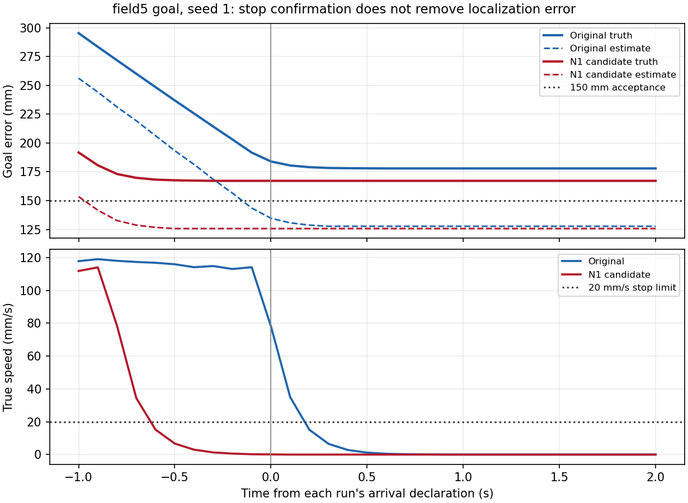
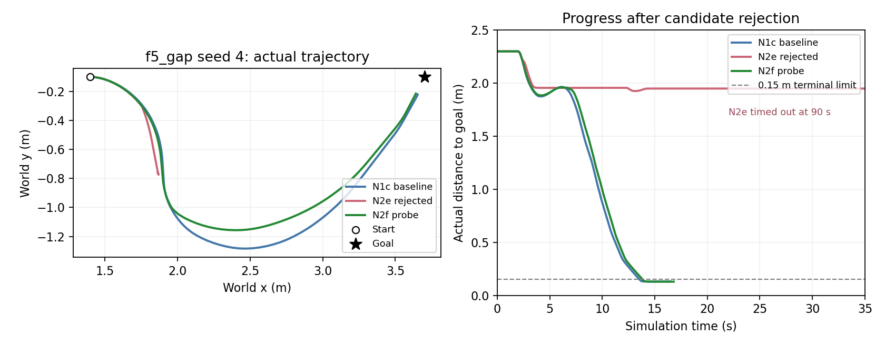
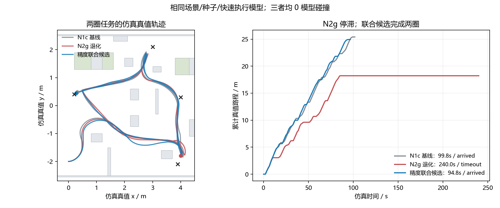
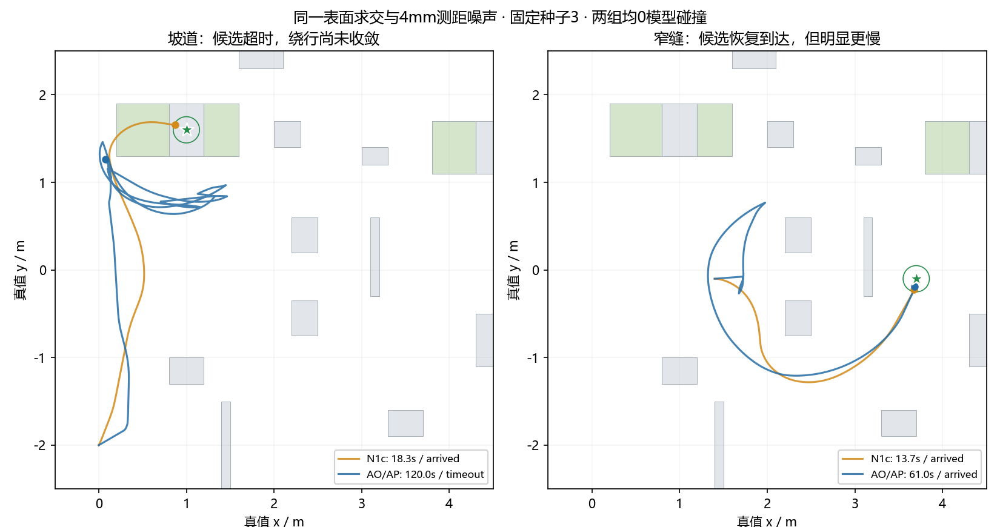

# 导航优化实施与验证结果

本轮保留AS实验：追清原始像素来源，修正旧射线地下偏差，保留25/50mm/s探测与近目标受检重试；过短前视和253可搜索两项试验均撤回。同一新观测口径下，AS窄缝61.8s到达、坡道120s超时，0碰撞；N1c对应13.7/18.3s到达。N2仍未接受。生产/测试C与冻结AS一致，主机/RV128通过（50880B/BSS73512B、6KiB栈后余536B、完整静态2672B）；整轮CPU时限未证明，未部署。

本轮从 2026-10-21 的 [任务规划](../1_plan/nav_optimization_plan.md) 执行。以下结论适用于本地导航工程 `7cd63d9` 及表中所列改动。现已取得只读控制快照`6443f56`和原4500策略，但尚未确认车上位流与源码的精确对应，不将离线结果外推为整车已验证。

**历史检查点（N2n）：专项通过、整体验收失败，接受基线仍N1c。** 主机、7880组几何、关键4例和原4500物理2例通过；长航点240s超时/0碰撞，终止图中148.8mm处有原始危险，而真值到最近箱体为248.5mm。下一阶段先处理L2历史图一致性、T1轮迹准入与CPU时限，不启动已知缺口仍在的全50例重复调参。下文保留各批历史，当前结论见任务规划进度表及本文末节。

## 1. A 批次范围与证据

A批修改闭环和地形评测，不修改导航C、参考地形算法或RTL。初版判分为 `nav-opt-v1`，现为 `nav-opt-v2`：只修正搜索任务“前进指令为零但仍在转向”被过早当作完成候选的问题，非搜索任务的终点/地形核心判据不变。原版导航源码保存在 `sim/build/nav_opt/baseline_20261021/source_7cd63d9.zip`；初版50例输出位于 `sim/build/batch/nav_opt_p0_baseline_20261021/`，受影响的10例搜索按v2复评。

### P0 评测口径

- 定点/路径任务：记录固件首次 `ARRIVED` 声明，继续观察 2 s；100 ms 评测采样点内真实位置误差不超过 150 mm，并在结束前满足真实速度 ≤20 mm/s、真实角速度 ≤50 mrad/s 连续 500 ms，才算终点有效。速度取连续 100 ms 真值位移/转角，不读取指令冒充速度。
- 跟踪任务没有固件 `ARRIVED` 状态：外部任务目标为发现目标、进入跟踪、距目标≤1m；还需前进指令接近零且转向指令为零，才启动最终停稳与漂移检查。前进为零而仍在对准朝向不算完成候选。该候选条件不称为固件到达声明，也不证明完整目标跟踪性能。
- 有效终点与模型碰撞分别记录；批量 `arrived` 要求终点有效且无模型碰撞。明确区分 `false_arrival`、`terminal_drift`、`not_stopped`、`timeout` 与 `collision`，不再在首次声明时结束。
- 原始危险识别使用膨胀前 `last_lethal` 和实际高程观测有效掩码；膨胀后阻塞、填补格、未观测危险/平地、边界忽略带分别计数。旧口径指标保留用于历史对照。
- 地形计数单位是“栅格观测次数”，同一世界位置可被多次观察，不能解释为独立样本数量。地形统计按当前真值/估计位姿对齐，用于隔离感知误差；全局定位误差另报。
- 定位误差保留有效状态条件下的统计，新增全阶段原始坐标差异、有效样本数量与比例。注意：有图模式在 `SET_POSE` 前尚未建立地图系，原始坐标差异不能当作定位误差。配对工具另报地图系建立后的全状态RMS（包含对准、退化、丢失），并保留初始化样本数；无有效样本时返回 `null`，不返回零误差。

这些终点阈值是本轮固定的离线评测约定，尚未经过实车控制噪声标定。碰撞仍使用既有 2.5D 运动模型，并非完整扫掠足迹/接触动力学；SAFE 与 RL 均未串入，属于 S1/N3/H2 后续任务。

### 验证记录

| 检查 | 结果 | 证据与边界 |
|---|---|---|
| 判分器定例 | 12/12 通过 | `sim/closed_loop/test_evaluation.py`；包括550mm假到达、末刻停车、观测断档、旋转未停、搜索转向不算完成、漂移后返回、膨胀遮盖漏检、未知填补和忽略带 |
| 短闭环接通 | 0.6 s 场景正常完成，任务按超时判分 | `sim/build/nav_opt/p0_smoke/`；仅验证工具接通，不作为任务通过证据 |
| 原版 RV32IMC 构建 | 通过 | `sim/build/nav_opt/baseline_20261021/rv_build.log`；镜像 36012 B、BSS 85324 B、128 KB RAM，保留栈 8192 B 后余量 1544 B |
| 原版50例初版闭环 | 已完成：27通过/20假到达/3未停稳，0碰撞 | 10类场景×种子1–5；其中搜索完成候选条件需修正，此处作为v1初版记录，不作为最终基线 |
| 原版搜索v2复评 | 已完成：7/10通过，3未持续停稳；0碰撞 | `sim/build/batch/nav_opt_p0_search_v2_20261021/`；使用保存的原版DLL，不重编算法 |
| 独立地形路线评测 | 已完成 | `sim/build/nav_opt/baseline_20261021/terrain.json`；原始已观测危险召回71.39%，膨胀后已知格阻塞召回87.08%；指定采集轨迹只验证感知 |

RV 构建保留了既有链接警告 `LOAD segment with RWX permissions`；它不是本批新增，也不表示资源/功能验收失败。未执行 RTL 综合或板级测试，本批没有相应代码改动。

独立地形路线的受评窗口包含30475次危险格计数，其中12855次无有效高程支持（42.18%）；窗口包含视场外、遮挡与过期格，此比例是覆盖诊断，不是可见区域漏检率。在已观测危险格中，原始漏检5041次，其中2865次被膨胀区阻挡，原始召回为71.39%，膨胀后已知格阻塞召回为87.08%。原始已观测可行格误报约0.14%，膨胀还阻塞了31696次原始地形可行格，其中包含必要的车体安全间隔；不能直接叫分类错误或无谓空间损失，超额损失要与N3独立足迹真值比较。计数均含重复窗口观测，仍依赖20mm/12°能力假设。

### 原版最终v2基线

最终仍为27/50通过、20例真实位置未满足到达标准、3例搜索未持续停稳，模型碰撞0。搜索复评已经排除了“尚在请求转向就启动最终观察”的评测缺陷；仍失败的3例是在已请求停止后没有满足持续停稳标准。不能将这些结果外推为真实RL控制器的表现。

| 用例 | 到达 | 其余结果 |
|---|---|---|
| 无图定点 f5_goal | 0/5 | 5例真实终点不达标 |
| 坡道 f5_ramp | 5/5 | — |
| 窄通道 f5_gap | 5/5 | — |
| 无图路径 f5_loop | 4/5 | 1例真实终点不达标 |
| 无图搜索 f5_search | 5/5 | — |
| 有图定点 pf5_goal | 0/5 | 5例真实终点不达标 |
| 有图路径 pf5_loop | 4/5 | 1例真实终点不达标 |
| 有图搜索 pf5_search | 2/5 | 3例未持续停稳 |
| 新增障碍 pf5_perturb | 1/5 | 4例真实终点不达标 |
| 被撞重定位 pf5_kidnap | 1/5 | 4例真实终点不达标 |

派生汇总在 `sim/build/nav_opt/baseline_20261021/baseline_v2_summary.json` 和同名Markdown。非搜索40例的终点/地形核心类在v1/v2间AST相同，复用原始轨迹；受影响搜索10例重跑，没有为诊断字段的变化重跑无关任务，也没有覆盖初版数据。历史50/50不能作为这一口径下的成功率。

20例真实位置不达标的到达声明中，19例在首次评测采样时估计目标距离已经≤150mm；真实目标距离范围约160–364mm，估计与真值位置之差均值约70mm。数据保存在 `declaration_diagnostics.json`。这表明后续需要共同处理终点控制容差和定位误差，不能把停稳修复当作位置精度修复，也不能把20例都归因于600mm卡住接受分支。

## 2. P1 参数来源与适用范围

参数唯一来源仍为 [platform.md](platform.md)、[ICD](../2_interface/icd.md)、`config/nav_params.yaml`、`config/regmap.yaml`；下表是本轮对源文件和运行入口的核对结果，不建立另一套复位值。

| 项目 | 本轮基线实际取值 | 来源与状态 | 使用限制/后续动作 |
|---|---|---|---|
| 导航板级时钟 | 50 MHz | 板级记录；`nav_params.yaml` 通用核心默认仍为 100 MHz | 运行周期不得按通用默认直接换算；S1/H1 核对延迟，保持配置原样 |
| 规划/状态周期 | 100 ms / 200 ms | `fw/app/nav_app.h` | N3 需为定位、雷达与其他主循环工作留余量，不以看门狗是否触发代替实时性 |
| 局部地图 | 128×128，约 50 mm/格，`inv_res=1311` | 结构配置及固件/参考模型 | 有限精度真实格宽 `65536/1311` mm，转换沿用既有整数语义 |
| 记忆地图 | 64×64，局部格下采样 2 倍（约 100 mm） | `gmap.h` 默认及 RV `--grid 64,2` | 不把编译期默认的空间大小混作运行期扩容能力 |
| CAD 外形/轮距 | 宽 332.3、前 127.4/后 118.4、轮距 269.9、轮半径 33.65 mm | `config/robot_calib.json`；导出姿态几何 | 不是任意腿姿态包络；N3/V1 复核固定导航姿态 |
| 足迹简化 | 外接圆半径 210 mm，左右支撑间距 270 mm | `world.Robot`、`py_set_caps()` | 目前圆周采样碰撞有限；N3 做扫掠与轮支撑检查 |
| 膨胀 | 4 格、圆形；约 200 mm | `MAP.INFL=0x14`；模型 `infl_r=4` | 与 210 mm 包络不能简单视为严格等价；格中心、边界和方向误差纳入 N3，不在基线偷偷增大 |
| 雷达姿态 | 下俯 10°、前伸 123、离地 155 mm；运行横向外参 0 | `nav_task.c`、`sim_world.MOUNT_*`；10° 为项目确认的安装方案 | 155 mm 基于暂定 L0=130 mm；CAD 偏右约 7 mm 当前未用，H2 装车复测后统一 |
| 历史 CAD 雷达角 | 下俯约 20.29° | `robot_calib.json` 历史几何 | 不能自动覆盖当前 10° 配置；不重写历史文件来伪装已重新标定 |
| 世界车辆能力 | 台阶 20 mm、坡度 12° | `world.Robot`；明确为假设 | 只定义本轮几何标签的条件，不是实车能力。现有 BalanceBot 碰撞模型也未直接实现完整坡度稳定性约束 |
| 感知危险阈值 | 台阶 30、粗糙度 50、20 cm 基线净升高 57、门控跳变 25 mm | `trav_v3.DEFAULT_V3` 与 MAP 寄存器复位值 | 分类/测量阈值与车辆能力不是同义；T1/T2 处理观测有效性、测量误差和边界判决 |
| 先验通行阈值 | 台阶 100 mm、坡度 20° | `prior_map.py` 默认 | T2 统一语义；本批冻结旧配置，不当作车辆更强的证据 |
| 地图有效性 | 年龄 60 帧、至少 1 点、中心 ±12 格保持 | `MAP.VALID_CFG` 和 v3 配置 | 局部高程按帧龄淘汰；全局普通观测尚无逐格自动衰减，X2 复核旧证据重用 |
| 运动请求上限 | 闭环 500 mm/s、1200 mrad/s，`vy=0` | `run_cl.py` 调用 `py_set_caps` | 导航请求范围；不是已经实测可跟踪范围 |
| 板上初始化限速 | 工具默认 300 mm/s、800 mrad/s | `tools/board_init.py` | 与闭环请求不同；实际整车设置未知，S1/H2 连接后核对 |
| SAFE 复位值 | 关闭；速度上限 vx=1000、vy=300 mm/s、w=1500 mrad/s；1 ms 节拍，Δv=2 mm/s、Δw=3 mrad/s，看门狗 200 ms | `config/regmap.yaml` SAFE 块 | 复位值不等于实际启用值；板上工具会修改限速和使能，闭环目前绕过 SAFE |
| 执行响应 | τ=0.12 s、纵向加速度上限 1.5 m/s²、角加速度 6 rad/s² | `robot.py` 假设 | S1 建立分层响应范围；H2 用实测代替，不能称为 RL 响应 |
| 误差与采样 | 激光 10 Hz、深度噪声 4 mm；里程计 50 Hz；IMU 100 Hz；其余参数见每例 manifest | `run_cl.py` 与 `RobotSim` 默认 | 深度误差不代表实测完整噪声分布；模拟 WIT 数据不验证 BMI088 驱动 |
| 资源边界 | TRAJ 候选/步数各≤64；MATCH 每批≤256，常规245 | 配置与 HAL | N3/L3 分别使用各自上限；不混为同一候选数量 |

先验 `auto` 会复用已有包；[历史实验记录](algorithms.md) 记载已按10°重新扫图，但缓存文件没有伴随的生成参数元数据。本轮将实际使用的二进制包保存到批次目录，保证后续配对使用同一输入；这不证明旧包的生成标定正确。重建先验的工作应另作受控比较，不能在双方比较期间替换缓存。

## 3. 导航与控制的现有输入合同

| 通道 | 当前导航要求/行为 | 最新整车待核对项 |
|---|---|---|
| 坐标与单位 | 机身/里程计系 X 前、Y 左、Z 上；mm、mm/s、mrad/s；内部角度 65536/周 | 轮速符号、陀螺轴向、姿态零位一致 |
| 连续请求 | `nav_cmd_t` 的 vx/vy/wz 为 int16；非全向 vy=0；`CMD_W` 写入提交整条命令 | RL 实际接受的量、更新节拍、允许倒车/原地旋转范围 |
| 停止 | 普通阻塞/定位失效发受控零速请求并保持平衡；硬件急停优先 | SAFE、控制有效状态与驱动禁能是否按此连接 |
| 速度反馈 | `hal_odom()` 读取计数器、vx/vy/wz 和采样时间；接口约定对地速度，静止 vx 精确0 | 是否已扣机身俯仰角速度、噪声、延迟、有效标志和中断行为 |
| 姿态/角速度 | 本地 `hal_imu_byte()` → WIT 解析 → `pose_imu_att/gyro()`；默认不使用绝对 yaw | 用户 BMI088 已调通；对接采样时间、姿态输出、共享采集与轴向转换，不重写驱动 |
| 时间 | 导航32位微秒时间，差值按回绕语义；雷达目前使用帧到达时间 | 控制/IMU 与导航时间基准关系；采集和接收时刻的差异 |
| 腿姿态 | 初版导航固定一档，雷达安装高度按该档配置 | 实际导航档位、L0；后续变姿态才扩展实时高度合同 |
| GOAL | yaw 为 `0x7FFFFFFF` 表示不关心，主机工具默认如此；当前任务忽略朝向 | N1 启用朝向前核对其他客户端的默认0行为 |

最新整车接口仍需源码或可复核记录确认；P1 交付的是当前导航合同与差异清单，不把未知项标成“已集成”。

## 4. 复现与结果保存

本机 GCC 15.2.0 的 `cc1.exe` 在原 PATH 下出现 `0xC0000139`（入口点/DLL 装载冲突）；仅在执行进程前置 `C:\msys64\mingw64\bin` 后恢复，不修改系统 PATH。

```powershell
$env:Path = 'C:\msys64\mingw64\bin;' + $env:Path
& 'D:\Anaconda\python.exe' -X utf8 sim/closed_loop/test_evaluation.py -v
& 'D:\Anaconda\python.exe' -X utf8 sim/closed_loop/batch.py --tag nav_opt_p0_baseline_20261021 --extra=--no-plots -j 10
& 'D:\Anaconda\python.exe' -X utf8 sim/closed_loop/eval_trav.py --trav v3 --out sim/build/nav_opt/baseline_20261021/terrain.json
& 'D:\Anaconda\python.exe' -X utf8 fw/bsp/build_rv.py --app nav --ram-kb 128
```

批次标签目录已存在结果时，工具拒绝覆盖，应使用新标签复现。每例记录解析后参数、实际命令、版本、挂载、能力假设和阈值；批次目录保存实际 runner、参考模型、配置、DLL 与先验包。基线种子 1–5 属历史用例；1–3 用于后续诊断，4–5 保留作历史验证，新增种子 11/12 留给后续保留用例，不能将旧历史种子称作全新未见验证集。

## 5. N1a 路径组合未采用

这组修复在原版基线的 DLL 和输入冻结后编写；基线进程继续使用原版 DLL，没有重新构建或替换它。主机测试使用独立的 `fw_test.exe`。

此实验组合同时修改了近目标直达、不可见路径点强行推进、部分路径末端替换，以及卡住后的到达判定。虽然路径反例通过，但 `f5_ramp_s3` 在120s内未完成，并产生13次模型碰撞；原版同一用例通过且无碰撞。日志包含-150mm/s倒车，初步判断为更严格路径检查与旧恢复策略相互作用，具体恢复分支仍需N2诊断。

该组合在完成26/50例时已被否决，剩余评测停止，不报告其总体通过率。隔离源码、DLL、逐例数据和 `rejection.json` 保留在 `sim/build/nav_opt/n1a_source_20261021/sim/build/batch/nav_opt_n1a_20261021/`。当时撤回路径部分，不能把该实验标为修复通过；后续与N2联合修复另见第8节。

该实验也包含实际速度停稳判定；此部分在N1b中单独保留验证。它没有改变急停协议；速度样本乱序/历史有效性仍属于L1，完整响应与刹停走廊属于S1/N3。

| 检查 | 原版 | 候选 | 证据 |
|---|---|---|---|
| 同一任务反例 | 12项断言失败（包含重复停稳检查） | 全部通过 | `fw/test/test_main.c` 的 `--nav-contract`；原版日志 `sim/build/nav_opt/baseline_20261021/contract_original/result.log`，候选 `n1_contract.log` |
| RV32IMC镜像/BSS | 36012 / 85324 B | 36348 / 85340 B | `rv_build.log` 与 `n1_rv_build.log`；代码增加336B、静态数据增加16B，预留8KB栈后余1192B |
| 完整固件主机回归 | 历史结果不代替本轮 | 通过；90条轨迹数值对照无差异 | `sim/build/nav_opt/baseline_20261021/n1_fw_test.log`；旧主机任务验收容差仍较宽，不代替新闭环判分 |
| 闭环回归 | 原版坡道种子3通过，无碰撞 | 同例13次模型碰撞；组合不采用，剩余评测已停止 | `rejection.json` 与 `f5_ramp_s3/metrics.json`；没有替换原版批次DLL |

N1未完成：路径修复需与N2共同推进，低速/停止候选、模式进展判定和可选末端航向仍待验证。原版无图定点假到达在声明时真实误差约177–245mm；不能只凭假到达就认定均由600mm接受分支造成。

`sim/closed_loop/compare_batches.py` 用于最终配对：要求用例/种子完整、物理场景与每例实际参数相同，直接比较先验包内容，不做SHA。同版本要求判分源码一致；仅为本轮v1→v2提供受限兼容：非搜索核心类AST必须相同，全部受影响搜索必须有v2复评，并与候选使用相同v2判分源码。其他输入或判分差异会被拒绝。耗时只比较双方均成功的用例，失败与碰撞分别报告。

定位诊断还需区分坐标系是否已建立。例如原版 `pf5_goal_s1` 的全阶段原始坐标差异RMS为0.522m，其中前20个采样尚未进入地图系；按定位状态记录分开后，地图系建立后的全状态RMS约0.088m。两项不互相替代，前者也不能用来声称已对准后的定位性能很差。该划分仅增加诊断，不改变双方的到达/停稳验收标准，原始文件保留。

### 已否决组合中的诊断：停稳与位置精度的区别

`f5_goal` 种子1中，原版首次声明时真实目标误差约184mm，仍在运动；候选等待停稳后才声明，真实误差约167mm。两者均未满足150mm真值验收，不能将“停稳逻辑已修复”写成“终点精度已通过”。估计位置误差已经小于150mm，而真值仍在外，说明还需处理定位误差和终点控制的精度预算。



图中每条曲线分别以该次运行的首次到达声明为零时刻；不是同一个绝对仿真时刻。数据来自原版与已否决N1a的 `f5_goal_s1`，没有用请求速度替代真实速度。此图保留作诊断，不代表当前候选已通过。

## 6. N1b 共用受阻规则已替代

这个版本保留实际反馈停稳并把600mm内卡住改为停止。完整50例表面上提高到30/50、0模型碰撞，但其中跟踪行为发生了非预期变化：`pf5_search_s2` 最终距目标约0.947m、速度为零，真值目标方向仍偏离机身约16.8°；原有朝向对准被共用行进函数里的定点受阻规则跳过。

因此没有把30/50作为可采用的导航收益。该版本已被N1c替代，数据与 `revision.json` 保留在 `sim/build/batch/nav_opt_n1b_stop_20261021/`，配对结果在 `sim/build/nav_opt/n1b_comparison_superseded/`。此例也说明“目标接近并停住”指标不能代替完整跟踪行为验收。

| 检查 | 结果 | 证据 |
|---|---|---|
| 完整固件主机回归 | 通过，轨迹90条无差异 | `sim/build/nav_opt/n1b_fw_test.log` |
| 停稳/受阻反例 | 当前全部通过，原版同组11项断言失败 | 原版 `sim/build/nav_opt/baseline_20261021/contract_original/stop_original.log`；当前包含在完整固件回归 |
| RV32IMC构建 | 通过；镜像36236B、BSS85340B，8KB栈后余1304B | `sim/build/nav_opt/n1b_rv_build.log`；相对原版代码增加224B、BSS增加16B |
| 曾触发否决的坡道种子3 | N1b通过，0模型碰撞 | `sim/build/batch/nav_opt_n1b_stop_20261021/f5_ramp_s3/metrics.json`；不能由单例替代完整回归 |
| 完整配对闭环 | 50例完成；30/50、0碰撞，但跟踪朝向兼容性不满足 | `sim/build/batch/nav_opt_n1b_stop_20261021/`；不采用此共用规则版本 |

N1c阶段，路径反例保留为 `fw_test.exe --lookahead-known`，当时出现3项未解决断言，未计入默认通过回归；`--nav-contract` 当时只验收停稳子集及跟踪朝向兼容性。本次N2联合修复已将路径反例纳入默认回归，旧命令仍可运行，预期改为0失败，见第8节。

## 7. N1c 当前定点子集与跟踪兼容性

N1c接受基线将近目标卡住停止规则限定到定点/航点；跟踪模式保留原有站位与朝向处理，并保留原进展计时更新行为。最终定点/最后航点仍要求新鲜速度反馈连续500ms满足阈值；不新增终点航向要求，不修改协议字段。其余任务在该阶段尚未推进；本次状态见第8节。

针对N1b问题新增反例：目标在斜前方、站位点在600mm内且进展计时已超时，TRACK仍须请求面对目标的转向，不能被定点停止规则覆盖。

| 检查 | 结果 | 证据 |
|---|---|---|
| 完整固件主机回归 | 通过；含跟踪兼容反例及90条轨迹对照 | `sim/build/nav_opt/n1c_fw_test.log` |
| RV32IMC构建 | 通过；镜像36256B、BSS85340B，8KB栈后余1284B | `sim/build/nav_opt/n1c_rv_build.log`；相对原版代码增加244B、BSS增加16B |
| 最终完整配对 | 28/50通过，对照27/50；均0模型碰撞，无原有成功用例退化 | `sim/build/nav_opt/n1c_comparison/comparison.json` 与 `acceptance.json`；最终50例使用统一固件 |
| 跟踪行为兼容 | 10/10搜索用例的记录轨迹与原版相同 | `tracking_trace_equal_at_logged_precision`；指保存精度下时序数据一致，不外推未测场景 |

最终批次额外保存 `firmware_source/`，与运行库、参考模型、配置和逐例输入一起冻结，便于后续按同一源码复现。尚未做实机验证和板级最坏周期测量。

### 最终配对结果与取舍

| 用例 | 原版 | 当前定点子集 | 模型碰撞（双方） |
|---|---|---|---|
| f5_goal | 0/5 | 0/5 | 0 |
| f5_ramp | 5/5 | 5/5 | 0 |
| f5_gap | 5/5 | 5/5 | 0 |
| f5_loop | 4/5 | 4/5 | 0 |
| f5_search | 5/5 | 5/5 | 0 |
| pf5_goal | 0/5 | 0/5 | 0 |
| pf5_loop | 4/5 | 5/5 | 0 |
| pf5_search | 2/5 | 2/5 | 0 |
| pf5_perturb | 1/5 | 1/5 | 0 |
| pf5_kidnap | 1/5 | 1/5 | 0 |
| 合计 | 27/50 | 28/50 | 0 |

唯一新增通过的是 `pf5_loop` 种子3：最终真实误差从约180mm降至114mm，到达声明从102.7s延后至104.2s。双方原本均通过的定点/路径用例，平均完成时间多约0.8–0.85s，符合新增停稳等待的代价；搜索耗时与记录轨迹保持一致。

本轮接受的是到达确认和定点受阻语义修复，不能据1个用例提升就声称全局定位或路径效率显著改进。当前仍有19例真实位置不达标、3例搜索未持续停稳；N1其余功能、N2/L1/T1等任务未完成。路径组合的碰撞和共用停止规则的跟踪影响都已记录并撤回，不计入可采用收益。

最终比较命令：

```powershell
& 'D:\Anaconda\python.exe' -X utf8 sim/closed_loop/compare_batches.py sim/build/batch/nav_opt_p0_baseline_20261021 sim/build/batch/nav_opt_n1c_goto_20261021 --before-search sim/build/batch/nav_opt_p0_search_v2_20261021 --out sim/build/nav_opt/n1c_comparison
```

后续批次使用保存的N1c运行库和配置作当前离线基线。修改物理响应、传感器或判分时重评双方；源代码/输入一致性检查不通过，就不输出可比的改善结论。

后续搜索停稳问题有一条可复核线索：原版 `pf5_search_s2` 在28.4–30.4s内转向请求覆盖-600至600mrad/s，非零请求发生2次反向。按内部角度65536/周换算，`wz = dh * 2 / 3` 对应外层朝向增益约6.95s⁻¹。较高增益、10Hz更新、死区与响应滞后共同引起摆动是待验证解释，不能据此指责真实RL控制器。N2统一角速度出口后，结合S1响应模型检查增益与死区，再决定X1调整。

## 8. N2与路径联合修复（执行中）

本次以接受的N1c批次为基线，评测、物理模型、地形算法、先验及任务输入不变。最终50例完成前，不以四例探测或单项断言替代验收。N2a、N2b等名称仅标记本次实验，不表示已接受。

### 已实现的候选

- 所有非零命令收敛到 `nav_task_step` 的共同出口；内部记录停止/局部规划/恢复/路径对准/规划失败兜底/跟踪面对目标/探索旋转/定位保持/急停来源及检查结果，Python HAL提供只读诊断，不改串口报文。
- `motion_guard.c` 用同代CPU缓存地图检查最终命令。当前按50ms离散步检查默认1.2s名义轨迹，使用210mm外接圆与半步路程扩张，检查完整圆与原始254格相交；253不再次叠加车体半径。圆包络旋转不扩张，只需检查当前足迹。离开窗口、超底盘能力、地图不可用/切换均拒绝运动。此处不证明动态刹停、定位误差包络或实车轮支撑。
- 定位退化时同时缩放线速度和角速度；N2f正常候选在硬件评估前缩放，其他分支在共同出口检查前缩放。最终命令均复核。硬件轨迹评估返回false或前后地图seq/中心/分辨率不一致时，不采用结果。上板地图复制遇到切图返回失败，下一周期重取，不递归重读或使用混代缓存。
- 前视点必须局部可见；完整、未裁剪的路径才允许替换为真实终点。无路径时停止，不直指终点。最近粗格中心不可见时，查找确实可见的后续接入点，每个接入点仍检查LOS；已接入后遇到遮挡截断。在膨胀区内可查找退出方向，但最终指令仍经完整原始危险足迹检查。
- A*超过256点时使用既有临时数组的环形回溯，保留靠起点的前缀并返回部分路径，不新增数组。无有效前视点/目标点过近时，不在机器人脚下添加虚拟障碍。

### 失败证据与调整

内部诊断编码（`motion.csv`，不改变外部协议）：

| 来源值 | 命令来源 | 检查入口 |
|---|---|---|
| 0 / 8 | 停止 / 急停 | 零速保持原停止层级，急停不受地图门槛阻塞 |
| 1 | 正常局部规划 | 最终命令检查，硬件结果另检查返回值和地图代际 |
| 2 | 恢复倒车或旋转 | 倒车方向选择先检查，最终命令仍统一复核 |
| 3 / 4 | 路径对准 / 局部规划失败兜底 | 统一检查；硬件评估过期直接零速，不再兜底转向 |
| 5 / 6 / 7 | 跟踪面对目标 / 探索兜底 / 定位保持 | 统一检查；无图或旧坐标地图不支持盲转 |

检查值：0零速、1已知危险检查通过、2无可用地图、3地图变化/评估过期、4足迹触及已知危险、5近程新增未知、6出窗口、7超底盘能力。值1不表示脚下全部地面已观测；当前足迹内未知及轮支撑有效性仍是限制。

N2a将近200ms中新进入的未知足迹一律拒绝。坡道种子3在起点保持不动，诊断明确为UNKNOWN拒绝；该批次未跑完即否决，不能报告全批次成功率。证据：`sim/build/batch/nav_opt_n2a_probe_20261021/rejection.json`、`sim/build/nav_opt/n2a_ramp_trace/motion.csv`。

当前地图的近身盲区意味着“凡未知都停止”与现有前向探索不能同时满足。候选沿用既有 `allow_unknown` 的前向探索许可，仍单独记录UNKNOWN，继续检查后续已知危险格；不会因先遇未知而漏查后方的已知危险。新增未知足迹的倒车拒绝，恢复方向选择也使用完整检查，必要时选择经检查的旋转。关闭允许未知会停止对应探索。该许可不是已验证通行或安全保证，T1/N3仍需建立近场支撑与停止区策略；N2不能按完整原计划标记全部完成。

完整主机回归还暴露两类交互：一是无可见路径时把当前位置作为前视点，恢复再把自己封成虚拟障碍；现场局部格0、全局格254。二是最近粗格中心位于局部膨胀边界，原来的首点拒绝会漏掉可见的后续接入点。两者已修复并加入反例，不能只归因于“检查太保守”。

### 前期N2e验证台账（最终结论见下方G记录）

| 检查 | 当前结果 | 证据/范围 |
|---|---|---|
| 专项反例 | 通过 | `fw_test.exe --nav-contract`：旧终点/跟踪合同、路径、长路径截断、自身虚拟障碍、所有非紧急命令来源、未知/地图切换/限速 |
| 独立名义几何复核 | 4028组，3583组精确圆弧碰撞均被拒绝，0错误放行；250组放行 | `sim/closed_loop/test_motion_guard.py`、`sim/build/nav_opt/motion_geometry/result.json`；不同速度/转速/角度回绕/栅格相位，独立SE(2)圆弧以1ms采样。195组圆弧无碰撞但被保守拒绝；这些是刻意靠近边界的样本，不外推自然工况误报率 |
| 完整主机回归 | 通过 | `sim/build/nav_opt/n2e_fw_final.log`；90条轨迹参考对照保持一致，绕墙/航点/探索/急停通过 |
| 四例种子3探测 | 4/4通过，0模型碰撞 | `sim/build/batch/nav_opt_n2b_probe_20261021/`；后续可见接入点修复前的候选，不能冒充最终50例 |
| N2e配对尝试 | 完成20/50后否决，其余停止 | `sim/build/batch/nav_opt_n2e_guard_path_20261021/rejection.json`；窄通道种子4/5由成功变为无碰撞超时，不报告该批整体通过率 |
| RV资源 | LTO构建通过：镜像36672B，BSS85340B，保留8KB栈后余868B | 关闭LTO超128KB；导航默认启用LTO，selftest不变；`sim/build/nav_opt/n2e_rv_build.log` 与默认构建 `n2e_rv_default_build.log`；板级周期未测 |

本次在看最终配对前保持验收要求：专项缺陷消除，不新增模型碰撞，同时逐例检查原成功用例退化、任务时间与恢复/停顿。若出现退化，保留并解释现场，修复后重跑相关用例；不因零碰撞就接受停止一切，也不修改评测口径追求分数。

N2b坡道诊断另存 `sim/build/nav_opt/n2b_ramp_trace/`：共280个100ms样本，47个为局部规划提议被原始危险足迹拒绝，随后一次经检查的恢复；8个样本为允许未知的前向动作，0个负向未知动作。26.0s完成，对照N1c的18.7s；窄通道23.1s，对照13.4s。有图/无图搜索探测耗时不变。探测证明该候选能避开既往坡道碰撞，但也显示停顿与效率代价，完整批次必须保留这一取舍。

### N2e退化与N2f复验

N2e的窄通道种子4/5分别在距目标1.950m/1.878m处超时；对应N1c分别14.5s/14.2s完成。两个版本均0模型碰撞，不能仅凭安全拒绝就接受新候选。定点5例也由假到达变成超时，不能算精度提升。N2e已完成20例，剩余评测停止，源码与DLL保留。诊断见 `sim/build/nav_opt/n2e_gap4_trace/motion.csv`，连续出现LOCAL/HAZARD后的零速。

N2f在既有候选数组内，按评分最多复核3条完整足迹，拒绝后可尝试下一个候选；限速提前到候选编码/硬件评估前，最终出口再复核。转向记忆改为实际下发的命令。此处仅有界名义复核，未实现响应/制动模型。专项及完整主机回归通过，RV镜像36972B、BSS85340B，8KB栈后余568B；窄通道/坡道种子4/5复验4/4通过、0模型碰撞。随后完整配对到30/50时被G替代，见 `sim/build/batch/nav_opt_n2f_guard_path_20261021/revision.json`；没有F全批通过率。板级周期仍待测。



图示仅为该例：N2e停止在目标约1.95m外，N2f探测恢复进展，接近N1c耗时；不能据此推断所有用例改善。作图源保留在 `sim/build/nav_opt/plot_n2_gap.py`。

N2f对既往碰撞的坡道种子3另做只读命令诊断：`sim/build/nav_opt/n2f_ramp3_trace/`。18.7s完成、0模型碰撞，无恢复动作；与N1c时间相同。诊断对应冻结N2f，未改变 `run_cl.py` 判分或物理输入；不将它冒充G的验证。额外验证源保留在 `sim/build/nav_opt/n2f_validation_source/`，不覆盖冻结记录。

### N2g修复受阻反馈（当前候选）

新增专项反例发现：为了避免在自身添加虚拟障碍，N2f还要求 `path_valid`；而局部规划失败本来就会清掉它，远处受阻点因此不能反馈给全局规划。N2f该例确定失败，证据 `sim/build/nav_opt/n2f_remote_block_failure.log`。其30/50闭环记录保留，剩余任务停止，`revision.json`明确其未完成且被替代。30例中暂无原成功→失败，但有4个原假到达变成超时，不能算改善。

N2g移除 `path_valid` 前提，保留受阻点远离车体的保护，同时通过自身封锁/远处反馈两个反例。完整主机回归通过，RV镜像36968B、BSS85340B，8KB栈后余572B。种子1短探测中，坡道/窄通道通过、定点仍假到达，均0模型碰撞，见 `sim/build/batch/nav_opt_n2g_probe_20261021/`。长航点只读诊断已完成，结果如下；G不接受，不启动已知失败版本的全50例重复。

另复核N2f定点种子5的最终地图：最近254格方框离估计中心约197mm，小于210mm包络，整个当前足迹已与地图危险相交。对应位置靠近箱体边界，独立标签包含边界忽略带，不能直接认定真实车体已碰撞，也不能直接把254改成可走。新观测、边界量化与执行响应造成的相交仍需区分；这是T1/T2、S1/N3的证据入口，不能只靠扩大候选预算解决。

### G最终联合验收：未通过

`f5_loop_s1`由N1c的99.8s成功变为G的240s超时，双方0模型碰撞；G最终真值(4.000,-1.792)m，当前目标仍为(4.0,0.3)m。诊断、地图、时序与判分均保留在 `sim/build/nav_opt/n2g_loop1_trace/`，机器可读结论为 `sim/build/nav_opt/n2g_comparison/acceptance.json`。没有新50例通过率，接受基线仍是N1c的28/50。

已逐项核对任务参数、判分/物理源码、能力/响应假设及当前C与冻结G源码，共52项一致；记录为该目录的 `input_comparison.json`。比较没有使用SHA校验。额外回归源保留在 `sim/build/nav_opt/n2g_validation_source/`。所有本轮评测进程已结束，未留下后台批次。

已确认的现场事实：

- 85.0s最后一段前进仍标记UNKNOWN；85.1s切换航点请求零速，随后真实车体又移动约12mm。85.2–85.6s名义旋转通过，85.7s起旋转被地图254足迹拒绝，之后持续停住。恢复累计27次是请求计数，不代表27次实际移动。
- 最终最近254格方框距估计中心约149mm，小于210mm包络；同一名义几何检查拒绝它符合设计。
- 独立场景真值在同样的当前局部对齐下，将最近两格标为自由（高度0），其余近格多属边界忽略带。检查没有把这些真值反馈给导航。见 `nearest_hazard_truth.json`；这证明不能将“地图足迹相交”直接解释为物理碰撞。
- 85.5–85.6s估计位置变化约48mm，而真实移动不足1mm。修正后估计更接近真值，不能据此认定匹配修正错误；旧融合图与修正位姿是否一致、采集姿态是否有效仍需追查。约12mm执行漂移也不足以单独解释最终约61mm的包络侵入量。

合理推测是采集姿态/历史、位姿修正与旧图融合、近场边界分类共同影响了此现场；没有完整逐帧地图记录，暂不能给出单一归因。继续放宽足迹或清掉254会掩盖缺陷，因此本轮保留实验实现，未合成/烧录，也未将其判为可替换基线。

下一入口已回填规划：先用这一现场补记帧、时间、位姿修正与速度证据，推进L1和地图一致性，再联查T1/T2及S1；N3使用N2已实现的统一出口，不以“N2整体先通过”构成循环依赖。针对性反例通过后才再运行完整配对。工作区 `fw/` 是G候选，冻结N1c才是当前接受版本。

## 9. 接续F1与J1–J4执行

按最新控制快照6443f56及总计划推进，控制C1–C5暂缓。本次导航验证输入包括原4500的8ms策略节拍、100Hz左右IMU/编码器、50Hz舵机以及零轮目标关PWM/清PID；模拟扫描不作为实车标定。动力学后端路线见[选型决定](../1_plan/simulation_architecture_decision_20261021.md)，J1–J4是[联合仿真](../1_plan/nav_control_simulation_plan_20261021.md)的实际交付，不由一阶响应代替。

F1只读逐帧诊断已完成：`trace_frames.py` 在冻结G上记录83–87s，后续小节给出时序及危险边界两类证据；没有预先把更接近真值的修正判错。

L1独立正确性修复已通过主机回归：高频积分与10ms历史采样解耦，XY历史去掉重复姿态以节省256B；历史过旧/过新明确拒绝，最多30ms测量速度外推显式标记，完整位姿另要求对应IMU历史；乱序反馈/姿态和旧目标被拒绝，反馈长缺口不插值虚假连续轨迹。覆盖1kHz、0.5s迟到、32位回绕、缺口、重复/乱序等反例。快速G场景本身是50Hz里程计，尚不将这些修复宣称为已解决G根因。证据 `sim/build/nav_opt/f1_l1_fw_test.log`；RV初版镜像37404B/BSS85084B，计数等最终改动后再更新。

J1已完成本机五项短时基础运行；J2已实际接通并完成两对基础任务，详见后续记录。原控制源码、权重、训练均未改，未上板。

### F1两阶段融合与L1最终配置（2026-10-21）

冻结G现场80份逐帧地图保存在 `sim/build/nav_opt/f1_g_frames`。85.502s旧位姿(4101,207,-25)mm融合，85.542s匹配后当前位置(4055,192,-25)mm，高度图未改；最近危险格方框距离251.9→205.8mm。该证据支持先匹配后融合同一帧，不支持削弱危险判据。旧近场证据累积与地形边界误判是否仍导致停车，须由候选闭环继续区分。

候选已实现两遍重用深度帧及提案/门控/提交分离，并同步RTL、寄存器源、三种HAL和参考模型。L1的XY历史最终为32×20ms（约620ms），姿态历史64×10ms；不把主机高频输入压缩成仅几十毫秒历史。`f1_staged_fw_test.log` 完整回归0失败；`staged_fusion_contract.json` 首遍0写入、第二遍融合1次；`f1_staged_rtl_contract_retry.log` 端到端通过。首次RTL参数命令行解析失败已修正测试入口，不是功能通过记录。

`f1_staged_rv128.log`：镜像37944B、BSS84452B、8KiB栈后余484B，真实128KiB链接通过。另160KiB诊断输出仅为获取LTO栈报告，未增大部署RAM；静态栈报告在 `f1_staged_rv128/nav_fw.elf.ltrans0.ltrans.su`，未测板级水位/最坏周期。

首个长航点探测被发现主机HAL在FUSE_ONLY之后误置SLF就绪而中止，见 `f1_staged_loop1/rejection.json`，不计成功率。修复后冻结 `f1_staged_v2_fw.dll` / `f1_staged_v2_source`，用例 `f1_staged_v2_loop1` 进行中。当前接受基线仍N1c，F1/N2尚未联合验收。

J1本机基础运行已完成：`j1_control4500_isolated/evaluation.json`，固定原4500、零命令偏置、2ms物理/8ms策略、无自动重置。停车/前进0.2m/s/后退−0.2m/s/左右1rad/s各1次6.008s均未达到原运行器失稳终止；实际平均前进0.1634、后退−0.1169m/s，左右偏航1.310/−1.192rad/s，停车位移27.8mm。仅为移植和基础合同证据，不是重复统计或实车能力；J2–J4未验收。

### F1后续复验：时序修复仍不足，T2边界定位实验进行中

最终两阶段RTL全回归16/16通过，见 `f1_staged_rtl_full.log`（新增1项，历史全量为15项）。导航独立综合/布线进行中，尚不能沿用旧资源和时序报告。修正HAL后的 `f1_staged_v2_loop1` 已在第二圈持续停车，不能接受；完整240s记录仍在运行。两阶段时序和L1缺陷修复本身保留，不用它们冒充N2闭环改善。

对冻结G的80份地图做只读分类复核：85.543s最近原始危险为H=−22mm的平坦地面，距当前中心205.8mm；其邻近较高箱体为259.2mm。将台阶高差只归属高侧的实验保留箱体危险，80帧中足迹侵入计数从29帧变成0帧。结果 `f1_step_localization_audit/frames.json`；这只解释该组地图，不能单凭它判新算法安全。

新增 `test_step_boundary.py` 独立圆/连续边界检查：75/150/300mm正负落差、四个栅格相位、0/15/37/90°，96项已观测几何过渡均在首次圆形足迹触边前拒绝。它假设每个相交格已有高度证据，不覆盖雷达漏观测、窄障碍或物理通过性。`step_high_only=1` 当前仅在Python实验中开启，默认与RTL仍保持旧判据，`f1_high_side_loop1` 正在用同一冻结C候选回放；未经RTL同步和配对不发布。

为避免时序/运行器变更混入比较，N1c在新快速运行器上重新配对基线进行中：`nav_opt_f1_n1c_current_harness_20261021`。batch已改为执行冻结目录，并要求显式DLL配其对应源码；不会把旧DLL配当前fw保存为假源码证据。未完成时不报告50例总通过率。

### J2导航物理闭环初版

新增可选MuJoCo后端及SAFE事务级模型。平地停车定例2.6s声明，观察至4.6s，最终误差11.2mm；0.6m短目标7.2s声明，观察至9.2s，最终误差91.6mm；二者无物理碰撞/失稳且通过原nav-opt-v2位置/停稳口径。目录 `j2_first_stop` / `j2_short_goal_candidate`。短目标全链路实时时间因子约0.119（该轮还有其他验证负载），未做独占性能定论。

输入链为真实导航C、显式使能SAFE、固定原4500/8ms策略、2ms动力学、100Hz轮速与IMU、10Hz虚拟雷达。轮速来自物理关节，不直接取车体真实速度；真值仅生成传感器/判分。WIT仅为现有导航解析器的传输适配，不声称BMI088输出WIT。初版只支持平地与箱体，拒绝坡面/绑架输入；训练等效开链和执行器仍保留，J3部署PID/舵机/量化及真实闭链未完成。

SAFE的使能/500mm/s/1200mrad/s是显式仿真启动配置，当前导航固件入口不写SAFE_ENABLE，不能推断实车已这样配置；整车G1须确定唯一配置责任。J2链路连通不等于J4配对或整车验证通过。

### 高侧候选定例完成，完整配对进行中

长航点 `f1_high_side_loop1/metrics.json`：95.8s成功、0模型碰撞，最终真实误差0.057m；到达后按原标准观察2s。对照N1c99.8s成功，G240s超时。联合修复并非单独归功于时序或分类，二者贡献需保留消融证据：两阶段单独版本仍持续停车，高侧联合版定例通过。

`nav_opt_f1_high_side_probe_20261021`：坡道/窄通道种子3分别18.9/13.3s成功、0碰撞。完整候选批次 `nav_opt_f1_high_side_full_20261021` 已启动，配对基线 `nav_opt_f1_n1c_current_harness_20261021`，两者执行同一冻结runner。台阶开关是预先声明的算法差异，不能伪称所有配置相同；比较器仅允许显式声明的 `step_high_only`，其他几何、物理、传感器和判分参数仍严格核对。候选高侧逻辑尚仅Python开启，RTL默认仍旧模式，不发布为可部署。

J2基础配对 `j2_pair_comparison/comparison.json`：停车/短目标共2对，双方各2次成功、0碰撞、耗时差0；声明可比输入一致，没有从两例推断总体收益。正在补转向、单箱绕行、多航点任务。SAFE事务级参考1200向量对RTL通过（`j2_safe_rtl_reference.log`）；原部署PID逐样本4637向量对只读6443f56 RTL通过（`j3_pid_rtl_reference.log`），覆盖零目标清状态、P/I/D/FF、斜坡/限幅/抗饱和及失速/反转故障。PID的8时钟算术流水被折叠，反馈超时与PWM载波/实际电机响应未由此验证，J3尚未完成。

### 高侧初版12例后否决，精度子项复验

初版 `nav_opt_f1_high_side_full_20261021` 仅完成12/50，已停止：`f5_ramp_s2` 真实151.9mm，超过原150mm判分；N1c对应成功。`rejection.json`保存完成明细，没有全批成功率。95.8s长航点成功这一事实保留，但不足以接受该版本。

当前精度候选保留150mm独立要求、500ms停稳和2s观察；内部最终估计阈值扣50mm预算，并为最终600mm接近区增加随距离缩小的速度上限。因2s前推下125mm/s最低速度会使100–125mm附近候选偏好旋转，不能只改阈值。主机回归0失败；RV镜像38072B/BSS84460B/预留8KiB栈余348B，见 `f1_precision_fw_test.log` / `f1_precision_rv128.log`。

`nav_opt_f1_precision_probe_20261021` 种子2：坡道19.5s、真实误差110mm；窄通道14.8s、84mm；定点仍假到达、190mm、定位误差101mm。50mm预留已被这一定位误差超过，不能当作可信上界；后续需要L2/标定，不能为过关再次改评分。精度版长航点 `f1_precision_loop1` 尚在运行。

高侧RTL模式已实现并经过模式0/1逐格及两阶段顶层3项专项；当前默认MAP.CTRL=0x0D（STEP_HIGH_ONLY=1），写0x05可回到双侧。完整20项回归与新布线进行中。之前两阶段版本的独立布线为Logic24783、BSRAM324/340、DSP67/298、clk50 Fmax50.048MHz、setup/hold违例0，冻结源码/报告/镜像在 `f1_staged_hardware_20261021`；rgmii_rxc由工具自动建100MHz时钟的告警仍需板级约束复核，不能称全车部署完成。

### J2五对任务与S1时延模型

基础2对及补充3对均完成，见 `j2_pair_comparison` / `j2_tasks_comparison`：双方5/5成功、0物理碰撞/失稳；补充任务转向8.6s相同、绕箱14.3→14.1s、航点15.4→15.3s。它们使用训练等效开链/执行器、旧C终点阈值与固定40ms匹配，不能当最新精度C或部署执行链已通过。

`slf_timing.py` 根据RTL状态机给出 `4+9*N+K*(3*N+18*V+9)` 周期，N为抽样点数，V为门控有效点数。`sim/build/tb_slf/timing.json`7次实测逐周期相同，50MHz测试范围约11.25–69.22ms。K<=256/N<=1024时最坏110.331ms，仅评估，不含CPU/总线/并图/高程扫描。旧HAL固定40ms是历史模型假设，不是实测板上延迟。

新增可选rtl50时序与双缓冲采集队列，固定40ms/旧采集行为保留供历史配对。原4500同后端、同新时序下的N1c/最新精度C5对任务正在运行。RISC-V最坏主循环和真实闭链/电机参数仍待后续证据。

### 最新精度候选长航点与全量验证入口

`f1_precision_loop1` 已完成：94.8s成功，观察至96.8s，真实终点误差83mm、0模型碰撞。三个精度探测的坡道/窄通道原成功用例仍成功，远处定点原失败仍未解决。最新完整候选 `nav_opt_f1_precision_full_20261021` 正在执行；不将已否决高侧初版的12例混入这一批。

N1c新运行器50例已经完成，28成功/19假到达/3未停稳、0碰撞；与冻结N1c50例的结果字段及50份timeseries逐字节一致，见 `f1_n1c_harness_compatibility.json`。没有SHA校验，也未以代码版本号替代实际轨迹一致性。

最新C/高侧RTL完整回归20/20通过（`f1_precision_rtl_full.log`）；20项覆盖旧15项及新增两阶段、高侧地图/顶层、SAFE与控制PID参考。发现Vivado工具和捕获stdout曾共写同名日志，运行器已改成独立stdout文件；当前针对SLF周期及高侧顶层复验日志捕获，不因日志改名机械重跑所有测试。



图为相同快速执行模型的独立真实轨迹/路程，仅支持这一反例；不是实车或最新50例整体结果。生成脚本 `plot_nav_progress.py`。

当前原4500仿真推理使用Torch float32原权重，尚不是FPGA16位F12推理；训练等效开链/执行器和未标定物理参数的边界保持不变。J2/S1的任务通过只能证明声明模型下的闭环，不能替代J3部署数字执行、真实闭链与H2实车验证。源码中曾将某类栅格过渡直接写为“真值可跨”的注释已改为条件说明，没有据此确认真实跨越能力。

### 精度候选26例后否决与已完成迁移检查

`nav_opt_f1_precision_full_20261021/rejection.json`：计划50例，完成26例后停止，未完成批次不报告总通过率。窄通道`f5_gap_s5`由N1c成功退化为90s超时，0模型碰撞；约5.9s开始持续停车，真实位置约(2.012,-0.908)m，离目标约1.872m。因此不能归因于最终600mm低速策略。最近原始危险格距估计中心约192mm，小于210mm包络；危险格H=145mm、RO=87mm，已经不是前一反例的低侧平地台阶光环。这些是现场事实；定位修正、旧地图投影、栅格量化与执行余动的贡献仍需逐帧分离。

最新导航独立布线已完成并冻结于`f1_precision_hardware_20261021`：Logic24885、BSRAM324/340、DSP67/298，目标50MHz、Fmax50.013MHz，setup/hold违例0。余量很小，rgmii_rxc自动建钟告警、整车联合资源和板级最坏周期仍未解决。128KiB ELF镜像38072B、BSS84460B、预留8KiB栈后余348B。`analyze_stack.py`从链接后调用图/栈报告得到可解析保守栈界1360B，无未解析调用/动态帧；仍保留8KiB，不用静态结果冒充板级水位。

日志输出分离后SLF与高侧两阶段顶层2/2复验通过；SLF7次周期仍逐周期一致。原4500、RTL逐次匹配时序下的5对基础任务双方5/5，0物理碰撞/失稳（`s1_rtl50_comparison`）。最新精度候选停车/短目标/转向/绕箱/航点分别2.6/7.4/8.7/14.2/15.4s；相对基线仅短目标和航点各慢0.1s，其他相同，不能推断总体改善。该后端仍为float32策略及训练等效开链，J3/J4完整部署执行链未验收。

### N2h：记忆路径丢失局部净空带的联合修复

冻结逐帧审计`f1_precision_gap5_clearance_audit.json`确认5.741s纯平移修正(18,15)mm前后，同一格到估计中心221.85→198.75mm。格下界约(799.83,-699.85)mm、H145/RO87mm，最近写入帧43、当前帧57；此时属于历史观测。该事实既不支持删除危险，也不证明定位修正本身错误。

增大规划膨胀的消融`f1_gap5_clearance5_probe`恢复33.0s到达、最终真实误差103mm、0碰撞。现有半径5会使用250mm方形膨胀，并非扩大后的圆形，因此没有改成默认。进一步审查发现`gmap_update`只保存<=252的代价，把253膨胀格降为粗格自由；局部视线/轨迹使用253，全局A*仅剩原始254与距离罚分，约束丢失会产生贴边引导。

N2h仅修正降采样：保留253作为规划净空代价，原始占用证据仍仅由254增加，自由新观测可替换253。没有改默认膨胀、车体半径或最终运动检查。原失败gap种子5在`n2h_gap5_probe`恢复23.1s到达，观察至25.1s，真实误差89mm、0模型碰撞；N1c对应14.2s成功，存在8.9s耗时增加，不能只报恢复成功。

完整主机回归0失败（新增253保留/非原始占用/自由替换/254累积合同），90条轨迹对照无差异；`n2h_gmap_rv128`镜像38060B、BSS84460B，8KiB栈后余360B；链接后静态栈界仍1360B。RTL未变，不重复未变20项回归或把之前位流称为含N2h的新位流。`nav_opt_n2h_clearance_probe_20261021`正跑坡道/窄通道种子2/3，`nav_opt_n2h_loop1_20261021`正跑长航点1；整体未接受。历史地图投影误差、绝对定位误差、未知支撑和动态制动仍未解决。

### N2h过度封格被否决，N2i保留分层约束

500mm直通道独立反例中，原始墙格距中心约250mm，210mm圆形足迹直行检查通过；两列自由细格跨粗格边界，粗格取最大253使A*硬封整条通道。N2h实际返回complete=0/look=0/vx=0（`n2h_coarse_corridor_rejection.log`）。该版本被拒绝，冻结C/测试exe于`n2h_coarse_corridor_source`。坡道/窄通道4例批次只完成gap2/3两例成功，长航点未完成；两批已停止并记录拒绝原因，不给未完成任务定性为最终超时。25s坡道诊断显示绕到侧边后兜底旋转，支持继续审查粗细图约束，不能冒充完整120s失败证据。

N2i保留253的高代价引导绕行，粗A*以254原始危险为硬禁行；细图LOS和最终210mm完整足迹、代际检查保持原强度。500mm反例恢复有完整路径/有效前视/正向指令，完整主机回归0失败、90轨迹对照一致，日志`n2i_clearance_fw_test.log`。`n2i_clearance_rv128`镜像38060B、BSS84460B，8KiB栈后余360B，静态栈界1360B。候选闭环在`nav_opt_n2i_clearance_probe_20261021`（坡道/窄通道5/2/3）和`nav_opt_n2i_loop1_20261021`（长航点1）运行；只读运动包装器记录中间现场，运行器/判分未改，尚未验收。

### N2i原退化仍在，N2j按粗格组成复验

N2i坡道2/3/5成功，分别19.2/19.1/20.5s，真实终点误差105/106/94mm，0碰撞；gap2/3也成功。但gap5于原位置(2.012,-0.908)m持续停车至22.8s，结果4=HAZARD，不能以其他5例成功接受。批次完成5/6后停止，长航点0/1完成；不把停止诊断伪写成完整超时。

N2j保留253绕行信息，并依据粗格是否全部受限分级：全细格为253/254→253禁行，部分受限→252高代价。252仅为软核记忆图编码，局部地图/寄存器/地形判据/210mm足迹均未改。`n2j_clearance_fw_test.log`主机全回归通过，包含部分/全受限、非原始占用、自由替换和500mm通道；`n2j_clearance_rv128`镜像38100B/BSS84460B，8KiB栈后余320B、静态栈界1360B。冻结`n2j_clearance_source`；先运行`nav_opt_n2j_gap5_20261021`，尚无新候选验收结果。

gap5定例已完成：N2j16.3s成功，终点真实误差88mm，继续观察2s且0碰撞；N1c14.2s，候选慢2.1s，不夸称效率提高。坡道2/3/5、窄通道2/3和长航点1已开始；原4500/逐次RTL匹配时序的绕箱与航点回归也在运行。未完成任务和部分批次不汇总为新通过率，全部必要反例稳定后才启动全量配对。

### N2j联合拒绝与N2k细路径/线段足迹

N2j联合定例已完成：ramp2/3成功19.1/18.8s，ramp5超时120s；gap2/3/5成功16.5/13.9/16.3s；loop1超时240s，全部0碰撞。两个原4500/逐次时序任务（绕箱14.5s/航点15.4s）通过，仍不能掩盖快速反例退化。见`n2j_joint_acceptance.json`，拒绝J整体，不启动其50例。

N2k增加已观测近场5cm裁窗A*，复用64×64缓存；只在非先验模式尝试，不借未知中心格跨越，不能完整到达就保留全局路线。缓存生成窗口原点，避免地图窗口移动后路径坐标随之移动。前视用原始254+210mm圆形线段扫掠，替代仅检查中心线；32段采样用`r+ds²/(8r)`上界加量化余量覆盖间隙，候选点检查有界，细路径无接入最多退回记忆路线一次。短细路径接入缩小速度格，防止最低速度越过拐点而持续旋转。物理足迹、停止口径和原始危险不变。

为了容纳实现，将A*父方向改为4bit（0..7方向/E起点/F未访问）；300组含奇数边长和未知/阻塞的路径与展开数逐项相同，`n2k_astar_compaction.json`。节省2048B，没有缩小8KiB栈。完整主机回归通过，原90条数值轨迹一致；增加裁窗外目标、未知隔断、500mm通道与侧方障碍胶囊反例。因正常guard复用内部检查器，重做4028组原独立运动几何，统计仍250接受/3583原始碰撞全拒绝/195保守拒绝；新线段1752组为910碰撞全拒绝/830接受/12保守拒绝。参考为0.25mm采样的独立直线/圆-方框，不冒充全域连续证明。证据`n2k_motion_final_geometry`。

`n2k_path_final_rv128`为39104B镜像/BSS82420B，8KiB栈后余1356B，静态可解析栈界1424B。新增近场搜索/足迹线段的软核最坏周期未验，不以主机耗时证明50MHz部署周期；新位流尚未生成。冻结`n2k_path_source`和`n2k_runner_source`，评分/物理运行器采用N1c冻结版本，只更新只读诊断列。

`nav_opt_n2k_critical5_20261021`已完成：坡道5从J的120s超时恢复20.4s成功、真实误差约87mm；gap5为16.9s成功、约88mm；均观察2s且0模型碰撞，日志确认接近阶段使用细路径。坡道2/3、gap2/3、loop1及原4500/逐次时序绕箱/航点继续验证；尚无K全量通过率。

### N2k碰撞否决与N2l有条件细化

K补充4例最终ramp2=19.8s成功，ramp3=33.8s但4次模型碰撞，gap2/3=17.8/15.1s成功。两个MuJoCo/原4500任务为绕箱14.3s/航点19.6s、0物理碰撞；长航点尚未完成即停止。`rejection.json`记录未完成范围。K不接受，不能用临界两例或单位几何通过替代联合安全。

首次碰撞前细路径处于启用状态，约15.7s被模型拒绝。`n2k_ramp3_collision_geometry.json`在记录的受阻位置做静态0.11mm下一步复核，左右轮当前/下一步高度均0，右轮前方30mm为20.3mm，高于既定20mm能力；因此这处拒绝不需要假定执行延迟即可重现。它是模型几何诊断，不是整段精确时刻重放或实车能力测量。v3默认step_max30mm与GBS200mm基线并不完整表达20mm轮迹准入，T1/T2有效性仍有缺口；不能因此放宽物理模型或把单个门限判为唯一根因。

N2l保留可执行粗路线，在粗路径没有足迹可行接入或局部执行失败时才请求细化；新目标/航点重置请求。主机全回归、500mm通道、可执行粗路线不替换/受阻后细化合同通过（`n2l_hierarchy_fw_test.log`、`n2l_hierarchy_contract.log`）。RV39204B/BSS82428B、8KiB栈后余1248B、静态栈1424B。几何内核未再变，4028/1752与300压缩结果继续适用，不机械重跑。`nav_opt_n2l_ramps35_20261021`及`nav_opt_n2l_gap5_20261021`验证中，整体未接受，T1未被分层规则替代。

### L六例配对与M相邻接入修复

L的ramp2/3/5与gap2/3/5均成功、0模型碰撞，`n2l_six_comparison`严格核对对应N1c六例；配置差异step_high_only被显式声明，物理和评分未改。原始完成文件组成派生选择集，不重放/改指标，不把重复ramp3算独立样本。双方6/6，坡道平均慢7.867s、gap慢1.7s。L物理两例14.6/15.4s成功。长航点在重复恢复后停止，保存当时记录，不声称已完成240s结果。

9点确定性反例显示8点抽样可跳过唯一可行的相邻下一点，返回自身(24,24)mm；`n2l_adjacent_access_rejection.log`失败，配套测试源`n2l_adjacent_test_source.c`可与冻结L代码复现。这是确认的逻辑错误，不单凭它断言所有长航点恢复均由此造成。

M在不增加8点上限的前提下保留`best+1`检查，排除近自身点作为远目标接入；粗/细短接入都增加适合当前距离的低速格。主机全回归与新反例通过，RV39312B/BSS82428B、8KiB栈后余1140B、静态界1424B。冻结`n2m_access_source`；关键3/5种子及长航点1复验中，整体未接受。

另补完全观测、无噪声台阶审计`step_capability_gap_audit.json`：21/25/30mm没有原始危险，31/75mm能检出。旧96项只覆盖75mm以上，没有证明20mm能力假设附近的安全。T1下一步需要保留区间/有效性/新鲜度，并单独核对轮迹；不把模型20mm当作已测实车能力，也不通过放宽评分隐藏缺口。

### M关键通过仍被数值反例否决，N修正积分/覆盖

M四个关键例全部成功/0碰撞：ramp3=19.7s、ramp5=21.9s、gap3=15.1s、gap5=16.3s。但前方闭格(5,0)在约249.947mm，起点x38mm、vx2mm/s时guard返回OK；连续1.2s的真实名义终点x40.4mm，间距209.547mm<210mm。逐步Q8增量截成零造成漏检，`n2m_low_velocity_rejection.json`保留反例。旧4028只覆盖125mm/s等速度/少数相位，不能外推到新低速候选。K/M的guard源码直接比较相同；M长航点因该缺陷停止，未形成最终结果。

N保留高精度位置/角度余量，用中点积分与私有正弦插值模拟名义恒定twist。硬件评分仍保持原定点表格数值，90轨迹交叉测试不变。采样圆覆盖半径取`r+ds²/(8r)`并加中心弧线弓高、积分/插值/坐标量化上界；保持210mm物理半径，数值裕量不代替执行/制动。移动检查最多64个50ms步，超范围明确LIMIT。

`n2n_final_motion_geometry`：原4028组参考碰撞3583全部拒绝，非碰撞组由250接受/195保守拒绝变为342接受/103保守拒绝；新增2100低速/正反/前向格相位，参考碰撞1102全部拒绝、951接受；1752线段组仍910参考碰撞全拒绝/830接受/12保守拒绝。均为独立数值采样参考，非地形/动力学或全域形式证明。主机回归通过；RV39928B/BSS82428B、8KiB栈后余524B、静态栈1424B。

冻结`n2n_numeric_source`，`nav_opt_n2n_critical35_20261021`复验关键任务。已知21–30mm支撑准入反例没有被数值修复消除，因此不把该候选标整体接受。

### 本轮最终结果与下一入口

`n2n_joint_acceptance.json`明确**不接受当前组合**，冻结N1c仍为接受基线。各后端分开报告：

| 验证层 | 最新N2n结果 | 与N1c对照 |
|---|---|---|
| 快速关键4例 | ramp3/5=19.7/21.9s，gap3/5=14.5/16.3s，4/4成功、0模型碰撞 | 双方4/4；坡道平均慢2.35s、gap慢1.6s；`n2n_critical_comparison`核对输入及显式step_high_only差异 |
| 原4500/逐次RTL时序 | 绕箱14.6s、航点15.4s，2/2成功、0物理碰撞/失稳 | 双方2/2，慢0.4/0.1s；`n2n_physics_comparison`；float32/训练等效执行器，不能当F12/PWM/真实闭链通过 |
| 长航点1 | 240s超时，0模型碰撞 | N1c对应99.8s成功，仍有退化 |
| C数值与资源 | 全主机/90轨迹对照、7880几何通过；RV39928B/BSS82428B，保留8KiB栈后余524B，静态栈1424B | 几何通过只针对给定危险图和名义运动；CPU最坏周期、整车联合资源/实机未验 |

终止现场`n2n_loop1_failure_audit.json`：真实位置(3.9485,-1.7843)m，约111.1s后保持最终位置；估计误差约10mm。最近原始危险格下界约(3.7492,-1.8000)m，H167mm/RO122mm，距估计中心148.8mm，已进入210mm圆；该格三个位置的真值高度采样均0，真值中心距箱C248.5mm。仅用这张原始危险图复核纯旋转，仍返回HAZARD，排除了“只是中心线采样或低速累计拒绝”的解释。最后一张图没有格写入时刻，尚不能唯一判断历史投影、近场保持或其他高度伪影分别贡献多少。

下一步先重放约108–112s并补绝对写入帧/采集位姿/修正链，推进L2本地图与定位变换一致性；同时按规划补T1区间/新鲜度/左右轮迹准入，覆盖21–30mm缺口，再做N3执行/制动和H1周期复核。继续只调A*代价或放松初始足迹检查不能解决当前地图冲突。当前保留实验实现与完整反例，尚无可部署结论。


### 接续L2/T1/N2实测记录（进行中）

- `l2_pose_fraction_contract/result.json`：旧实现7mm/s、100ms匹配、10s丢70mm，125mm/s丢50mm；修复9例精确为0。
- `n2n_loop1_provenance/audit.json`：115s只读重放时序逐行前缀一致，危险格(75,4)在111.242–111.742s新写；当时估计x4021mm、真值3948.5mm，后续修正导致足迹与固定历史点冲突。
- `t1_small_step_boundary_contract.json`：21–300mm正负台阶224例无受测漏放；20mm是模型假设，0/15/20mm三组无误致命，不代表噪声下轮支撑合同完成。
- `t1_retention_rtl.log`4/4；`n2s_retention_rtl_full.log`21/21。53bit字保留过期危险并锁存STALE，防257帧回绕后复活；新观测替换后清标志，同代区间HAL保留上下界/点数/年龄。
- `nav_opt_n2s_critical35_20261021`4/4：23.3/41.0/18.1/16.2s，0碰撞；`nav_opt_n2s_rtl50_physics_20261021`2/2：14.5/15.4s，0物理碰撞/失稳。S/T长航点均148.1s到达/0模型碰撞。
- 连续胶囊几何7880例0受测误放行；`n2r_motion_cpu_cycles`线段已知/未知图5.210/34.362ms降为0.254/2.492ms，移动最大17.915ms。
- `n2t_long_corridor_rejection`确证3m窗外目标无法细化、粗路径完成但vx0；U细化为已观测近场路径前缀，主机通过，不能称完整目标。缓存clearance0..15的300组路径/展开完全一致。
- T板级`n2t_hardware_20261021`：Logic24960，BSRAM325/340，DSP67/298，布线Fmax50.002MHz、setup/hold违规端点均0；setup最小slack约0.001ns，rgmii_rxc自动时钟警告仍待整车约束核对。镜像是冻结T，不是当前U。无实机下载。
- H1仍失败：T纯A*空图7345345周期、未知23089530周期；U重新计时中，需解决有界搜索/调度后才能完成迁移。

### 历史AE检查点

- 路径与调度：原子发布、可执行路线按事件复用；新障碍阻断未来路线时重搜。粗图每次最多4行后台更新，清图后等待首张图就绪；每个规划周期至多一个128次出堆搜索块。最终主机0失败、90条轨迹一致，分行1/3/4/8行合同通过。
- 轮支撑：49项构造合同通过；AB四例、AD两例真实高程点云任务均超时，0碰撞不能抵消任务失败。只读重放280行精确一致，异常查询全为缺失高程；此日志包括未选中候选及平地声明内点，不能解释为独立危险数量或唯一根因。
- CPU：AE普通已知/未知图分片最大2.518/1.632ms，滚图最大13.141ms；整轮累计39.724/25.553/50.513ms，高于原同步34.238/22.770/40.237ms。只解决部分阻塞，未证明100ms全循环。真实HAL轮支撑在理想寄存器应答下单次3.521–19.472ms，忙等待/仲裁另待计入。
- 资源：硬件16bit候选/计数字段压缩静态内存2560B；外部寄存器与Python32bit回调格式不变。RV128镜像47960B、BSS75536B；导航默认6KiB栈，自动要求完整静态界<=3KiB且IRQ关闭，当前2512B，余1432B；尚未上板。
- 结论：接受基线仍N1c，N2/T1组合未接受。后续先补可观测支撑表示，并在已知平地独立做N3执行/停止包络；关键反例稳定后再长航点/原4500动力学与完整配对。

详细命令、失败现场和文件入口见[任务规划最新记录](../1_plan/nav_optimization_plan.md)，机器记录`sim/build/nav_opt/n2ae_checkpoint.json`。

### AM最新交付：修复成立，组合未接受

- 未知子区域：256组独立几何见证，旧版138次把新增未知占用报为已知，新版0次；有限用例不作全域证明。轮胎使用随航向旋转的34×14mm半尺寸投影与采样间裕量，51区间/缺测/坡度合同、192轮迹几何用例通过。当前实物胎宽和通过能力仍待测。
- 路径：候选/匹配数组生命周期复用，原子路线发布和分片保留；A*回溯借用输出环省512B，300普通+26长前缀与冻结旧版路径/返回码/展开一致。补微动/慢转向和有界候选名额，修正细路径在LP之前拒绝未知方向的问题，最终车体/轮支撑门控保留。
- 最新主机0失败、90轨迹一致；RV128镜像50844B/BSS73512B、6KiB栈后余572B、完整静态界2672B，IRQ关闭门槛不变。轮支撑三项17.251/21.101/3.131ms、车体受测最大19.975ms，仅为目标CPU与理想寄存器应答实测，尚无100ms整循环/200ms看门狗通过结论。
- `nav_opt_n2am_fine_guidance_probes3_20261021`：ramp3/120s、gap3/90s超时、0碰撞；对应N1c为18.7/13.4s到达。严格比较核对评分/任务/物理输入并显式列出step_max、step_high_only、local_frame算法差异。A*丢弃均0，堆峰198/368。没有以重复种子扩充样本，也没有在已知失败时跑全50例或声称物理后端通过。
- `n2al_final_support_audit`末态反事实查询：坡道有可转方向，部分前向被区间[-14,6]mm等拒绝；窄缝最近原始危险闭格距中心201.600mm，所有探测均被车体守卫拦截。该快照缺原始年龄/计数，不独立作因果结论。
- `n2al_gap_provenance_audit.json`补齐窄缝完整90s重放：tlog/图/状态/真值/匹配等10个数组逐项相同。格(20,4)在89.842s真实重写为[116,116]mm、计数1，末态年龄2；相邻快照stamp变化排除回绕假重写。旧图遗留不能单独解释此格；原始点噪声、姿态与离散化贡献仍未分离，不能据此清掉单点危险。
- 当前缺口转为拒绝动作对应的原始点来源、观测噪声与混合表面支撑表示、支撑感知的有界接入及完整循环预算。具体验收顺序已回写任务规划；不放宽20mm假设/新鲜度/启动声明，不修改控制原4500或RTL，不上板。最新机器记录`sim/build/nav_opt/n2am_checkpoint.json`。

### 原始点来源与表面求交修正

`n2an_raw_source_audit.json`给出两条不同的来源链，不能采用同一种“滤掉异常点”处理：

| 来源 | 保存的事实 | 对处理方式的约束 |
|---|---|---|
| 窄缝格(20,4)，89.842s | 唯一像素6066命中箱体侧面；无噪声距离195mm、原始深度182mm，融合高度116mm；带噪世界点向通道偏移12.535mm | 危险高度来自真实箱体表面，不能仅因单点/高点删掉。4mm高斯标准差不是误差硬界 |
| 坡道前平地格(11,7)，24.042s | 73点融合范围[-14,6]mm；无噪声命中z已为[-8.375,-0.130]mm，带噪点z为[-14.155,6.295]mm | 旧射线以15mm步进返回首个地下点，数值偏差与测距噪声叠加，不能全部算成真实地形粗糙度 |

窄缝90s的10个轨迹/图/状态数组、坡道45s的450条轨迹和匹配前缀均与冻结AM完全相同；追踪没有把真值喂给导航。`trace_raw_points.py`限fast单保留帧，多缓冲时序须先补采集ID关联。

AP用XY格边界DDA及格内解析求交替换旧步进，保持1cm高程场、4mm测距噪声和原任务评分。`n2ap_surface_verified_contract`独立平面/AABB参考5136射线通过，包含一格宽薄障碍；这验证数值求交，不是实机测距标定。

`n2ap_fixed_pose_noise_audit.json`固定第241帧的真实采集姿态、C融合姿态及同一噪声流，旧记录深度精确复现；仅修正交点后，格(11,7)跨度20→15mm、格(12,6)19→13mm。栅格归属后的点数随交点改变，没有筛除高点，也没有加大20mm能力。先验缓存名增加射线版本，避免新源复用旧步进扫图。

### 路径消融与近目标重新规划

所有新射线闭环使用公共冻结运行器`n2ap_surface_runner_source`；N1c保留原固件/感知算法但使用同一新`sim_world.py`。严格比较继续核对物理源及manifest的射线/噪声字段，不能直接套用旧射线的完整50例成绩。

| 新射线种子3 | 坡道 | 窄缝 | 模型碰撞 |
|---|---|---|---|
| N1c重评 | 18.3s到达 | 13.7s到达 | 0 |
| AM消融AQ | 120s超时 | 61.8s到达 | 0 |
| 已知近点优先+速度探测AO/AP | 120s超时 | 61.0s到达 | 0 |
| 仅保留速度探测AR | 120s超时 | 61.8s到达 | 0 |
| 近目标受阻后受检重试AS | 120s超时，误差369mm | 61.8s到达 | 0 |
| 细路径253高代价AT，已撤回 | 120s超时，误差541mm | 61.8s到达 | 0 |

AO的“任何已知近点都优先”是试验策略，不是原算法必然错误；其单测只证明实现符合该策略。首次分叉把约900mm前视缩到不足100mm，速度压到45mm/s；AO/AP坡道按100ms真值累积约12.07m仍超时。该规则已撤回并删除对应策略单测，不能以单测通过认定优化成立。



上图是已撤回前视策略的AO/AP历史试验。窄缝双方都绕过箱体，候选更慢；坡道候选在入口外绕行。`n2aq_terminal_support_audit`在AM坡上末态仍找到25mm/s、+100/+150mrad/s的可行反事实；它缺原始年龄/计数，不代替完整回放。

AR恢复AM前视，仅保留转向后交替25/50mm/s探测。生产C/H相对AM只改local_planner.c/h，两种最终守卫逐字节不变。264轮迹几何含原192及新增72例，137个参考相交全拒绝；256个25mm/s未知边界用例中139次旧错误已知降为0。检查仍最多3+3次，未增加数组。

AS处理另一个明确的任务状态问题：原N1在600mm内停滞6s后持续提前返回，无法再次尝试可行规划。首次零速和受阻报告保留，后续周期允许重新规划，通过全部车体/轮支撑出口才可运动；不会启动未经检查的恢复或改变到达/停稳标准。冻结AR在新受检重试反例失败1处，AS全主机0失败、90轨迹一致；真实危险图下重试仍零速。AS镜像50880B/BSS73512B，6KiB栈后余536B、完整静态2672B，仍未上板。

AS仍1/2到达，但坡道从AR的(0.4216,1.5809)m推进到(0.6338,1.6432)m。末态13个探测可通过车体/支撑，却只剩自身1点细路径；`n2as_inflation_path_audit.json`相同终态裁窗上253禁行仅返回2点部分路径，254禁行可返回7点至目标。AT试验让已知近场253保持高代价，未知中心和254仍禁行；专项通过但仍1/2到达，坡道误差541mm比AS更大，未见联合收益，故撤回配置及策略单测。最终源码/测试恢复至已验证AS，不因机械流程重复已通过的测试，历史试验证据保留。

剩余问题已具体化：候选细检顺序与可行原语未被选择，以及坡上跨时段高度一致性。AS末态估计z=2mm、真值60.2mm，最大误差58mm；N1c该任务最大26mm，不能仅凭这个差异宣布地图危险是假障碍或放松新鲜度。下一步需把候选拒绝与原始点、融合高度、锚定准入串起来；当前没有实现或验收实机噪声统计估计器。最新检查点`sim/build/nav_opt/n2as_checkpoint.json`，规划文档末节给出执行入口。

## 2026-10-22地形动力学接续：补足负空间证据

本轮真实原4500坡/阶/沟已运行27个主工况及模型/执行敏感性对照，详见[地图可行性报告](local_map_terrain_feasibility_report_20261021.md)与[逐例视频](../../sim/build/terrain4500_20261022/VIDEO_INDEX.md)。不覆盖上述简化模型结果，N2仍未验收。

本轮另修正MuJoCo3.3.7批量斜向射线与单射线不一致的观测源，14,735条独立几何求交通过；固定命令从同一物理状态重建地图。正常平滑地面高程因此改善，不能归功于降低危险阈值。40mm深沟却在无噪声下也仍被含远岸点的49.989mm格表示成V=true、低代价，真实AS支撑C返回PASS；已保存原始像素、真实命中点、格内区间与查询见证。这说明除高度、年龄和噪声外，还缺格内支撑覆盖信息。

AU尝试在已查验450mm退出走廊后提前结束观察，主机合同/资源通过，真实平地等3例恢复到达，但40mm深沟17.03s锁存失稳；旧新射线窄通道也由AS的61.8s到达退化为90s超时。已否决，生产/测试C/H仍与冻结AS一致。关闭空洞填补只把无直接高程的推断格还原UNKNOWN，也不能解决远岸点已经使V=true的别名；未采用为生产修复。

同原始帧的估计/理想采集位姿回放逐帧复现记录地图，普通导航中的高程平均误差约10–18mm，理想位姿分支约2–3mm；定位/升沉和保留高程仍需与候选日志联合归因。下一优先级是轮迹尺度的空间覆盖/有效性宿主原型、真实执行/停止包络，再考虑RTL存储和路径策略，不能继续以到达率或膨胀召回掩盖负障碍漏判。
