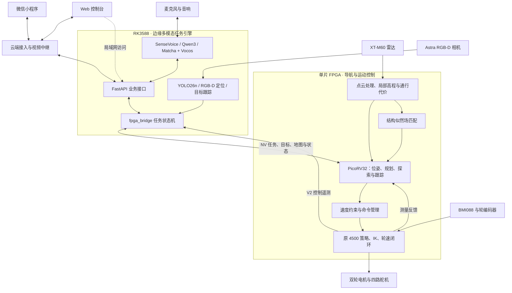

# 云拓轮腿机器人总体设计方案

云拓面向室内巡检、目标寻找、人员跟随与自然语言交互，采用 FPGA 与 RK3588 协同的计算架构。FPGA 承担雷达感知、地图维护、定位、路径规划、避障和轮腿运动控制；RK3588 运行视觉、语音和语言模型，完成任务理解、目标定位与任务编排。Web 控制台和微信小程序提供地图、视频、任务和设备状态的统一交互入口。

## 1. 系统目标与功能

机器人采用两轮自平衡轮腿构型，通过双轮驱动和四路腿部舵机实现移动与姿态调节。系统围绕“理解任务、感知环境、规划运动、控制执行、反馈状态”组织功能。

| 功能 | 处理方式 |
|---|---|
| 定点导航与返航 | RK 将航点或起点转换为导航目标，FPGA 完成定位、路径规划、局部避障与运动执行 |
| 多点巡检 | RK 管理巡检点序列与停留逻辑，FPGA 逐段执行导航 |
| 目标寻找 | 按类别和颜色筛选视觉目标，通过探索扩大观察范围，发现后转入接近与跟踪 |
| 人员跟随 | RK 持续更新人员目标位置，FPGA 根据目标与周围地形调整运动 |
| 地形导航 | 根据局部高程、坡度、高差、粗糙度与落差计算通行代价，约束路径和速度 |
| 自然语言交互 | 语音转写或文字输入经规则与语言模型解析，形成任务参数和回复 |
| 远程操作与展示 | Web 和小程序提供地图、视频、任务操作、遥测及事件查看 |

## 2. 总体架构

系统分为交互层、任务层、导航层和运动控制层。任务和目标向下传递，测量、执行状态与故障信息向上反馈。



### 2.1 计算分工

| 平台 | 主要输入 | 主要输出 | 职责 |
|---|---|---|---|
| FPGA 导航 | 雷达点云、运动反馈、地图、任务目标 | 车体速度目标、位姿、导航状态 | 环境几何处理、定位、规划、避障、探索与跟踪 |
| FPGA 控制 | 运动目标、姿态、轮速与历史观测 | 轮电机与舵机驱动、控制遥测 | 强化学习策略推理、平衡与执行器闭环 |
| RK3588 | 图像、深度、语音、用户任务与 FPGA 状态 | 结构化任务、视觉目标、交互回复 | 本地模型推理、任务编排和业务服务 |
| 云端 | 终端请求、RK 状态与媒体流 | 业务转发、状态推送与视频播放入口 | 公网接入、鉴权和视频中继 |
| Web / 小程序 | 用户操作与后端数据 | 任务请求、确认和停止请求 | 人机交互与可视化 |

导航的连续速度由 FPGA 产生；RK 下发目标、任务模式和视觉信息。强化学习控制在 FPGA 本地运行，闭环计算由片内完成。云端承担远程访问和媒体分发。

### 2.2 硬件组成

| 部分 | 选型 | 用途 |
|---|---|---|
| FPGA 平台 | ACX750，高云 GW5AT-LV138 | 导航硬件、软核固件、策略推理及外设控制 |
| 边缘计算平台 | RK3588 Linux | RKNN / RKLLM 模型推理、音频、视觉与业务服务 |
| 地形传感器 | XT-M60 Pro 固态 Flash 雷达 | 环境点云、地形地图与结构匹配 |
| 视觉传感器 | Astra Pro Plus RGB-D 相机 | 目标类别、颜色、三维位置与视频 |
| 惯性传感器 | BMI088 | 加速度、角速度与姿态融合 |
| 运动反馈 | 520 减速电机 AB 编码器 | 轮速闭环与里程计估计 |
| 执行器 | 双轮电机、四路舵机 | 平衡、移动、转向与腿部调节 |
| 音频设备 | 麦克风、USB 音响 | 语音输入与播报 |

机器人名义几何来自 URDF / CAD，控制换算与传感器安装参数分别管理。轮距、轮半径、固定腿姿包络、雷达和相机外参的取值及来源见[平台参数](4_design/platform.md)。

## 3. FPGA 自主导航

导航采用 RTL 与 PicoRV32 软核协同设计。重复且规则的数据运算由 RTL 并行处理，任务管理、路径搜索及状态决策由软核固件完成。

### 3.1 感知与地图

```text
雷达收包 → 深度转点云 → 姿态与外参变换 → 过滤与栅格化
                                              ├→ 滚动高程图 → 地形代价 → 包络膨胀
                                              └→ 结构点提取 → SLF 匹配 → 位姿修正
```

XT-M60 提供沿视线的径向深度。系统读取帧尾内参，通过方向查找表生成点云，再依据雷达外参与测量时刻的姿态转换坐标。软核中的 TCP 客户端负责雷达启动，深度数据通过 UDP 接收。

局部高程图采用 128 × 128 栅格、50 mm 分辨率，覆盖 6.4 m × 6.4 m。窗口随机器人移动，保留观测历史并清理过期数据。地形分析从高程变化中提取坡度、高差、粗糙度和落差，生成通行代价；随后根据机体包络膨胀障碍区，为局部轨迹碰撞检查提供输入。

| 代价类型 | 含义 |
|---|---|
| 0–200 | 可通行代价，数值越大表示通行代价越高 |
| 253 | 障碍膨胀区 |
| 254 | 不可通行 |
| 255 | 未知区域 |

原始地形代价描述环境危险，膨胀代价描述机体通过所需的空间。对窄沟、遮挡和小于栅格宽度的地形，判断质量受采样覆盖与地图分辨率影响；相关分析见[局部地图地形可行性报告](4_design/local_map_terrain_feasibility_report_20261021.md)。

### 3.2 定位与地图模式

定位以轮里程计和 IMU 提供运动预测，以结构似然场（SLF）对雷达结构点进行匹配打分。软核结合匹配结果和定位质量维护机器人位姿。

| 模式 | 定位依据 | 全局引导 |
|---|---|---|
| 无先验地图 | 运动反馈与局部结构匹配 | 在线累积的记忆栅格、A* 路径与边界探索 |
| 先验地图 | 先验 SLF、初始位姿与雷达匹配 | 先验代价图结合当前观测，提供规划及重定位管理 |

先验地图通过主机工具生成 `.nvmp` 文件，经 RK 下发到 FPGA。地图包包含空间几何、定位场和通行代价等信息，加载后由定位管理模块完成初始对准与质量判断。

### 3.3 路径规划、避障与探索

全局规划在先验地图或记忆栅格上运行 A*，生成到目标的路径引导。局部规划采样候选速度与轨迹，综合地形代价、机器人足迹、目标方向和运动约束进行评分；RTL 轨迹评估模块加速候选检查。

探索模块根据已知区域与未知区域的边界选择观察位置。找物任务将探索与视觉目标结合，目标出现后转入接近和跟踪；人员跟随持续使用 RK 更新的目标位置。目标超过有效时间后进入丢失处理，由任务模式决定后续搜索或停止行为。

导航输出经过速度限幅、变化率约束、超时和停止逻辑，再交给运动控制。到达判断在任务层结合目标距离、定位状态与新鲜运动反馈进行复核。

### 3.4 片上工程配置

| 项目 | 配置 |
|---|---|
| 软核 | PicoRV32 |
| 程序与数据 RAM | 136 KiB（PNR99/100：128KiB主体＋8KiB尾区） |
| 局部高程图 / SLF | 128 × 128 |
| 主逻辑 / 雷达接收时钟 | 50 MHz / 100 MHz |
| 主机通信 | 导航串口与独立控制遥测串口 |
| 运动策略 | 原 4500，125 Hz |

当前交付PNR100实际占用322/340块BSRAM、178个DSP，主逻辑50MHz、雷达100MHz、相机50MHz、LCD8.967MHz的已约束setup/hold均为0。原4500及地图容量保持，CPU增加8KiB用于当前清障应用。Flash默认应用与RK热加载应用分别管理；发布、实测及继承的外部IO签核边界见[阶段交接](3_guide/project_handover_20261104.md)，历史PNR63与资源优化记录保留作版本对照。

## 4. FPGA 轮腿运动控制

运动控制复用原 4500 策略，将导航给出的前进速度、偏航角速度与高度目标转换为六路动作。控制侧统一采集 BMI088 和编码器，完成策略观测、姿态融合、轮速闭环与驱动输出。

### 4.1 策略推理

| 项目 | 设计 |
|---|---|
| 推理周期 | 8 ms，125 Hz |
| 当前观测 | 28 维，包含角速度、重力方向、运动目标、轮关节速度和历史动作等 |
| 历史观测 | 5 帧，共 140 维，按旧到新排列并包含当前帧 |
| 历史编码器 | 140 → 128 → 64 → 3 |
| 动作网络 | 31 → 128 → 64 → 32 → 6 |
| 权重 | 40,704 个 16 位权重 |
| 模型输入、激活与输出 | 24 位有符号 Q12 |
| 动作顺序 | 左髋、左膝、左轮、右髋、右膝、右轮 |

定点推理、ROM 排布与流水结构服务于 FPGA 部署。模型来源、观测缩放和导出格式见[控制模型说明](../control/model/README.md)。

### 4.2 执行器链路

四路腿部动作叠加到高度逆运动学给出的基础角度，再按舵机零位、方向和机械限位转换为 PWM。左右轮动作转换为轮目标速度，经编码器速度闭环产生电机方向和 PWM。

车体目标描述期望的前进和转向；策略输出描述实现目标及维持平衡所需的轮腿动作。零车体目标下，控制器仍通过轮腿纠偏维持平衡。编码器轮速经单位、符号和参考点适配后用于导航运动估计。

### 4.3 命令管理与停止

| 机制 | 作用 |
|---|---|
| NAV SAFE | 约束导航输出速度与变化率，处理导航停止和看门狗 |
| 命令租约 | 管理命令所有者、有效时间与重新授权 |
| 红外接管 | 方向键覆盖前进与转向目标，释放后按超时规则交还导航 |
| 运行停止 | 撤销导航运动目标并保留平衡，任务层等待反馈确认 |
| IR5 / 控制锁停 | 进入轮输出锁停路径 |
| hold 诊断镜像 | 提供独立的恒零输出诊断环境 |

PNR63 命令授权使用每 100 个新反馈组成的采样块：有符号平均前进速度绝对值不超过 50 mm/s、平均角速度绝对值不超过 100 mrad/s，并要求块内反馈新鲜、租约输出为零，随后接受零命令握手。该判据用于控制权恢复；任务停稳采用双轮速度、角速度和持续时间分别判断。

命令租约、反馈新鲜度和固件主机活性的名义期限分别为 200 ms、50 ms 和 250 ms，分别作用于控制命令、测量有效性与主机通信。

### 4.4 手动驾驶的超声波保护

保护默认关闭，遥控0键切换，LED7/N17指示。SG90固定1500µs朝前，不扫描；仅遥控前进在600→250mm范围连续减速，近障时由原4500继续平衡并做停车轮速保持。导航目标完整旁路此模块。IR5控制锁停与网页运行停止分别保留，不能混作同一个关轮动作。引脚和实际数值见[交接说明](3_guide/project_handover_20261104.md)。

## 5. RK3588 边缘多模态任务引擎

“云拓·RK3588 边缘多模态任务引擎”由视觉、语音、语言理解和任务服务组成。各服务通过结构化结果协作：视觉输出目标，语音输出文本，语言理解输出意图，任务状态机协调执行。

### 5.1 模型与计算资源

| 能力 | 模型 / 方法 | 运行方式 | 输出 |
|---|---|---|---|
| 目标检测 | YOLO26n INT8 | RKNN，NPU | 类别、置信度与检测框 |
| 目标定位 | 颜色判断、RGB-D 深度关联与跟踪 | CPU 后处理 | 目标 ID、属性与三维位置 |
| 车载语音识别 | SenseVoice INT8 | sherpa-onnx，CPU | 识别文本 |
| 语言理解 | Qwen3-1.7B W8A8 | RKLLM 1.3.1，NPU | 任务意图、参数或文字回复 |
| 语音合成 | Matcha 中文 / 英文模型 + Vocos | sherpa-onnx，CPU | 播放音频 |
| 视频编码 | Rockchip MPP | 硬件编码器 | H.264 视频流 |

Qwen 服务接收文本与结构化业务上下文；图像由视觉服务处理。任务系统将模型结果与导航状态组合，为自然语言操作、目标寻找和跟随提供输入。

Qwen 与 YOLO 共享 NPU。感知服务可根据任务活跃程度调整检测频率，语音与业务接口在独立服务中运行。当前语言服务使用 1K token 初始化上下文，模型文件支持 16K；具体部署参数见[RK 服务说明](https://github.com/LRaina215/QHXD_Web/blob/yuntuo-fpga/docs/YUNTUO.md)。

### 5.2 语言到任务

语言处理流程为：

1. 从文字输入或语音识别获得文本。
2. 优先匹配常用指令规则，复杂表达交给 Qwen 解析。
3. 检查任务类别、目标属性、航点和必填参数。
4. 对运动类语音意图展示确认信息。
5. 将确认后的任务交给状态机执行，并根据执行状态生成回复。

任务系统支持水瓶、杯子、人员、球、椅子和背包六类视觉目标。类别与颜色筛选由业务配置统一管理。

### 5.3 视觉到导航目标

Astra 彩色图像进入 YOLO 检测链，深度图提供空间测量。视觉服务对检测结果进行类别与颜色筛选、目标关联和跟踪，再将相机坐标系中的三维位置转换到机身坐标系，生成 TARGET 报文。

本地显示使用OV5640→FPGA→4.3英寸480×272 LCD，不接RK，也不由Astra代替。160×120 RGB565双缓冲使用38块BSRAM，已在PNR66显示验收并继承到PNR100，保留完整取景与颜色及HUD。早期800×480显示方案保留历史；实现与验收范围见[显示改版记录](4_design/g2_camera_compaction_plan_20261030.md)。

桥接限制目标更新频率为最多 12 Hz，并丢弃延时超过 400 ms 的视觉帧。目标报文保留类别、置信度、位置、目标 ID 和延时信息。导航侧使用平面目标位置驱动接近和跟踪。

### 5.4 任务状态与反馈

FastAPI 后端管理任务请求、预检、确认、事件和 SQLite 持久化；`fpga_bridge` 管理 FPGA 链路、导航任务状态与视觉目标更新。

任务完成前复核目标身份、估计距离、新鲜控制反馈与连续停止条件。暂停、取消和停止分别显示请求、执行和反馈确认阶段。RK提供双轮速度不超过5mm/s、角速度不超过20mrad/s、持续500ms且反馈健康新鲜的停稳条件；是否把轮速静止作为到达门槛由当前YUNTUO_ARRIVE_NEED_WHEEL_STOP配置选择。真实稳定站立仍需物理证据，不能把配置关闭或导航指令归零当作已经停稳。

重复 STATUS 不刷新在线年龄；重连或复位后保持任务状态隔离，恢复操作由显式请求触发。

## 6. 通信与数据约定

### 6.1 数据链路

| 链路 | 内容 | 配置 |
|---|---|---|
| XT-M60 → FPGA | 深度数据与设备控制 | 板载 RJ45，UDP 数据与 TCP 启动 |
| RK ↔ FPGA 导航 | NV 任务、视觉目标、地图、STATUS / MAP_ACK | 板载 CH 串口，921600 8N1 |
| FPGA 控制 → RK | 原 V2 控制遥测 | P11-40 / A16，3.3 V TTL，230400 8N1，126 字节 / 帧 |
| Web / 小程序 ↔ 业务服务 | 查询、任务、状态和语音 | REST、WebSocket；公网使用 HTTPS / WSS |
| RK → 云端 → 客户端 | 车载视频 | MediaMTX；WebRTC / HLS 播放 |

当前双串口配置由 `fpga_bridge` 统一管理，P11-39 外部速度输入关闭。串口设备路径按实际枚举配置。

SFP1 作为独立千兆扩展工程，采用 P6 / U11、Q0 Lane2、1000BASE-X 与自协商配置；其 NV 应用接入及工程配置单独维护，见[SFP 工程](../integration/sfp/README.md)。

### 6.2 主要报文

| 方向 | 报文 | 用途 |
|---|---|---|
| RK → FPGA | GOAL / WAYPOINTS | 定点目标与路径点 |
| RK → FPGA | MODE | 空闲、探索、跟踪和停止相关模式 |
| RK → FPGA | TARGET | 视觉目标及空间位置 |
| RK → FPGA | SET_POSE | 初始位姿 |
| RK → FPGA | MAP_BEGIN / MAP_DATA / MAP_END | 先验地图分块下发 |
| FPGA → RK | STATUS | 导航模式、状态、位姿与导航指令 |
| FPGA → RK | MAP_ACK | 地图接收进度与加载结果 |
| FPGA → RK | 控制 V2 遥测 | 姿态、轮速、动作、策略与故障信息 |

地图发送采用逐块 ACK、有界重试和最终 READY 确认。当前 NV v1 的通用启动身份、命令序号与 ACK 扩展，以及 FPGA 完整路径和实时局部地图上送，列入[接口设计](2_interface/icd.md)的扩展项。STATUS 中的速度字段表示导航指令，运动测量来自控制遥测。

### 6.3 坐标、单位与时序

导航采用 X 前、Y 左、Z 上；控制内部采用 X 右、Y 前、Z 上。控制向量到导航系的转换为 `(y_ctrl, -x_ctrl, z_ctrl)`，策略内部保持训练坐标与观测缩放。

对外位置以 mm、线速度以 mm/s、角速度以 mrad/s 表示；策略侧使用 Q12。FPGA 微秒计数按 32 位回绕处理，控制毫秒时间通过适配层统一单位。

数据同时保留来源、采样时间、接收年龄与有效性。地图坐标、机身目标、相机测量和控制内部量在接口处进行明确转换，相关字段见 [ICD](2_interface/icd.md)。

## 7. Web、微信小程序与云端服务

### 7.1 Web 控制台

Web 采用 Vue 3、TypeScript 与 Vite，包含当前任务、地图、视频、任务操作、语音交互、FPGA 遥测、视觉目标与事件等区域。

场地视图展示先验地图、机器人位姿、航点、目标与历史轨迹。地图文件可通过浏览器上传，经后端校验后交给 bridge 下发；进度来自 MAP_ACK，最终 READY 对应加载完成。独立预览模式用于查看地图内容，页面标注“预览 · 未下发 FPGA”。

视频以 WebRTC / WHEP 为主，HLS 和检测图片作为回退。地图使用说明见[地图上传](https://github.com/LRaina215/QHXD_Web/blob/yuntuo-fpga/docs/MAP_UPLOAD_20261027.md)。

### 7.2 微信小程序

| 页面 | 内容 |
|---|---|
| 总览 | 当前任务、地图、HLS 视频、视觉目标、FPGA 状态和事件 |
| 任务 | 目标类别与颜色选择，找物、跟随、定点与巡检 |
| 助手 | 文字输入、按住说话、回复与运动意图确认 |
| 我的 | 连接地址、访问令牌、诊断、告警与模式配置 |

手机语音通过 WechatSI 转为文字后发送到 RK；车载麦克风走 RK 本地 SenseVoice 服务。小程序经网关换取限时 HLS 播放地址，播放器在切页或切换连接后释放资源。任务与导航状态使用 WebSocket 推送，REST 查询补充更新。

### 7.3 云端与媒体

Nginx 提供网站与 HTTPS 接入，Cloud Gateway 转发受鉴权的业务请求，MediaMTX 接收和分发车载视频。RK 从相机采集画面，经 MPP 编码后向 `robot/front` 发布一路视频，Web 与小程序分别建立播放连接。

业务服务也支持现场局域网访问。模型推理在 RK 本地完成，公网交互、微信语音识别与云端视频使用各自的网络服务。

## 8. 典型任务流程

### 8.1 寻找红色水瓶

1. 用户通过 Web、小程序或车载语音输入目标。
2. 语言服务解析类别“水瓶”和颜色“红色”，任务服务展示确认。
3. RK 视觉服务筛选匹配目标；目标未出现时，任务桥接协调 FPGA 探索。
4. 目标出现后，RK 持续下发机身系目标位置。
5. FPGA 根据地形、路径和目标更新速度，控制策略执行轮腿动作。
6. 任务层根据目标、位置与停止反馈更新完成状态，界面和语音同步提示。

### 8.2 定点与巡检

用户选择航点或巡检路线，RK 管理点序列与停留逻辑，FPGA 逐段执行定位、规划和避障。返回起点由同一目标导航链路处理。状态与事件持续返回客户端。

### 8.3 暂停与停止

暂停或停止请求撤销当前导航运动目标，平衡控制继续工作。任务状态先进入等待反馈阶段，满足停止判据后再更新确认状态；继续任务通过显式操作恢复。控制锁停与诊断镜像按独立流程管理。

## 9. 工程组织与验证体系

| 仓库 / 目录 | 内容 |
|---|---|
| [Yuntuo](https://github.com/LRaina215/Yuntuo/tree/main) | 项目介绍、组件入口与文档导航 |
| [SOC_FPGA_NAV](https://github.com/LRaina215/SOC_FPGA_NAV/tree/main) | 导航 RTL、软核固件、地图工具与仿真 |
| `control/` | 原 4500 模型、控制工程与外设驱动 |
| `integration/` | 导航控制联合工程、反馈适配与板级诊断 |
| [QHXD_Web](https://github.com/LRaina215/QHXD_Web/tree/yuntuo-fpga) | RK 服务、Web、网关与视频 |
| [QHXD_Miniprogram](https://github.com/LRaina215/QHXD_Miniprogram/tree/yuntuo) | 微信小程序 |

验证按模块数值、协议、任务状态机、导航闭环、真实接触动力学与板级系统分层组织。导航仿真提供场景、虚拟雷达、感知模型与固件执行环境；原 4500 动力学仿真覆盖坡道、台阶和沟槽，输出轨迹、接触信息和视频；板级测试检查通信、测量、资源、时序与执行行为。

设计、操作和测试记录分别维护在以下文档：

- [接口定义](2_interface/icd.md)、[引脚分配](2_interface/pinout.md)：协议与硬件连接。
- [平台参数](4_design/platform.md)、[RK3588 对接设计](5_teams/rk3588_design.md)、[底盘集成设计](5_teams/chassis_integration.md)：模块设计与参数。
- [落地调试与建图指南](3_guide/ground_debug_and_mapping_20261027.md)：操作流程。
- [整车总计划](1_plan/system_integration_plan_20261021.md)：开发进度与后续工作。
- [PNR63 实现与落地报告](4_design/g2_PNR63_review_20261028.md)、[地形可行性分析](4_design/local_map_terrain_feasibility_report_20261021.md)：专项结果。
