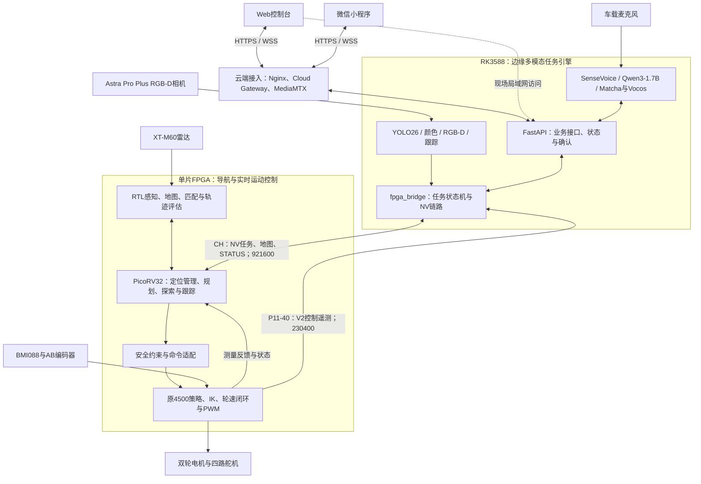
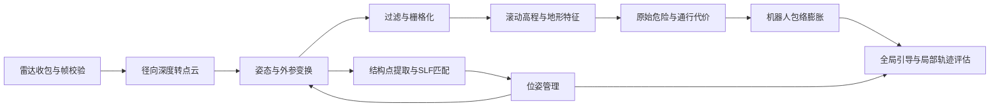
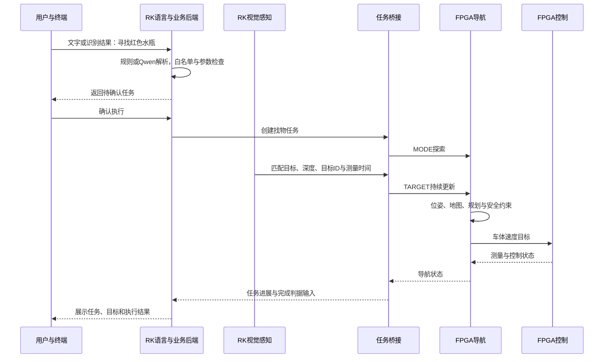

# 云拓：FPGA与RK3588边缘协同的多模态轮腿机器人总体设计

版本：2026-10-27。核对范围：导航与原4500共同工程、RK3588服务、Web、云网关及微信小程序。

本文依据本地源码、专项机器证据和相关执行会话整理。最近选择的联合候选为PNR61 / SYN49，采用SLF128与双串口，已布通且所报告内部50/100MHz时序通过；完整整车验收仍未完成。2026-10-27 22:01（北京时间）只读公网复核为网关/RK在线、real模式，导航及控制遥测offline；最近实板收尾记录为hold F322，本次没有重新读取或下载FPGA。在线应用、已实现架构和实车运行状态分别说明。

用户此前确认的小程序真机基础验收保留；10月25—26日新增连续视频及缓冲恢复没有取得新版手机完整验收或新包发布记录。当前仍按用户选择采用已有URDF/CAD、控制基线、已确认安装信息和现行RK配置，不把未做的现场几何/视觉标定写成已完成。

本文介绍项目的系统构成、设计取舍、模型部署、导航控制、通信接口和用户交互，是总体设计入口。它依据当前导航、控制、Web和小程序源码及已有验证记录整理，不安排开发任务、优先级或时间表。当前进度与验收结果仍由[整车总计划](1_plan/system_integration_plan_20261021.md)维护；外部接口字段以[ICD](2_interface/icd.md)为准。

## 1. 项目定位

云拓是一套面向室内目标寻找、人员跟随、定点移动和巡检的多模态轮腿机器人系统。机器人采用两轮自平衡轮腿机构，以FPGA承担雷达处理、地图维护、定位、路径规划、安全约束和强化学习运动控制，以RK3588承担视觉感知、离线语音、语言理解与任务编排，并通过Web控制台和微信小程序提供统一的人机交互。

系统的核心是三种计算职责的协作：

- **FPGA实时执行平台**：并行处理传感器数据，在片上软核与RTL之间划分导航计算，并运行原4500策略及轮电机、舵机控制。
- **RK3588边缘多模态任务引擎**：在机器人本地协调视觉、语音和语言模型，将用户意图转换成有约束的任务和视觉目标。
- **Web与微信小程序交互平台**：以相同的后端契约展示机器人状态、地图、任务和视觉信息，提供任务下发、语音交互及停止入口。

“复杂地形”描述系统的研究与应用范围，包括坡道、台阶和沟槽的感知、通行判断及运动响应。实际可通行范围由传感器可见性、地图表达、控制能力和接触条件共同决定；本文不将仿真工况直接写成已经实现的实车越障指标。

### 1.1 功能组织

| 功能 | 系统处理方式 |
|---|---|
| 指定位置导航与返航 | RK将航点或起点转换为导航目标；FPGA完成定位、规划、避障和底盘执行 |
| 多点巡检 | RK维护巡检任务与各点停留逻辑；FPGA逐段执行导航 |
| 寻找指定目标 | 用户指定类别和颜色；RK视觉筛选目标、估计三维位置；FPGA探索、接近并跟踪目标 |
| 跟随人员 | RK持续输出匹配人员的视觉目标；FPGA根据目标与局部环境更新运动 |
| 自然语言交互 | 语音转文字，经规则或语言模型解析，再通过参数检查与确认流程进入任务系统 |
| 地形导航 | FPGA维护局部高程和通行代价，结合机器人包络约束局部路径及速度 |
| 运行展示与诊断 | Web和小程序展示任务、定位、链路、视觉、控制遥测与事件，区分模拟、真实和过期数据 |

这些功能已经有相应代码或专项记录，但“功能存在”不等于“完整整车链路已验收”。第12节集中说明本版的实现边界。

## 2. 总体架构与职责划分

系统采用“交互—任务—导航—控制”的分层结构。用户表达目标，RK编排任务，FPGA决定自主运动并完成实时执行。状态、测量和故障沿反方向返回。



图中表示系统的完整设计关系。FPGA内的共同顶层、SFP物理链路以及反馈闭环仍有联合验收边界，见第12节。

### 2.1 计算与控制边界

| 层级 | 输入 | 输出 | 主要职责 |
|---|---|---|---|
| Web / 小程序 | 用户操作、文字和语音，后端推送 | 有语义的任务请求、确认或停止请求 | 交互、展示和操作反馈 |
| 云端接入 | HTTPS、WSS、视频发布 | 发往RK的受限请求、终端状态和媒体流 | 公网访问、鉴权、转发与视频中继 |
| RK3588 | 语音、图像、深度、用户任务和FPGA状态 | GOAL、MODE、TARGET等NV报文 | 边缘推理、目标筛选和任务编排 |
| FPGA导航 | 雷达、位姿相关测量、任务和地图 | 安全约束后的车体速度目标 | 地图、定位、规划、避障和导航状态 |
| FPGA运动控制 | 车体目标、姿态、轮速和历史动作 | 左右轮目标与驱动、四路舵机PWM | 平衡、动作生成和执行器闭环 |

自主模式下，RK下发任务和目标，连续车体速度由FPGA导航产生。现有控制UART中的直接速度命令保留为底盘调试入口，与自主导航的任务协议分开。用户界面的并发访问也不等于多个进程可以同时占用FPGA链路：RK上由`fpga_bridge`集中管理该链路。

FPGA导航在本片计算，不依赖RK逐周期规划或云端推理；云端主要用于远程交互。当前PNR61主机活性采用名义250ms超时锁存，RK失联后不能靠后来一个心跳自动解锁或续跑；视觉TARGET约1.5s丢失后的搜索行为另管。互联网断开与RK桥接/主机串口失联也不同，不把两者混为平衡控制的计算依赖。

## 3. 硬件平台与传感器

| 部分 | 当前选型或实现 | 系统用途 |
|---|---|---|
| 轮腿机构 | 两轮自平衡轮腿构型，四路舵机与两路轮驱动 | 支撑姿态调节、平衡与移动 |
| FPGA | ACX750系列高云GW5AT-LV138平台，器件资源上限340块BSRAM | 导航硬件、软核固件、策略推理和外设控制 |
| 边缘平台 | RK3588 Linux平台 | RKNN / RKLLM推理、音频、视觉、任务与应用后端 |
| 几何传感器 | XT-M60 Pro固态Flash雷达，当前数据处理按160×60深度组织 | FPGA局部地形感知与结构匹配 |
| 视觉传感器 | Astra Pro Plus RGB-D相机 | RK目标识别、颜色判断、深度关联与三维定位 |
| 惯性传感器 | BMI088，复用控制侧I²C采集与融合 | 控制姿态、角速度及导航反馈适配 |
| 轮速传感器 | 520减速电机AB编码器 | 左右轮速度闭环与运动测量 |
| 音频输入 / 输出 | 车载麦克风、浏览器/手机麦克风；Matcha/Vocos与USB音响 | 本地合成、串行播放和USB音响已有交付记录；各录音入口与识别准确率分别验收 |
| 本地显示 | 控制侧OLED源码；整车主要可视化由Web和小程序承担 | 显示控制诊断与系统状态；FPGA摄像头 / HDMI链路没有当前联合验收依据 |
| FPGA雷达接口 | 板载RJ45，现有百兆RGMII收发链路 | 雷达启动控制与深度数据接收 |
| FPGA主机接口 | 当前PNR61使用板载CH导航串口与P11-40独立遥测；SFP1为已独立验证的扩展路径 | 双串口承担当前任务/测量；SFP不包含在PNR61资源和时钟统计中 |

轮半径、轮距、质量、质心、雷达高度、相机安装及最大扫掠包络会直接影响定位与通行判定。项目将训练模型、旧CAD和实车标定分别记录在[平台参数](4_design/platform.md)中。当前控制换算采用32.5mm轮半径、1320 count/轮圈；这些源码参数仍须与受载实车标定对应。

独立SFP已在P6/U11、Q0 Lane2、1000BASE-X/自协商开启的配置下与RK eth2建立1000Mb/s全双工链路，五种长度共100/100包原样回显，接收错误/丢弃/掉链计数为0。该结论属于所测模块和独立诊断镜像，不是当前联合镜像的NV应用验收；旧Lane0配置接到了另一物理资源，不能沿用其结果。见[SFP修正与实测](4_design/sfp_mapping_correction_20261024.md)。

## 4. RK3588边缘多模态任务引擎

本文将RK上的感知、语音、语义解析与任务编排统称为**“云拓·RK3588边缘多模态任务引擎”**。这一名称对应多个本地模型和服务的协作，不表示已经训练出一个统一的新模型，也不表示新增了一个已经交付的单一软件封装包。

### 4.1 模型部署与计算分工

| 能力 | 当前模型 / 方法 | 部署方式与计算资源 | 输出 |
|---|---|---|---|
| 车载语音识别 | SenseVoice int8 | sherpa-onnx，RK的CPU本地推理 | 识别文本 |
| 语言理解 | Qwen3-1.7B，W8A8；Qwen2.5-1.5B作为回退 | RKLLM 1.3.1，NPU；模型文件支持16K，当前初始化仅1K token | 受限意图JSON或文字回复；关闭思考输出并过滤思考段 |
| 目标检测 | YOLO26n INT8 | RKNN，RK的NPU | 目标类别、置信度和图像框 |
| 目标属性与空间位置 | 颜色判定、深度关联、坐标变换、目标跟踪 | CPU后处理与RGB-D几何计算 | 目标ID、属性、三维位置和时间信息 |
| 语音合成 | Matcha中文 / 英文模型＋Vocos声码器 | sherpa-onnx，RK的CPU本地推理 | 可供播放的音频 |
| 任务编排 | 规则、白名单、参数校验、确认流程和任务状态机 | FastAPI与`fpga_bridge` | 导航任务与执行反馈 |

当前业务白名单包含水瓶、杯子、人员、球、椅子和背包六类目标。模型可识别范围与任务系统允许接受的范围分别管理；语言模型不能通过自由生成扩大执行权限。

当前Qwen仅接收文本提示，图像经独立视觉链路处理；“有没有某物”等问题可路由至当前检测结果，而非把像素输入Qwen。因此，本架构属于**多模型协同的多模态系统**。它尚未部署直接联合读取图像与文本的VLM，也不属于直接从图像和语言生成底层动作的VLA策略。

### 4.2 语言到任务

语言入口依次完成：文字获取、常用指令规则匹配、必要时调用Qwen、任务类别与参数检查、确认、执行与反馈。

常用说法优先由规则解析，以减少时延和不确定性；复杂表达再由语言模型生成结构化候选。任务候选还需通过类别、颜色、航点、置信度和必填参数检查。无法支持或参数不清楚的表达应得到明确解释或澄清提示。

运动类语音指令在确认后进入任务执行。任务状态、失败原因和完成回复由校验后的业务状态生成，使模型的自然语言回复与实际执行结果保持对应。

### 4.3 视觉到目标

```text
Astra彩色图像 ─→ YOLO检测 ─→ 类别 / 颜色筛选 ─→ 目标关联与跟踪
                         ↑                          │
Astra深度图 ─→ 彩深配准与深度关联 ──────────────────┘
                                                    ↓
                          相机系三维位置 → 机身系变换 → TARGET
```

RK负责从候选目标中选择符合当前任务的对象，维持目标ID，并按当前视觉帧更新TARGET。桥接当前限制目标更新频率不超过12Hz，丢弃延时超过400ms的视觉帧，避免积压旧目标。

三维目标来自RGB-D测量，目标类别来自检测，颜色来自独立属性判断。目标位置进入FPGA前，必须按相机安装外参变换到约定机身坐标。出厂彩深标定、安装配置和整车实测精度是不同环节，配置存在不能代替标定通过。

### 4.4 边缘运行与资源调度

语音识别、语言模型和语音合成具备本地离线运行路径；视觉也在RK本地推理。Qwen与YOLO共享NPU，空闲时感知可降至5fps，任务活动时按配置提高感知频率。视频编码使用Rockchip MPP硬件通路，与模型推理分工。

[RK部署记录](https://github.com/LRaina215/QHXD_Web/blob/yuntuo-fpga/docs/YUNTUO.md)中的当前Qwen3测量为加载约4秒、内存约2.4GB、意图JSON约2—3秒、部分状态问答约5—9秒；SenseVoice单句约0.15—0.2秒，TTS单句合成约0.5—0.7秒。数字归对应输入与并发条件，不与早期1.5B测量混用，也不作为所有请求的时延保证。USB音响按设备名寻址，播放串行化以避免上一句尚未播完即被下一句覆盖。

## 5. FPGA导航子系统

导航在同一FPGA内采用RTL加速与PicoRV32软核协作。RTL承担规则明确、数据量较大和适合流水处理的工作；软核承担任务状态、搜索和规划管理，固件采用定点计算。

### 5.1 感知与局部地图



雷达深度表示沿视线的径向距离。系统利用帧尾内参与方向查找表生成点云，再按传感器外参与测量时刻的姿态变换。有效帧、无效深度和数据中断分别处理；雷达启动由FPGA软核中的最小TCP客户端管理，深度主体走UDP接收通路。

当前局部地图采用128×128栅格、默认50mm分辨率，覆盖6.4m×6.4m窗口。地图随机器人移动维护地形证据和历史，不把单次未观察到的位置直接视为平地。通行代价包括可通行代价、膨胀区、不可通行和未知类别；其编码和参数以ICD及配置为准。

地图设计区分两种含义：**原始地形是否存在危险**，以及**考虑机器人包络后某位置是否适合机体通过**。膨胀用于约束机体碰撞包络，不能补回原始地图漏掉的沟槽或落差。

真实接触仿真已发现窄沟可能被同一50mm格中的对岸点错误表达为有支撑地面。子格覆盖、置信度和历史维护的实验用于分析这一问题，尚不能写成当前主线已经解决负空间漏判。详见[局部地图地形可行性报告](4_design/local_map_terrain_feasibility_report_20261021.md)。

### 5.2 定位与地图模式

| 模式 | 定位依据 | 全局引导与环境使用 |
|---|---|---|
| 无先验图 | 运动反馈与IMU积分，结合局部结构似然场SLF匹配约束漂移 | 累积记忆栅格、A*引导和边界探索 |
| 有先验图 | 下发先验地图与初始位姿，SLF对准、匹配与定位质量管理 | 先验代价与当前观测共同参与规划，支持丢失后的重定位管理 |

先验地图可由量测或外部扫图得到，经工具生成`.nvmp`包后下发。这里的有图模式以定位和使用先验地图为核心，不等同于在FPGA上运行完整SLAM后端。

SLF使用环境中的结构点与结构似然场进行候选位姿打分。软核结合匹配结果、里程计和定位质量管理位姿。轮编码器、IMU和雷达的时间及坐标必须对齐；姿态融合提供的重力方向不能单独给出绝对航向。

### 5.3 规划、探索与目标跟踪

软核在全局或记忆栅格上进行A*规划，为局部运动提供路径引导；局部规划采样候选速度与轨迹，结合通行代价、机器人足迹、目标方向和运动约束进行评价。轨迹评估有RTL加速模块，固件通过HAL访问。

探索通过已知可通行区域与未知区域的边界选择新的观察位置。找物和跟随由导航任务状态与视觉TARGET共同驱动；暂时丢失目标时，系统按既定超时和模式规则处理，不能把旧位置无限当作新目标。

到达判定涉及定位误差、目标距离、实际速度及停稳观察。下发零目标或固件进入“到达”状态，都不能单独证明机器人已经在真实终点停稳。

RK任务层在完成前复核本任务目标、估计距离、新鲜控制反馈与连续停止证据；暂停、取消及跟随超时区分“已请求停止”“等待核验”“反馈满足停稳条件”。重复STATUS不刷新在线年龄，重连/复位不自动恢复旧任务。10月25日的32项隔离回放已通过，相关逻辑已随10月27日真双串口桥接部署，并实际保留架空空转时的“等待停稳”，没有冒报已停车。现有轮速/净计数精度和缺少boot/session的身份限制仍保留，不能当作整车物理停止或真实定位精度验收。详见[任务层修复与回放](4_design/rk_task_layer_replay_20261025.md)及[RK真链路记录](https://github.com/LRaina215/QHXD_Web/blob/yuntuo-fpga/docs/REAL_FPGA_INTEGRATION_20261027.md)。

### 5.4 片上实现与资源组织

导航软核使用128KiB片上程序与数据RAM，地图、结构似然场、点缓冲、网络缓存与策略ROM也消耗同片资源。联合资源按完整顶层实际保留的数据通路核算，不能直接把两个独立工程的资源相加，也不能仅由综合估计判断最终能否放入器件。

当前选择的共同实现为SYN49→PNR61：SLF缩为128×128、保留128KiB软核RAM、原4500、雷达和双串口，主逻辑50MHz、雷达接收100MHz。该版本没有SFP的125MHz域，也没有25MHz策略域。SFP版本及其它候选分别记账，不能把独立SFP或旧332/334块候选的时钟/存储直接套到PNR61。

PNR61实际BSRAM为280/340（269源叶经11组宽块拆分为280物理叶）；所报告setup/hold违例均0，列出的最差setup裕量+0.045ns、hold+0.163ns。相同综合网表的PNR62也布通，但50MHz域仍124个setup违例，因此没有替换61。外部RGMII IO、CDC分辨时间/载荷稳定、复位电气和实物器件条件仍有未闭合项；内部报告通过不等于完整板级签核。详见[PNR61签核](4_design/g2_PNR61_signoff_20261027.md)。

器件BSRAM硬上限为340块，项目现有工作门槛为不超过336块；数量、布局布线、时序与跨域检查共同决定该配置是否可接受。当前主要导航与策略存储依赖片上资源，本文不将未落实的外部存储扩展计入可用容量。

## 6. FPGA原4500轮腿运动控制

运动控制复用原4500策略、观测结构、历史、动作映射及既有外设链。控制策略在FPGA本地执行，运行时不依赖RK逐周期返回动作。

### 6.1 策略与推理结构

| 项目 | 当前设计 |
|---|---|
| 策略基线 | 原4500，完整来源和固定模型见`control/`与模型说明 |
| 推理节拍 | 125Hz，即8ms一帧 |
| 当前观测 | 28维，包含角速度、重力方向、车体目标、高度目标、轮关节速度及历史动作等 |
| 历史观测 | 5帧共140维，按旧到新排列，最新帧包含当前观测 |
| 历史编码器 | 140→128→64→3 |
| 动作网络 | 当前28维与3维编码拼接：31→128→64→32→6 |
| 权重基线 | 40704个16位权重；偏置、激活与中间结果采用各自定点格式 |
| 模型输入 / 激活 / 输出 | 24位有符号Q12；权重物理打包不改变原始数值含义 |
| 六路动作顺序 | 左髋、左膝、左轮、右髋、右膝、右轮 |

当前工程中的精确位宽、ROM排布和流水候选用于资源与时序适配。保持权重、算法与125Hz节拍，是这些候选的设计约束；候选仍须按其实际验证范围接受，不能由名称推断已经部署或与实车效果完全等价。

### 6.2 动作到执行器

四路腿部动作叠加到高度IK给出的基础角度，再按实车零位、方向和限位转换为舵机PWM。左右轮动作分别转换为轮目标速度，结合AB编码器测量进入轮速闭环，最终产生方向和PWM输出。左右轮目标可以不同，用于平衡与转向。

10月27日断排线修复后，双轮20%—80%占空比正反开环和滑行已取得编码器短测，随后PNR61架空原4500以125Hz运行、轮速约−0.6m/s且无故障；这不是落地站立或NAV已驱动车体的证据。当前租约恢复要求5mm/s、20mrad/s连续500ms，架空纠偏转轮未满足该门。低参考速度下的堵转保护覆盖和倾倒保护仍有边界，不能将有限健康标志当作所有机械异常均受保护；本次文档未改控制参数或停止阈值。详见[台架记录](../integration/g2/k_bench_20261027/README.md)。

导航提供的是车体目标前进速度与偏航角速度；策略给出的是维持平衡与完成目标所需的六路动作。二者不是同一个量。零车体目标下，策略仍可能通过轮腿动作纠偏，不能要求左右轮目标始终为零，也不能用目标轮速替代真实机身速度。

原4500基线已具备独立上车调试记录；共同工程通过存储、精确位宽和流水组织适配资源/时序，保留权重数值、网络、动作语义与125Hz基线，没有重训替换。当前双串口联合镜像已有实板推理与外设短测，不能据有限数值对照和架空转轮就宣称保持了全部落地控制效果。

### 6.3 测量与导航反馈

BMI088和编码器由控制侧采集，原控制观测的符号、缩放和调参保持其既有定义；导航在边界进行单位与坐标适配。控制系记为X右、Y前、Z上，导航系为X前、Y左、Z上，按定义推导的向量转换为`(y_ctrl, -x_ctrl, z_ctrl)`，仍须用装车动作核实。

轮编码器测量轮相对机构的转动。对地里程计还涉及机体俯仰、杆臂、轮半径和滑移，因此系统保留原始计数、轮速、角速度、姿态和有效性信息，用于建立和验证导航反馈。独立计数窗口原型不能单独证明物理停稳。

## 7. 通信、坐标与数据契约

### 7.1 三条主要数据链路

| 链路 | 承载内容 | 设计方式与实现边界 |
|---|---|---|
| XT-M60→FPGA | 深度帧与设备控制 | 雷达口独立RJ45；UDP深度、软核TCP启动与断流恢复已有板级记录 |
| RK3588↔FPGA导航 | NV任务、视觉目标、地图、STATUS / MAP_ACK | 当前板载CH串口，921600 8N1；RK路径以实际枚举为准，最近为ttyACM0；bridge独占 |
| FPGA控制→RK3588 | 原126字节V2控制遥测，约100Hz | P11-40/A16经独立3.3V USB-TTL，230400 8N1，最近为ttyUSB0；当前联合镜像不启用P11-39速度输入 |
| SFP扩展 | 独立1G ARP/UDP回显；NV / CONTROL_V2封装候选 | Lane2独立实测通过；当前PNR61未采用，不占其资源 |
| Web / 小程序↔RK | 业务接口、状态推送、语音与媒体 | 局域网HTTP / WS或公网HTTPS / WSS，统一后端契约 |

雷达几何处理留在FPGA，RK视觉链使用自己的RGB-D深度。当前方案不需要为了目标测距将雷达原始深度绕行RK，也不通过FPGA任务邮箱转发视频。

### 7.2 NV应用协议

| 方向 | 报文 | 用途 |
|---|---|---|
| RK→FPGA | GOAL / WAYPOINTS | 定点、多路径点与巡检段目标 |
| RK→FPGA | MODE | 空闲、探索、跟踪相关任务模式与停止入口 |
| RK→FPGA | TARGET | 目标发现标志、类别、置信度、机身系三维位置、延时与目标ID |
| RK→FPGA | SET_POSE | 设置初始位姿，结合定位模式解释 |
| RK→FPGA | MAP_BEGIN / MAP_DATA / MAP_END等 | 分块下发先验地图包 |
| FPGA→RK | STATUS | 模式、状态、位姿、导航指令等；当前周期约5Hz |
| FPGA→RK | MAP_ACK | 地图接收偏移与加载状态 |
| FPGA→RK | 原控制V2帧；候选CONTROL_V2类型0x83 | 当前经独立TTL传原126字节帧；SFP候选封装加4字节NV头，保留字段/单位/CRC，不能混淆为当前端口 |
| FPGA→RK | PATH / 局部地图图块 | 全局路径和地图显示所需数据；完整生产上送尚未交付，不能由前端已有画布推断实现 |

协议字段能够打包，不等于固件已经使用该字段。例如当前目标位置更新主要使用平面x/y等信息，末端yaw的执行也不能仅由GOAL包含yaw推断。精确行为由ICD和当前固件共同定义。

NV v1还没有完整通用的命令session、seq、ACK及有效期合同。地图ACK、桥接重发或本机HTTP成功不能代替这些语义；控制遥测序号也不能代替命令序号。

当前主机工具与bridge的地图发送使用逐块ACK、有界重试和最终READY校验。导航运行心跳只证明上位机活性，不延长旧视觉TARGET时间；失联锁存和恢复需显式命令，不用重新收到一个包自动解锁。独立TTL遥测已复现间歇少字节，USB与应用共同记录一致，因此不是把“解码器未报错”当作完整帧送达证明；具体电气/适配器/驱动根因仍未确定。

### 7.3 时间、测量与来源

世界位置、机身相对目标、相机测量和控制内部量分开表示；对外位置主要用mm，速度用mm/s，角速度用mrad/s，策略侧使用Q12。内部航向与对外角度表示不同，由适配层明确转换。

样本时间、接收时间和展示时间分别管理。FPGA存在32位微秒计时，原控制还使用毫秒时间，两者不能不经换算直接比较，回绕按模差处理。跨重启和长断链还需会话识别，不能仅靠计时差推断同一启动周期。

后端数据保留来源、transport、版本、接收年龄、测量年龄和fresh标志。过期原始诊断可保留供排查，当前实时字段应明确失效。界面中的“实车模式”、网关在线或RK在线，均不能单独证明FPGA数据来自真实硬件。

## 8. Web、微信小程序与云端接入

### 8.1 共享后端与业务状态

Web和小程序使用同一RK FastAPI后端与`fpga_bridge`任务执行链。后端维护任务预检、业务状态、语音确认、事件和SQLite持久化；桥接维护导航任务状态、视觉目标筛选、NV收发与状态上送。设备协议集中在桥接，不由两个客户端分别实现。

常用业务包括定点、返航、巡检、找物、跟随、暂停、继续、取消和停止。客户端看到的提交结果、任务执行状态和真实测量分别表达，避免将接口受理等同于任务完成。

后端通过REST提供查询和操作，通过WebSocket发布状态与导航更新。终端在断线或推送过期时使用查询兜底，并显示链路状态和新鲜度。

### 8.2 Web控制台

Web采用Vue 3、TypeScript和Vite。控制台组织为当前任务、地图与视频、任务操作、语音、FPGA平台遥测、视觉目标、事件及系统架构等区域，面向电脑调试与现场展示。

地图可叠加机器人位姿、航点、目标与轨迹；数据可能来自先验地图、模拟器或设备状态，必须保留来源。FPGA实时局部代价图与完整路径上送仍有接口缺口，不能将页面上“有地图”直接写成“FPGA局部地图已实时上传”。

当前“场地”视图已部署`.nvmp`文件上传和下发进度。浏览器→Cloud Gateway→RK后端校验/有界接收→bridge→MAP_ACK，最后READY才显示100%；上传不自动解除运行急停、设置初始位姿或启动导航。另有隔离预览路径：可在hold/离线时上传地图看显示，标注“预览 · 未下发FPGA”，隐藏机器人、轨迹与任务点，不替换真实导航地图。公网3×5米演示包为11840字节、53×34个10cm代价格，是合成布局而非实测场地图。软件/公网入口已有验证；浏览器选文件到真板成功的整段操作尚未验收，先前真串口最大包READY另行保留。见[地图上传说明](https://github.com/LRaina215/QHXD_Web/blob/yuntuo-fpga/docs/MAP_UPLOAD_20261027.md)。

视频使用Astra彩色图和检测框，经RK的MPP编码后送往云端MediaMTX的同一路`robot/front`，Web以WebRTC / WHEP为主，HLS与检测图片回退。10月27日浏览器HLS代理404已修复，授权主/子清单及分片200、抽样解码通过；HTTP/解码通过与真实浏览器持续播放验收分开。视频帧率与检测帧率分开，旧检测框有时效限制；旧海康推流说明属于复用历史。

### 8.3 微信小程序

小程序采用微信原生页面与组件，提供四个主要页面：

| 页面 | 交互内容 |
|---|---|
| 总览 | 链路、当前任务、地图、HLS连续视频/图片回退、FPGA平台状态、视觉目标和事件 |
| 任务 | 目标类别 / 颜色选择、寻找、跟随、定点和巡检 |
| 助手 | 文字或按住说话、助手回复、运动意图确认 |
| 我的 | Token、连接诊断、模式和调试地址 |

小程序默认经`https://api.lingxunrobot.cn`访问公网网关，不直接连接FPGA。连续视频通过`POST /api/video/miniprogram/session`用已有Token换同源、限时HLS地址，微信`<video>`读取清单及分片，长期Token不进入媒体URL；不依赖共享浏览器Cookie。连接/无授权/失败时回退检测图片，切页或地址变化后释放播放器、定时器和旧请求。

Web与小程序各建观看连接、复用同一MediaMTX源，RK不重复采图、推理或编码；云端出口流量随观看端增加。开发者工具真实公网播放已验证，10月26日补了原生播放入口和有限缓冲恢复，同一播放器经历三次缓冲错误仍可继续；HLS不等于WebRTC时延，也没有取得新版手机完整验收/新包发布记录。旧版手机不能因仓库更新自动获得这些修改。

小程序按住说话由手机麦克风和WechatSI插件完成识别，再向RK发送文字；车载麦克风由RK上的SenseVoice处理；Web浏览器录音还可经音频上传进入板载识别链。三种入口分别涉及终端权限、网络和识别实现，不能合称全部离线。

小程序的数据仓库统一管理状态与订阅，切换服务地址或停止连接时隔离旧请求，避免迟到数据写入新连接。运动确认本地有效窗口为30秒，页面隐藏或连接配置改变后失效；已经发出的请求不会因切页自动撤回。写请求结果未知时不自动重试，应通过任务状态核对实际结果。

当前小程序共享后端的state/detail，但源码尚未补齐`verifying_arrival`、`waiting_stop`、`stop_unconfirmed`三个阶段的中文映射，可能直接显示英文阶段码；Web已有对应标签。小程序目前只有地图显示，没有Web新增的地图文件上传和隔离预览入口，不能把共享后端等同于两端功能已经完全同步。

### 8.4 公网与局域网

公网入口由Nginx、Cloud Gateway与MediaMTX组成。Web使用网站入口，小程序使用API入口；网关再通过部署网络连接RK后端。云端承担转发、访问控制、浏览器音频格式适配与媒体中继，主要感知和语言推理在RK本地运行。

写接口采用Token鉴权，运动相关请求还受`PUBLIC_CONTROL_ENABLED`控制；视频有独立的会话与发布鉴权。Token和密钥保留在运行配置与终端缓存，不写入项目源码或总体设计。

现场可以通过局域网访问RK，减少对公网的依赖。小程序正式运行还受微信登记域名与插件权限约束；开发者工具关闭域名校验、电脑只读连通和真实手机可用属于不同结论。

## 9. 典型工作流程

### 9.1 语音寻找红色水瓶



这条流程是设计数据流。当前模型、模拟任务链、真串口命令受理和部分状态/地图操作已有证据，但真实视觉目标到受控移动、最终停稳与到达精度仍缺整车验收；桥接已使用测量核验，不再仅凭指令速度报完成。

### 9.2 定点与巡检

用户选择航点或路线，后端检查模式、链路和任务参数，桥接将当前位置段转换为GOAL。FPGA根据地图模式和定位状态规划路径，并在局部代价图约束下执行。巡检状态机在每段结束后处理停留和下一航点，持续向两端同步任务状态。

航点必须与机器人采用的世界坐标和起始位姿一致；配置中的“A台阶”“B斜坡”“C碎石”等名称及坐标不能代替真实场地标定。返航复用同一导航任务链。

### 9.3 暂停、停止与异常

用户请求先到业务与桥接，再转为FPGA模式或安全命令。当前界面区分“已请求停止”“等待停稳”“停稳未确认”，完成前使用控制反馈、目标/定位条件及持续窗口。遥测有效性下降时撤销停稳证据；这些软件判据仍受轮速量化、净计数及姿态可观测性限制。

网页运行急停的含义是终止导航运动目标、锁定新的任务，保留原4500平衡，目标为稳定站立；不是关闭全部轮控。公网接口已测到ESTOP、前进/转向指令为0、平衡继续active和显式解除，因急停前指令已经为0，不能当作非零运动到站稳的制动验收。IR5/控制键锁存和hold诊断属于不同停止路径，hold不是网页急停实现；架空轮子继续纠偏也不能单独证明落地急停失败或成功。

### 9.4 当前建图与导入路径

固定3×5米场地采用量测JSON→点云→配套SLF128工具→NVMP v3。当前包头48字节、结构字18位、结构图128×128/5cm，规划代价图最多64×64/10cm；几何标识`0x0107`、包profile `0x33580001`、ZHI350mm/ZLO−300mm。运行SLF查询profile `0x534C0108`属于另一字段，不能与地图包profile互换。

根目录旧v2工具不适用于当前镜像；配套工具及可复现导出入口见[落地与建图指南](3_guide/ground_debug_and_mapping_20261027.md)。初始位姿对准在结构不足时可能请求转向，因而不是纯只读步骤。地图加载、定位对准和运动验收分开；当前没有“推车扫一圈自动生成地图”或将FPGA局部图直接导出先验包的生产链路。

目标丢失、感知过期、定位质量下降、链路断开和底盘故障各有独立含义。主机断网不自动等价于硬件断驱动，正常停车也不等价于切断平衡输出。

## 10. 安全、可靠性与可观测性设计

安全机制跨越多个层级：

| 层级 | 已有设计 / 实现 | 需要保留的语义边界 |
|---|---|---|
| 终端交互 | 运动确认、急停入口、确认失效、请求防重复 | HTTP超时不能证明设备未执行；软件急停不等于物理断电 |
| 业务后端 | 白名单、置信度、参数和运行状态预检 | 语言模型输出本身不构成执行授权 |
| 任务完成 | 当前目标复核、估计距离、连续/新鲜/健康反馈与停止阶段文案 | 估计距离和离散轮速不能证明真实终点精度或物理站稳 |
| 网关 | 写接口鉴权、公网控制开关、访问策略 | 网关在线不能证明机器人可安全运动 |
| FPGA导航 | `safety_guard`限幅、斜坡、看门狗和急停相关输出 | 须核对共同顶层实际连接及控制侧动作含义 |
| 命令监管 | owner / session / 年龄与有界减速候选 | 尚未形成所有入口和NV命令的完整统一验收 |
| 底盘控制 | 姿态与轮速反馈、控制故障及红外急停锁存 | 正常平衡停车、故障停机和驱动关闭行为不同 |
| 遥测与展示 | 来源、序号、测量年龄、接收年龄、fresh及事件 | 模拟数据和陈旧数据不能冒充实时实车测量 |

控制遥测保留姿态、轮速、动作、故障和原始诊断，既服务用户展示，也支持区分感知、定位、规划和执行问题。新的CONTROL_V2封装保持原帧内容，减少不同接口各自解释控制字段造成的偏差。

多终端共享状态入口有利于观察同一任务，但尚无完整的多用户独占控制权或通用会话防重放保证。小程序仍保留旧网关急停回退取消的兼容分支，不等于当前新网关一定走了回退；各入口须按实际响应解释。IR5在最新落地准备记录中仍待实板专项，控制侧也没有以本次文档更新新增倾倒保护。

## 11. 软件组织与验证支撑

### 11.1 仓库与模块

| 工程 | 分支 / 基线 | 主要内容 |
|---|---|---|
| [SOC_FPGA_NAV](https://github.com/LRaina215/SOC_FPGA_NAV) | `codex/integration-g2-20261022`，核对源码基线`846767e` | 导航、原4500受跟踪副本、PNR61/62证据、双串口联调、独立SFP、地形仿真与文档 |
| [控制原仓库](https://github.com/Chenyudog/fpga) | 导入来源`main@6443f56` | 原4500模型、RTL、训练与仿真资源；完整受跟踪副本维护在导航仓库`control/` |
| [QHXD_Web](https://github.com/LRaina215/QHXD_Web/tree/yuntuo-fpga) | `yuntuo-fpga`，核对基线`31c679d`；已部署功能源码`047c648`含`6327c67`桥接补齐 | Qwen3/RGB-D/语音、真双串口任务层、视频网关、地图上传及隔离预览 |
| [QHXD_Miniprogram](https://github.com/LRaina215/QHXD_Miniprogram/tree/yuntuo) | `yuntuo`，核对基线`b8ed624` | 微信四页面、HLS/图片回退、缓冲恢复、共享状态与运动确认；不据此推定微信已发版 |

分支和提交用于说明本版阅读的来源，不宣称远端或已运行服务一定与本地提交完全一致。控制来源与候选维护方式见[control/FORK.md](../control/FORK.md)。

### 11.2 验证分层

系统采用多层验证支撑设计：定点参考与RTL对照、软核主机运行和RISC-V构建、联合综合与布局布线、模拟FPGA应用联调、真实传感器检查，以及固定原4500的接触动力学仿真。

动力学仿真将几何地形、雷达观测、局部地图、导航指令和原4500执行串成可回放链路，保存成功与失败状态及视频。分析分别识别地图漏判、过度保守、定位误差、控制失败和碰撞建模差异；简化运动模型通过不能代替真实接触动力学通过。

Web和小程序可使用mock FPGA核对任务协议、界面、确认和错误路径。模拟闭环能够验证应用逻辑，不能替代真实FPGA通信、车载运动或手机语音验收。

## 12. 当前实现边界

本节用于界定“当前项目”与总体架构的关系，不作为任务清单或阶段规划。具体最新结果仍查总计划及各工程维护记录。

| 部分 | 本版能够确认的实现 | 尚不能据此宣称 |
|---|---|---|
| RK边缘模型 | Qwen3-1.7B、SenseVoice、YOLO26n、Matcha/Vocos及USB音响已有部署/交付记录 | 原生图文VLM；所有语音入口离线；所有请求具备同一时延/识别精度 |
| Web | 已部署真实串口来源、任务核验、HLS代理、地图上传和独立预览；本次公网只读复核RK在线/real | 当前FPGA已在线；实时局部图完整上送；网页选文件到真板成功已完整验收 |
| 小程序 | 基础真机验收由用户确认；新增HLS与缓冲恢复在开发者工具公网通过，Android媒体200记录保留 | 新视频功能已在新版手机验收/发布；HLS等于WebRTC低延迟；手机和Web并发已完整验收 |
| 原4500 | 策略、RTL、外设和独立控制调试记录已存在，权重及125Hz基线固定 | 当前联合镜像效果等同独立控制；所有地形都能跨越 |
| 导航 | 雷达板级记录、地图 / 定位 / 规划代码、离线闭环与地形动力学证据已存在 | 地图负空间漏判已解决；终点精度和实际停止已在实车通过 |
| 联合FPGA | PNR61实际280/340块、布通且报告内部时序通过；PNR62布通但50MHz仍124个setup违例 | 完整外部IO/CDC/复位签核已闭合；PNR62可替代61；整车导航已验收 |
| SFP与任务链 | SFP独立Lane2千兆/100包回显通过；当前PNR61以CH导航+TTL遥测完成实际地图、指令受理和复位/失联专项 | 当前联合使用SFP；指令受理等于导航驱动车体到点；合成地图READY等于定位通过 |
| BMI与计数 | PNR61已有六轴/G3姿态通路、原4500推理、轮编码器与架空转轮记录 | 装车物理轴向/零偏、对地速度与落地稳定站立均已验收 |
| 长时反馈与当前运行 | 完整负载多次浸泡因CRC/缺序提前失败；USB软重启后25.537s仍缺1帧；本次公网导航/遥测offline | 30分钟浸泡通过；已唯一定位根因；offline必然代表整车断电 |

280块仅归所选PNR61/62共同网表，原334/332块含SFP或其它结构属于历史候选。10月27日真链路已有短段约5Hz STATUS、100Hz遥测、86064字节最大地图READY、公网运行急停锁定和显式恢复记录；急停前指令本为0、NAV受控速度尚未证明驱动车体，不能写成落地制动通过。间歇遥测损失影响RK显示和任务停止证据，不由此推导片内平衡通路失效，也不把它当作所有零目标站立测试的绝对前置阻塞。本文只保留设计与接受边界，逐轮实验、落地准备和剩余执行顺序仍查总计划/专项。

## 13. 设计依据与文档关系

| 内容 | 依据 |
|---|---|
| 当前整车状态、接受边界与执行顺序 | [整车总计划](1_plan/system_integration_plan_20261021.md) |
| 导航模块结构 | [导航README](../README.md)、[算法说明](4_design/algorithms.md)、`rtl/`与`fw/nav/` |
| 接口、坐标、单位与引脚 | [ICD](2_interface/icd.md)、[引脚说明](2_interface/pinout.md)、`config/`与协议源码 |
| 机器人与传感器参数 | [platform.md](4_design/platform.md) |
| 原4500观测、网络与动作 | [控制README](../control/README.md)、[控制来源](../control/FORK.md)、`control/model/`及`control/fpga/src/` |
| RK部署、模型和板上测量 | [YUNTUO.md](https://github.com/LRaina215/QHXD_Web/blob/yuntuo-fpga/docs/YUNTUO.md)、[真链路记录](https://github.com/LRaina215/QHXD_Web/blob/yuntuo-fpga/docs/REAL_FPGA_INTEGRATION_20261027.md)及对应服务源码 |
| Web功能与接口 | `QHXD_Web/frontend/src/`、`backend/app/`、`yuntuo/`与`cloud_gateway/cloud_gateway.py` |
| 小程序交互、网络与验证范围 | [小程序README](https://github.com/LRaina215/QHXD_Miniprogram/blob/yuntuo/README.md)、[维护记录](https://github.com/LRaina215/QHXD_Miniprogram/blob/yuntuo/MAINTENANCE.md)、`miniprogram/` |
| 地图和真实接触仿真边界 | [地形可行性分析](4_design/local_map_terrain_feasibility_report_20261021.md) |
| 联合资源与SFP证据 | [PNR61签核](4_design/g2_PNR61_signoff_20261027.md)、[G2历史资源](4_design/g2_joint_resources_20261022.md)、[SFP实测更正](4_design/sfp_mapping_correction_20261024.md) |
| 本次只读核对来源 | [架构状态证据](4_design/evidence/architecture_20261027_status.json)：源码基线、相关会话范围和22:01公网筛选字段；不含Token或设备操作 |
| 当前地图生成/上传/预览 | [落地建图指南](3_guide/ground_debug_and_mapping_20261027.md)、[Web上传文档](https://github.com/LRaina215/QHXD_Web/blob/yuntuo-fpga/docs/MAP_UPLOAD_20261027.md) |

本文为系统介绍入口，专项文档保存详细设计与历史证据；当前进度只在总计划维护。跨仓库主要依据使用GitHub分支链接，便于独立浏览；本次只更新文档与推送，不部署服务、重新布线、下载位流或执行运动测试。
