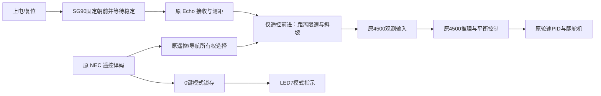

# 遥控驾驶超声波减速与停车候选（2026-11-03）

**当前验收入口是 conda mujoco 物理运动仿真，见[MuJoCo结果](MUJOCO.md)。原遥控前进档保持0.3 m/s不变。下方RTL断言记录属于历史低层验证，不作为机器人停车效果的通过依据，也不继续追加。停车态编码器保持尚仅在MuJoCo候选，不在当前RTL中，二者不可混称同一已验收实现。**

默认关闭，遥控 **0 键**切换。只保护遥控驾驶；导航源拥有控制权时，前进与转向指令逐位旁路，导航算法、地图及其原避障逻辑保持不变。该候选先完成 RTL 仿真，尚未进入联合综合/布线，也没有替换板上 PNR85。

按用户后续要求，当前版已取消 SG90 扫描：开关保护都固定朝前，并把减速起点从 850 mm 改为 600 mm。场地面积不直接决定制动距离；该选择结合当前约 0.3 m/s 遥控档位与65 ms测量周期，仍需按真实制动与安装偏置标定，暂不同时压缩250 mm停车余量。

## 接线和指示

现有接线依据为 `docs/2_interface/pinout.md`、`docs/3_guide/hardware_guide.md` 及冻结实现 `K_terrain19_follow1/g2.cst`。

| 项目 | 现有引脚 | 候选用途 |
| --- | --- | --- |
| 超声波 Trig | P11-38 / A14 | 沿用 12 µs 脉冲、65 ms 间隔 |
| 超声波 Echo | P11-37 / A13 | 原两级同步；30 ms 超时；每次测量新增一拍完成脉冲 |
| SG90 PWM | P11-36 / B13 | 始终固定 1500 µs 中位，保护开、关都不扫描；仍输出保持 PWM |
| LED7 | N17 / `led_cpu[3]` | 新的超声波保护模式灯 |
| NEC 模式键 | IRIN / A21，候选 0 键码 `0x16` | 短按切换，长按重复不反复切换 |

LED7 的候选语义：**灭=关闭；闪烁=已开启、正在转向/等待有效前方测距或测距失效；常亮=开启且前方测距有效**。常亮也包含发现近障碍、已经阻止前进的状态，不表示前方可通行。独立计数每 250 ms 切换相位（2 Hz），带复位，不依赖原来没有 RTL 初值的心跳计数器。LED7 原来是软核计数最高位，候选改为专用模式灯；LED4–6 继续显示计数低三位。LED0 心跳、LED1 中断、LED2/3 停止与超时、LED8 软核异常指示保持。

中位是否正对车头、传感器距车体最前沿的偏置及 LED 实物极性仍需在采用候选时核对。HC-SR04 Echo 如为 5 V，沿用文档要求的 3.3 V 电平转换。仿真不证明电气接线和机械角度。

## 控制方案



新增保护在原指令所有权选择之后、4500 观测输入之前处理目标速度。它不修改 PID、轮子 PWM、腿姿、4500 权重、模型使能或原 125 Hz 节拍。停车是**运动目标归零并继续运行平衡策略**；不是关闭所有电机。原遥控 5 键停机锁存仍具有原有优先级，0 键不能解除它。

原遥控方向键 2/8/4/6 的覆盖和约 180 ms 松键超时保持。松开遥控后，两个指令轴按原机制一起交还导航，保护不会残留上一遥控限速。0 键启用状态不会因方向键松开而清除，复位则回到关闭。

上电或复位后，SG90 从第一帧开始仅输出 1500 µs 中位脉冲，等待15个完整20 ms帧结束后才开放测距。开启/关闭保护均不改变舵机位置，也不重新等待300 ms；每次切换仅作废在途测量，等两次新的有效测量后再允许受保护的遥控前进。Trig仍保持12 µs、相邻触发65 ms，不因模式切换提前重触发。保护关闭时仍显示正前方距离。

### 初始参数（待实车标定）

| 参数 | 值 | 含义 |
| --- | --- | --- |
| 正常遥控前进目标 | 1229 Q12，约 0.300 m/s | 原遥控档位，不提高 |
| 减速区起点 | 600 mm | 更远时允许原档位 |
| 停车距离 | 250 mm | 更近时立即把前进目标置零 |
| 重新允许前进的距离 | 350 mm | 防止停车边界抖动 |
| 有效读数 | 20–4000 mm | 超范围、无回波和故障不当作空旷 |
| 读数过期 | 150 ms | 丢更新则禁止遥控前进 |
| 加速斜坡 | 每 1 ms 加 2 Q12 | 目标加速度约 0.488 m/s² |
| 正常减速斜坡 | 每 1 ms 减 4 Q12 | 目标减速度约 0.977 m/s² |

中间距离的目标为 `1229 × (距离−250) / 350`，向下取整，最高 1229。典型点：600 mm → 约 0.300 m/s；500 mm → 约 0.214 m/s；400 mm → 约 0.128 m/s；300 mm → 约 0.043 m/s；250 mm → 0。1 ms 斜坡把相邻测距结果之间的目标变化展开，实际策略每 8 ms 捕获/推理一次。

突然出现近障碍、无效回波或过期读数时，目标可直接归零，不为了维持斜坡而继续输出前进目标。已经停车或行驶中测距故障后，即使障碍消失，也不会在前进键仍按住时自动起步；需要松键，并收到两次 ≥350 mm 的有效测距，再重新前进。

倒车及原地转向保留，用于人工退出；前向超声波不提供侧面和后方覆盖。模式打开但导航拥有控制权时，即使超声波故障，导航原指令仍不受本模块修改。这是用户选定的所有权规则。

**距离从传感器表面算起，上述加减速度是目标变化率。** 当前没有车体碰撞闭环仿真、实车制动距离、实际停稳时间或机械转向时间的通过结论，不能把 250 mm 当成已经证明的安全停车余量。下一阶段需结合安装偏置和真实速度/制动响应标定。

HC-SR04 的触发/回波协议参考[原始数据手册](https://cdn.sparkfun.com/datasheets/Sensors/Proximity/HCSR04.pdf)；65 ms 间隔和其余测距时序沿用已使用的驱动，并非把测距频率改成 1 kHz。

## 实现边界

冻结来源：`F:/nav_integration_g2_20261023/K_terrain19_follow1`。`prepare_candidate.py` 只向新目录生成以下候选：

- `ultrasonic_drive_guard.v`：模式、测距新鲜度、距离目标、斜坡、停车/重新起步条件。
- `g2_range_servo.v`：原驱动加正前方保持、稳定等待、在途事务作废和完成脉冲。
- `ultrasonic_mode_led.v`：LED7 显示与 LED4–6 保留接线。
- `control4500_core.v`：保留原所有权表达式，接入目标过滤；导出模式和测距健康状态。
- `g2_top.v`：测距/控制/LED 连线。现有 CST、物理引脚和时钟不变。

其余 RTL、固件、全部模型资产、摄像头/LCD、导航及控制停止条件不修改。没有声明新的资源节省或 50 MHz 时序通过；这两项需要未来联合实现报告。

## 历史RTL记录与复现（非本任务物理验收）

仿真摘要、原始输出位置及失败/修正记录见 `evidence/simulation_results.json`。`evidence/approach_profile.png` 展示真实 Echo 脉冲驱动的限速/停车目标曲线，不是车体运动曲线。

| 实际完成项 | 结果 |
| --- | --- |
| 模式/斜坡/停车/失效/导航旁路 | 2034 项检查通过 |
| 始终居中及前向测距 | 138项场景/时序检查、24次测量、97帧1500µs PWM；上电就绪约300 ms，跨过原扫描周期仍不转动；模式切换不截短触发/间隔 |
| 原 NEC 译码连通 | 18 项检查、3 次有效重复码；坏帧、长按、0/2/8/4/+及原5键覆盖 |
| Echo→保护组合 | 14 项检查；1200→500→400→300→250 mm，停车、重新起步、丢 Echo 与倒车通过 |
| 原完整 4500 | 20 次完整发布、21 项检查；6 帧非零前进、停车后3帧零目标；输入 RAM 实际前进词核对，每次推理83534拍 |
| LED | 820 项检查；关闭、250 ms 相位切换、常亮、复位及其余 CPU LED 位保留通过 |
| 原控制顶层实际接线 | Icarus 11 项检查通过；直接使用候选和原模块，没有仿真替代模块 |

```powershell
# 在仓库根目录运行；每次使用新的输出目录，保留失败现场。
python integration/g2/ultrasonic_guard_20261103/prepare_candidate.py --out F:/nav_integration_g2_20261023/ultrasonic_my_candidate
python integration/g2/ultrasonic_guard_20261103/run_sim.py --candidate F:/nav_integration_g2_20261023/ultrasonic_my_candidate --out F:/nav_integration_g2_20261023/ultrasonic_my_tests
python integration/g2/ultrasonic_guard_20261103/run_core_iverilog.py --candidate F:/nav_integration_g2_20261023/ultrasonic_my_candidate --out F:/nav_integration_g2_20261023/ultrasonic_my_core_test
```

前六项使用安装的 XSim。完整原控制顶层在 XSim 展开时出现访问异常；ModelSim 的编译通过后，现有许可证拒绝 Verilog 运行，未绕过许可。顶层接线测试改用 WSL Ubuntu-20.04 的 Icarus。它直接读取候选及原依赖，不靠删减控制模块或替换传感器/推理模块完成。

测距/NEC/组合保护测试将参数化控制时钟设为 1 MHz，保持 µs/ms 协议时间；原 4500 测试使用真实 50 MHz、原权重、8 ms 周期和 100 Hz 合成 IMU，仅把标定样本数设为 4 以减少启动等待。顶层接线测试只压缩 NEC/保护计数时间，外部 IMU 未驱动，不把它当作完整车体平衡验证。所有夹具均不 force DUT 内部状态。

仿真完成后，后续接入顺序是：核对候选差异 → 联合综合/网表与存储检查 → 布线/全部时序和停止签核 → SRAM 与架空按键/居中/LED验证 → 低速实车距离和制动标定。当前任务停在设计与仿真交付，不把仿真候选直接下载到正在使用的车上。
